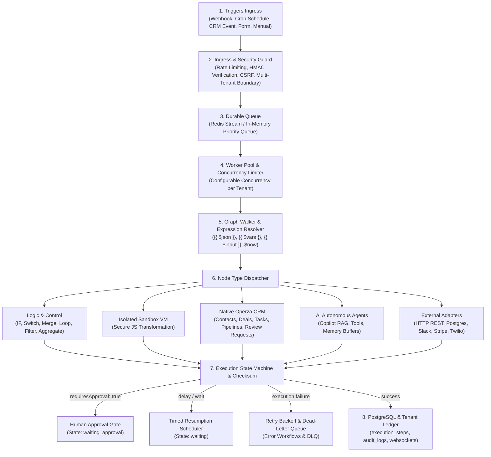

# Operza Workflow Engine Architecture & Distributed Systems Blueprint

## 1. Executive Architecture Overview

Operza's workflow automation engine is a deterministic, distributed, multi-tenant state machine designed to run complex directed acyclic and cyclic graphs (DAGs/DCGs) with n8n-compatible execution semantics and deep native Operza CRM integration.



---

## 2. Core Subsystems

### A. Directed Graph Walker (`walkGraph`)
* **Adjacency Representation:** Workflows are structured as an array of `Node` definitions with typed ports and output branch targets (`next: string | string[]`, `branches: { [key: string]: string }`, `children: string[]`).
* **Deterministic Traversal:** Queue-based graph traversal visiting nodes in dependency order.
* **Cycle & Loop Guarding:** Employs a `visited` registry to prevent uncontrolled infinite cycles while safely enabling deliberate `loop` constructs via scoped child sub-graphs.

### B. Dynamic Expression Engine (`renderTemplate` & `resolvePath`)
* Resolves n8n-style expressions:
  * `$json`: Target payload (e.g. `{{ $json.email }}`)
  * `$vars`: Execution-scoped variables (e.g. `{{ $vars.totalDiscount }}`)
  * `$input`: Inbound trigger payload (e.g. `{{ $input.webhookPayload }}`)
  * `$now` / `$today` / `$timestamp`: Real-time ISO date and Unix millisecond timestamps.
* Supports arbitrary nested properties, array indexing (`items[0].id`), and graceful fallback hydration.

### C. Isolated Code Sandbox
* Re-evaluates user JavaScript transformations inside isolated scoped function environments without exposure to backend process primitives (`process.exit`, `fs`, `child_process`).
* Passes normalized input arrays `items` and returns transformed JSON arrays compatible with n8n's data item protocol.

### D. Human-in-the-Loop Approval Gates
* When a node specifies `requiresApproval: true`, the graph walker suspends execution in the `waiting_approval` state.
* The execution is persisted with its complete checkpointed context.
* A human operator can review the pending step payload in the Operza UI and trigger `/api/workflows/runs/:id/approve` or reject to resume or terminate the workflow.

### E. Resilience, Retries & Dead-Letter Queue (DLQ)
* **Exponential Backoff:** Configurable retries with random jitter ($t = \min(\text{baseDelay} \times 2^{\text{attempt}-1}, \text{maxDelay}) \times (0.5 + 0.5 \times \text{rand})$).
* **Dead-Letter Queue:** Executions exceeding maximum retry limits are routed to the tenant DLQ with diagnostic error codes and stack traces, enabling zero-data-loss inspection and safe execution replay.
* **Error Workflows:** Allows registering dedicated error handler workflows that execute automatically when a primary pipeline encounters an unhandled exception.

---

## 3. PostgreSQL Database Schema

```sql
-- Workflows
CREATE TABLE IF NOT EXISTS workflows (
    id UUID PRIMARY KEY DEFAULT gen_random_uuid(),
    agency_id UUID NOT NULL REFERENCES agencies(id) ON DELETE CASCADE,
    location_id UUID REFERENCES locations(id) ON DELETE CASCADE,
    name VARCHAR(255) NOT NULL,
    description TEXT,
    status VARCHAR(50) NOT NULL DEFAULT 'draft', -- draft, published, archived
    version INT NOT NULL DEFAULT 1,
    trigger_kind VARCHAR(50) NOT NULL,
    trigger_config JSONB NOT NULL DEFAULT '{}'::jsonb,
    nodes JSONB NOT NULL DEFAULT '[]'::jsonb,
    connections JSONB NOT NULL DEFAULT '{}'::jsonb,
    settings JSONB NOT NULL DEFAULT '{"executionOrder": "v1", "saveExecutionProgress": true}'::jsonb,
    created_at TIMESTAMPTZ NOT NULL DEFAULT now(),
    updated_at TIMESTAMPTZ NOT NULL DEFAULT now()
);

-- Workflow Execution Runs
CREATE TABLE IF NOT EXISTS workflow_runs (
    id UUID PRIMARY KEY DEFAULT gen_random_uuid(),
    workflow_id UUID NOT NULL REFERENCES workflows(id) ON DELETE CASCADE,
    agency_id UUID NOT NULL REFERENCES agencies(id) ON DELETE CASCADE,
    location_id UUID REFERENCES locations(id) ON DELETE CASCADE,
    status VARCHAR(50) NOT NULL DEFAULT 'running', -- running, completed, waiting_approval, waiting, failed, cancelled
    trigger_type VARCHAR(50) NOT NULL,
    trigger_context JSONB NOT NULL DEFAULT '{}'::jsonb,
    variables JSONB NOT NULL DEFAULT '{}'::jsonb,
    steps JSONB NOT NULL DEFAULT '[]'::jsonb,
    current_node_id VARCHAR(100),
    approved_by VARCHAR(255),
    error_message TEXT,
    retry_count INT NOT NULL DEFAULT 0,
    max_retries INT NOT NULL DEFAULT 3,
    dead_lettered BOOLEAN NOT NULL DEFAULT false,
    started_at TIMESTAMPTZ NOT NULL DEFAULT now(),
    finished_at TIMESTAMPTZ,
    checksum VARCHAR(64) NOT NULL
);

-- Workflow Execution Steps (Detailed Per-Node Ledger)
CREATE TABLE IF NOT EXISTS workflow_execution_steps (
    id UUID PRIMARY KEY DEFAULT gen_random_uuid(),
    run_id UUID NOT NULL REFERENCES workflow_runs(id) ON DELETE CASCADE,
    node_id VARCHAR(100) NOT NULL,
    node_name VARCHAR(255),
    node_type VARCHAR(100) NOT NULL,
    status VARCHAR(50) NOT NULL, -- completed, failed, waiting
    input_payload JSONB,
    output_payload JSONB,
    duration_ms INT,
    error_code VARCHAR(100),
    error_details TEXT,
    attempt INT NOT NULL DEFAULT 1,
    executed_at TIMESTAMPTZ NOT NULL DEFAULT now()
);

-- Encrypted Credentials Vault
CREATE TABLE IF NOT EXISTS workflow_credentials (
    id UUID PRIMARY KEY DEFAULT gen_random_uuid(),
    agency_id UUID NOT NULL REFERENCES agencies(id) ON DELETE CASCADE,
    name VARCHAR(255) NOT NULL,
    type VARCHAR(100) NOT NULL, -- http_basic, http_bearer, api_key, oauth2, postgres, stripe, slack
    encrypted_data TEXT NOT NULL, -- AES-256-GCM encrypted payload
    iv VARCHAR(64) NOT NULL,
    auth_tag VARCHAR(64) NOT NULL,
    created_at TIMESTAMPTZ NOT NULL DEFAULT now(),
    updated_at TIMESTAMPTZ NOT NULL DEFAULT now()
);
```

---

## 4. Multi-Tenant Isolation Guarantee

1. Every database query, queue operation, and execution state is bounded strictly by `agency_id`.
2. Cross-tenant reading or mutating of workflow graphs, credentials, executions, or DLQ jobs is rejected with HTTP 404/403.
3. WebSockets filter real-time state broadcasts strictly to active sessions belonging to the corresponding tenant agency.
