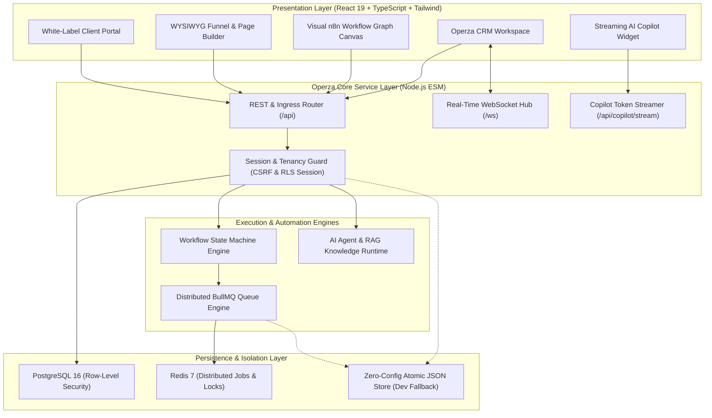

<div align="center">

# ⚡ Operza

### The Open-Source Business Operating System & Intelligent Automation Engine
**GoHighLevel Agency CRM + n8n Visual Automation + Autonomous AI Copilot**

[](https://github.com/MuhammadAsimdeveloper/operza-growth/actions)
[](scripts/test-e2e.mjs)
[](package.json)
[](apps/web)
[](apps/web)
[](docker-compose.yml)
[](LICENSE)

<p align="center">
  <a href="#-quickstart-in-30-seconds">Quickstart</a> •
  <a href="#-system-architecture">Architecture</a> •
  <a href="#-core-capabilities--modules">Core Capabilities</a> •
  <a href="#-competitive-matrix-operza-vs-ghl-vs-n8n">Comparison Matrix</a> •
  <a href="#-rest--websocket-api-directory">API Reference</a> •
  <a href="#-contributing">Contributing</a>
</p>

---

</div>

## 💡 What is Operza?

Modern growth agencies and scaling businesses are forced into an expensive, fragmented software trap:
1. **GoHighLevel (GHL)** provides CRM, pipelines, and funnels, but locks agencies into closed-source monoliths with restrictive workflow logic and high recurring fees (\$497+/month).
2. **n8n** provides developer-grade node-and-wire automation, but lacks native CRM contacts, sales pipelines, client billing, and public agency portals.

**Operza solves this fragmentation.** It unites the full-featured multi-tenant agency CRM and funnel builder of GoHighLevel with the visual node-graph orchestration of n8n, powered by an autonomous, streaming AI Copilot with human-in-the-loop safety gates.

---

## 🏛️ System Architecture



---

## ⚡ Key Capabilities & Modules

### 1. Visual Workflow Graph Canvas (n8n Parity)
- **2D Node-and-Wire Canvas:** Smooth panning, multi-level zoom (40% to 200%), and draggable trigger, condition, action, and delay nodes.
- **Dynamic Curving SVG Wires:** High-precision cubic bezier connection lines with directional arrowheads and animated pulsing energy dashes.
- **Color-Coded Branching:** `YES` affirmative branches in emerald green, `NO` negative branches in crimson red.
- **Dual-Mode Workflow Engine:** 1-click toggle between **"Visual Graph (n8n Mode)"** and **"Step List (GHL Mode)"** to suit both developers and non-technical account managers.

### 2. In-Browser Visual Funnel Page Builder (GHL Parity)
- **WYSIWYG Drag-and-Drop Editor:** Design conversion-optimized sales pages directly in the browser.
- **Component Palette:** Headlines, Body Copy, Hero Images, 2-Column Responsive Layouts, Urgency Countdown Timers, 1-Click Order Bumps, Call-to-Action Buttons, and Social Proof Testimonials.
- **Multi-Device Responsive Preview:** Instant live preview across Desktop (100%), Tablet (768px), and Mobile (375px) viewports.

### 3. Multi-Tenant Agency OS & Instant Snapshots
- **Hierarchical Tenancy:** Global Agency → Sub-Account Workspaces → Role-Based Users.
- **Row-Level Security (RLS):** Hardened at the PostgreSQL engine level (`SET LOCAL app.current_agency_id`) — cross-tenant data leakage is physically impossible.
- **1-Click Blueprints & Snapshots:** Package entire agency setups (workflows, forms, funnels, pipelines, custom tags) into reusable snapshots and deploy them into new sub-accounts in under 2 seconds.

### 4. Omnichannel CRM, Inbox & Telephony
- **Pipelines Kanban:** Drag-and-drop lead stage progression with monetary deal values and weighted forecasting.
- **Smart Lists & Contacts:** Multi-criteria tagging, advanced filtering, and instant CSV streaming export.
- **Unified Communications Timeline:** Seamlessly inspect SMS, voice calls, webchat conversations, and emails in a single chronological feed.
- **Virtual Phone Provisioning:** Provision local/toll-free numbers with IVR call routing and SMS/MMS webhook handlers (Twilio native).

### 5. Autonomous AI Copilot with Human Approval Gates
- **Low-Latency Streaming:** Real-time token streaming over Server-Sent Events (`/api/copilot/stream`).
- **Semantic Grounding (RAG):** Ingest internal SOPs, pricing sheets, and knowledge articles to train AI sales closers and support bots.
- **Human-in-the-Loop Safety:** Irreversible workflow operations (bulk broadcasts, customer refunds, contract dismissals) automatically pause in a `waiting_approval` state, surfacing an instant 1-click approval notification in the Copilot Hub.

### 6. Billing, E-Signatures & Client Portal
- **Stripe Invoicing & Payment Links:** Create branded invoices, line items, and public checkout pages with 1-click order bumps.
- **Digital Contract E-Signatures:** Legally timestamped digital contract generation, public signing links, and audit trails.
- **White-Label Client Portal:** Dedicated client-facing dashboard for tracking project progress, paying invoices, and accessing LMS course modules.

---

## 📊 Competitive Matrix: Operza vs GHL vs n8n

| Capability / Dimension | GoHighLevel (GHL) | n8n | **Operza** |
| :--- | :---: | :---: | :---: |
| **Open Source & Self-Hostable** | ❌ Closed SaaS | ⚠️ Fair-Code (n8n license) | ✅ **100% MIT Open Source** |
| **Visual Workflow Graph Canvas** | ❌ Linear tree only | ✅ Full 2D Node Canvas | ✅ **Full 2D Node Canvas + Step Toggle** |
| **In-Browser WYSIWYG Funnel Builder** | ✅ Prop-heavy builder | ❌ Not available | ✅ **Built-in Responsive Visual Builder** |
| **Multi-Tenant Agency & Sub-Accounts** | ✅ Available ($497/mo) | ❌ Single tenant | ✅ **Native PostgreSQL RLS Tenancy** |
| **Agency Blueprints & Snapshots** | ✅ Proprietary | ❌ Manual JSON export | ✅ **Native 1-Click Snapshot Engine** |
| **Durable Redis Queue (BullMQ)** | ❌ Black box | ✅ Redis backed | ✅ **Native RESP TCP + Zero-Config Fallback** |
| **Autonomous AI Copilot & Token Streaming** | ⚠️ Add-on credits | ⚠️ Community nodes | ✅ **Built-in SSE Streaming + Approval Gates** |
| **Omnichannel Unified Inbox & Telephony** | ✅ Built-in | ❌ Requires integrations | ✅ **Built-in Twilio + Webchat + Email** |
| **White-Label Client Portal & LMS** | ✅ Built-in | ❌ Not available | ✅ **Built-in LMS + Invoices + Portal** |
| **Software Cost** | 💸 \$97 – \$497+ / month | 💸 \$20 – \$50+ / month | 🆓 **\$0 Free & Fully Self-Hostable** |

---

## 🚀 Quickstart in 30 Seconds

### Prerequisites
- **Node.js**: >= 20.0.0 (Node 22 LTS recommended)
- **npm**: >= 10.0.0
- *(Optional)* Docker & Docker Compose for PostgreSQL & Redis.

### 1. Zero-Config Local Development
Operza has a **zero-friction local development mode**. If Docker or PostgreSQL is not running, it automatically uses the atomic local JSON store (`data/store.json`) and an in-memory high-precision queue.

```bash
# Clone the repository
git clone https://github.com/MuhammadAsimdeveloper/operza-growth.git
cd operza-growth

# Install monorepo dependencies
npm install

# Start both API and Web UI concurrently
npm run dev
```

The system will boot instantly:
* **Web Client Workspace:** [http://localhost:5173](http://localhost:5173)
* **REST & Ingress API:** [http://localhost:4000](http://localhost:4000)
* **Liveness Health Check:** [http://localhost:4000/health](http://localhost:4000/health)
* **Readiness Container Probe:** [http://localhost:4000/ready](http://localhost:4000/ready)

---

### 2. Full Production Stack with Docker Compose
To boot the full production stack with **PostgreSQL 16 (Row-Level Security)**, **Redis 7 (BullMQ Queue)**, **n8n Automation Engine**, and the compiled **Operza Web & API containers**:

```bash
docker compose up -d
```

| Service | Port | Description |
| ------- | ---- | ----------- |
| **Web UI** | `80` (or `5173`) | Nginx Alpine hosting compiled React 19 SPA |
| **API Server** | `4000` | Node.js ESM REST API + WebSocket Hub |
| **PostgreSQL** | `5432` | Multi-tenant PostgreSQL 16 with RLS |
| **Redis** | `6379` | Distributed Redis 7 Queue & Cache |
| **n8n Studio** | `5678` | Integrated n8n Automation Studio |

---

## 📁 Repository Layout

```
operza/
├── .github/
│   ├── workflows/
│   │   ├── ci.yml              # Multi-OS & Node 20/22 build & test CI matrix
│   │   ├── docker.yml          # Container build verification
│   │   └── codeql.yml          # Automated security & vulnerability scan
│   ├── ISSUE_TEMPLATE/         # Structured bug report & feature request templates
│   ├── PULL_REQUEST_TEMPLATE.md# Enterprise pull request verification checklist
│   └── dependabot.yml          # Automated weekly dependency updates
│
├── apps/
│   ├── api/                    # Node.js ESM REST API, WebSockets & BullMQ Queue
│   │   ├── server.mjs          # Core HTTP & WebSocket server (68 API endpoints)
│   │   ├── queue.mjs           # Native RESP Redis BullMQ queue driver
│   │   └── Dockerfile          # Multi-stage Node 22 Alpine API image
│   │
│   └── web/                    # React 19 + TypeScript + Vite CRM Application
│       ├── src/
│       │   ├── components/
│       │   │   ├── WorkflowCanvas.tsx    # n8n-style 2D visual node canvas
│       │   │   ├── VisualPageBuilder.tsx # GHL-style WYSIWYG funnel page builder
│       │   │   ├── CopilotWidget.tsx     # Floating SSE AI chat assistant
│       │   │   └── Layout.tsx            # Main CRM responsive sidebar layout
│       │   ├── pages/                    # 25+ view modules (Funnels, Pipelines, etc.)
│       │   └── App.tsx                   # Client routes & global context
│       └── Dockerfile                    # Multi-stage Nginx Alpine SPA container
│
├── packages/
│   ├── db/                     # PostgreSQL Migrations & Row-Level Security (RLS)
│   ├── workflow-engine/        # Deterministic state machine & step execution engine
│   └── shared/                 # Shared TypeScript domain contracts & DTO schemas
│
├── scripts/
│   ├── dev.mjs                 # Single-command local launcher
│   └── test-e2e.mjs            # Comprehensive 68-step end-to-end test suite
│
├── docker-compose.yml          # Complete PostgreSQL, Redis, n8n, API & Web stack
├── package.json                # Monorepo root workspaces configuration
├── CONTRIBUTING.md             # Contribution guidelines & branching strategy
├── CODE_OF_CONDUCT.md          # Contributor Covenant v2.1
├── SECURITY.md                 # Vulnerability disclosure policy & SLA
└── LICENSE                     # MIT Open Source License
```

---

## 🔌 REST & WebSocket API Directory

Operza provides an exhaustive, RESTful API and WebSocket event hub:

### Observability & Infrastructure
* `GET /health` — Health check & WebSocket status
* `GET /ready` — Production container readiness probe
* `GET /metrics` — Process memory RSS & connected client telemetry
* `GET /api/admin/queue/status` — Inspect BullMQ Redis/In-Memory queue health
* `POST /api/admin/queue/test-job` — Dispatch a background diagnostic job
* `GET /api/admin/db/status` — Database engine status & RLS confirmation

### CRM & Sales
* `GET /api/dashboard/stats` — High-level agency revenue and contact metrics
* `GET|POST /api/crm/contacts` — Contact management with tags and smart lists
* `GET|POST /api/crm/pipelines` — Kanban deal stages and monetary values
* `GET|POST /api/crm/tasks` — Task management and assignment
* `GET|POST /api/crm/calendars` — Appointment scheduling and slots
* `GET|POST /api/crm/invoices` — Billing, invoice generation, and status
* `GET|POST /api/crm/documents` — Digital contracts and e-signatures
* `GET|POST /api/crm/phoneNumbers` — Virtual phone numbers and IVR configuration

### Automation & AI
* `GET|POST /api/crm/workflows` — Automation workflow blueprints
* `POST /api/workflows/:id/run` — Trigger workflow execution
* `POST /api/workflows/runs/:id/approve` — Resume paused human approval gate
* `GET /api/copilot/stream` — Low-latency Server-Sent Events (SSE) AI token stream
* `POST /api/copilot/knowledge` — Semantic document ingestion for AI grounding

### Agency Operations
* `GET|POST /api/agency/locations` — Sub-account workspace provisioning
* `GET|POST /api/agency/snapshots` — Blueprint packaging and 1-click deployment
* `GET|PUT /api/agency/branding` — Custom white-label domain and portal styling
* `GET /api/audit-logs` — Multi-tenant compliance audit trail with CSV export

---

## 🧪 Verification & Testing

Operza features an exhaustive end-to-end integration test harness (`scripts/test-e2e.mjs`) covering all 68 core workflows, database writes, and public ingress points.

```bash
# Run the complete 68-step integration test suite:
npm test

# Run frontend TypeScript typechecking & bundle build:
npm run build
```

Expected test result:
```
=====================================================
🧪 Starting Operza End-to-End System Verification
=====================================================
...
[TEST 68] Durable Queue & Relational Database Telemetry: GET /api/admin/queue/status & POST /api/admin/queue/test-job
✅ Durable job queue lifecycle and database telemetry verified

🎉 ALL 68 SYSTEM INTEGRATION TESTS PASSED CLEANLY! 🎉
```

---

## 🤝 Contributing

We welcome contributions from the open-source community!
Please read our [Contributing Guidelines](CONTRIBUTING.md) and [Code of Conduct](CODE_OF_CONDUCT.md) before opening a pull request.

To report a bug or request a feature, please use our structured [Issue Templates](.github/ISSUE_TEMPLATE/).

---

## 🛡️ Security

For vulnerability disclosures and security policies, please consult [SECURITY.md](SECURITY.md). Please do not report security vulnerabilities via public GitHub issues.

---

## 📄 License

Operza is open-source software licensed under the [MIT License](LICENSE).
© 2026 Operza Contributors.
