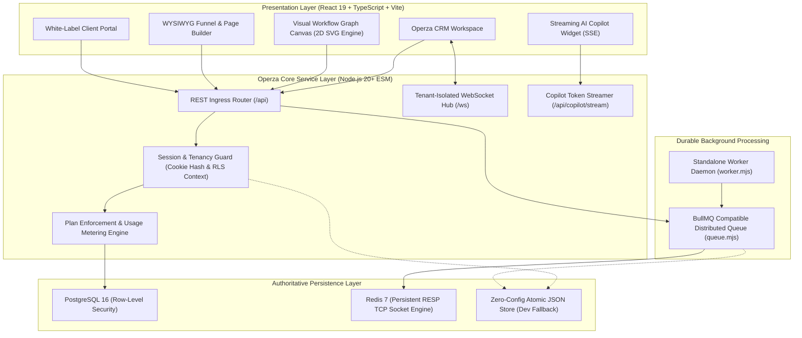

# Operza Enterprise Architecture & System Topology

## 1. System Vision & Architecture Overview

Operza is an enterprise-grade, multi-tenant Business Operating System designed for growth agencies and high-velocity scaling companies. It unifies CRM contact management, 2D visual node-graph workflow automation, drag-and-drop funnel/website builders, omnichannel conversation streams (Email, SMS, WhatsApp, Meta Messenger), white-label client portals, and carrier compliance into an authoritative relational architecture.

---

## 2. Core Subsystems

### A. Presentation Layer (`apps/web`)
- **Technology Stack:** React 19, TypeScript 5.6, Vite 5.4, Tailwind CSS, Lucide Icons.
- **Workflow Canvas:** 2D interactive node-and-wire canvas with smooth pan/zoom, cubic bezier SVG wires, directional animated energy dashes, affirmative (`YES`) / negative (`NO`) condition branching.
- **Funnel & Page Builder:** Component palette with draggable blocks (Headlines, Hero Images, 2-Column Responsive Layouts, Countdown Timers, 1-Click Order Bumps, Social Proof).
- **SEO & Search Visibility:** Strict `<SEO />` dynamic head manager with Open Graph, Twitter Cards, JSON-LD `@graph` schemas, and zero competitor keywords.

### B. Core Service API (`apps/api`)
- **Technology Stack:** Node.js 20+ native ESM (`server.mjs`), zero bloated heavy frameworks, high-throughput asynchronous request handling.
- **Tenant Context Resolution:** Resolves session cookies via SHA-256 token hashes, binds requests strictly to the actor's authenticated agency and active location, and sets transaction-scoped PostgreSQL variables (`app.current_agency_id`).
- **Server-Side Plan Metering:** Configurable tiered plan limits (`trial`, `starter`, `paid`, `growth`, `pro`) enforcing max contacts, team seats, active workflows, monthly executions, and storage capacity before database mutation.

### C. Background Processing & Distributed Queues (`apps/api/queue.mjs` & `apps/api/worker.mjs`)
- **Queue Engine:** Direct RESP TCP socket implementation communicating with Redis 7 or falling back to in-memory priority queue in testing.
- **Worker Daemon:** Standalone multi-queue processor handling `workflows`, `webhooks`, `emails`, `telephony`, and `default` queues with exponential backoff and Dead-Letter Queue (DLQ) routing.

### D. Authoritative Relational Persistence (`packages/db`)
- **Engine:** PostgreSQL 16 with Row-Level Security (`FORCE ROW LEVEL SECURITY`).
- **Privilege Separation:** 
  - `operza_migrator`: DDL migration role, holds `CREATE TABLE` and schema alteration grants.
  - `operza_app`: Unprivileged runtime role with `NOSUPERUSER NOBYPASSRLS`, restricted strictly to DML (`SELECT`, `INSERT`, `UPDATE`, `DELETE`) within authenticated tenant boundaries.
- **Advisory Locked Migrations:** Managed by `packages/db/scripts/migrate.mjs` under `pg_advisory_xact_lock(741029181)` with SHA-256 checksum tracking and tamper detection.
