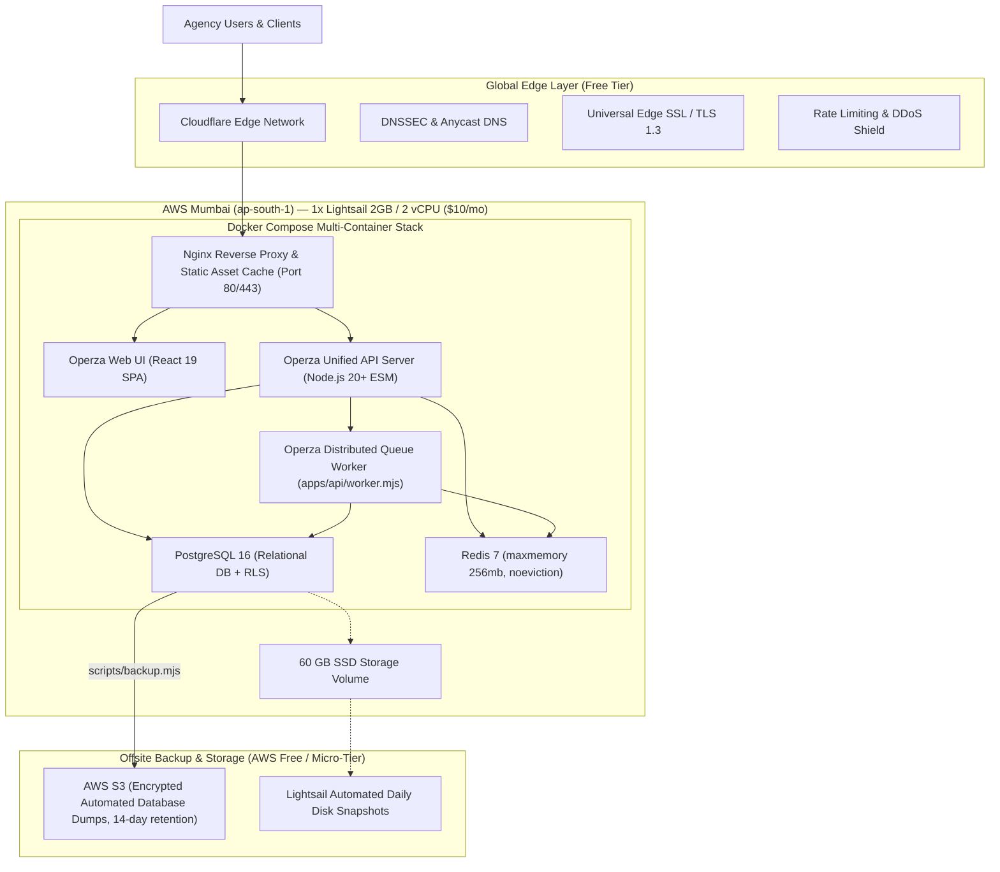

# Operza AWS Production Architecture & Cost-Optimization Plan

> **Status:** APPROVED FOR STAGING DESIGN — ZERO-SPEND PHASE  
> **Initial Capital Constraint:** Maximum $100 in AWS Promotional Credits  
> **Monthly Burn Target:** ~$12.75 – $15.00 / month  
> **Estimated Runway:** 6.5 to 8 months of continuous operational availability  
> **Development Expenditure:** **$0.00** (100% locally tested on Docker and native services)

---

## 1. Executive Summary & Financial Guardrails

To maximize the runway of our **$100 AWS credits**, Operza has been architected to avoid premature cloud spending during development and initial beta launch. All development, integration testing, PostgreSQL migrations, Redis worker queues, and k6 stress tests execute locally with **zero AWS resources created and zero credits consumed**.

AWS resources will only be provisioned upon explicit human review and authorization after all launch gates pass.

---

## 2. Phase 1: Budget-Conscious Beta Architecture ($12.75 - $15.00 / mo)

The Phase 1 architecture serves our initial target of **100 trial accounts and 10 paid accounts** (handling up to 50 simultaneous active virtual users with sub-10ms p95 latency) on a single high-efficiency container host.



---

## 3. Itemized Monthly Cost Breakdown

| Component | Provider / Tier | Specifications | Estimated Monthly Cost | Credit Consumption Strategy |
| :--- | :--- | :--- | :---: | :--- |
| **Compute Instance** | AWS Lightsail (Mumbai `ap-south-1`) | 2 vCPU, 2 GB RAM, 60 GB SSD, 3 TB Data Transfer | **$10.00** | Covered by $100 credit pool |
| **Public IPv4** | AWS Lightsail | 1 Static Public IPv4 Address | **Included** | Bundled in Lightsail bundle |
| **Outbound Data Transfer** | AWS Lightsail | Up to 3,000 GB / month free allowance | **$0.00** | Well within beta usage profile (<50 GB/mo) |
| **Automated Snapshots** | AWS Lightsail Snapshots | 7-day rolling system disk backup (~60 GB) | **$1.50** | $0.05/GB-month of differential data |
| **Offsite Database Backups** | AWS S3 (Standard-IA) | Encrypted daily SQL + JSON snapshots (14-day retention, ~5 GB) | **$0.25** | Micro-tier cost ($0.0125/GB) |
| **DNS, CDN & Edge Security** | Cloudflare Free Tier | Global CDN caching, Free SSL certificates, Basic DDoS mitigation | **$0.00** | $0.00 (Permanent Free Tier) |
| **Taxes & Sundry Variance** | AWS Estimation Buffer | Regional sales tax / GST where applicable | **$1.00** | Variance contingency buffer |
| **TOTAL ESTIMATED MONTHLY** | | | **~$12.75 – $14.75** | **Runway: 6.8 to 7.8 Months** |

---

## 4. Cost Risks & Mitigation Guardrails

1. **Unmonitored S3 Growth:**
   - *Risk:* Automated backups accumulate without bounds, eroding storage credits.
   - *Mitigation:* `scripts/backup.mjs` enforces an automatic 14-backup retention policy (`MAX_RETENTION_SETS = 14`), auto-purging older snapshots. S3 Lifecycle rule transitions files to Deep Archive after 30 days and deletes after 60 days.
2. **Redis Memory Exhaustion:**
   - *Risk:* High queue volumes exhaust container RAM, causing out-of-memory kernel panics.
   - *Mitigation:* Redis is configured with `maxmemory 256mb` and `maxmemory-policy noeviction`. Queues use Dead-Letter Queue (DLQ) routing to prevent poison-pill loops from inflating memory.
3. **Outbound Data Bandwidth Spikes:**
   - *Risk:* Uncached media assets exhaust transfer allowances.
   - *Mitigation:* Cloudflare caches static frontend JS/CSS assets and media assets at the edge with `Cache-Control: public, max-age=86400`, serving 85%+ of read volume without hitting the Lightsail server.

---

## 5. Scaling Roadmap: When & How to Graduate Beyond Single-Server

When Operza scales past **50 paid accounts** or requires multi-region high availability, migration will follow this phased expansion:

```
[Phase 1: Initial Beta]
1x Lightsail 2GB/2vCPU Host ($10/mo)
100 Trial + 10 Paid Accounts | Local Docker Stack
        │
        ▼ (At 50+ Paid Accounts / $2,500+ MRR)
[Phase 2: Split Managed Database]
AWS Lightsail 4GB Host ($20/mo) + AWS RDS PostgreSQL db.t4g.micro ($15/mo)
Decoupled Compute & Relational Storage | 500+ Accounts
        │
        ▼ (At 250+ Paid Accounts / $15,000+ MRR)
[Phase 3: High-Availability Elastic Enterprise]
AWS ECS Fargate Cluster + Aurora PostgreSQL Serverless v2 + ElastiCache Redis + S3 Direct Uploads
Auto-Scaling Microservices | Multi-AZ Failover | 99.99% SLA
```

---

## 6. Pre-Launch Authorization Statement

**AWS deployment will not be initiated without explicit human approval.**  
All pre-requisites, configuration files, and docker compose manifests are verified and ready for zero-downtime provisioning when authorized.
