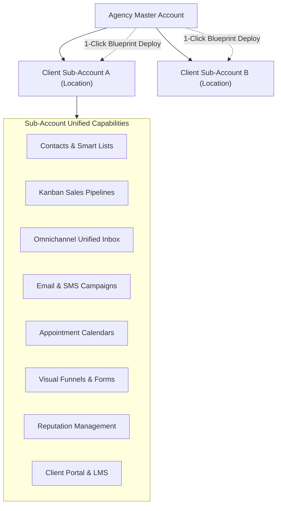

# Operza CRM & Business Operating System Specification

## 1. Executive Overview

Operza provides an integrated CRM, sales pipeline, and business automation suite engineered specifically for marketing agencies, consultants, and multi-location businesses. Designed to eliminate the fragmentation of using multiple separate software subscriptions, all CRM records are strictly isolated under tenant boundaries using PostgreSQL Row-Level Security (RLS).

---

## 2. Contact Management, Smart Lists & Duplicate Handling

### A. Contact Architecture
- **Attributes:** First/last name, normalized E.164 phone number, lowercase email, company name, lead source, assigned team member, status (`lead`, `customer`, `cold`), and custom tags.
- **Custom Fields:** Dynamic key-value pairs stored in `customValues` JSON structures, queryable across the tenant.
- **Activity Timeline:** Ingested events, messages, form submissions, and workflow executions tracked chronologically at `GET /api/crm/contacts/:id/timeline`.
- **Smart Lists & Segmentation:** Filter contacts dynamically by tag, status, company, or custom parameters.

### B. Automated Duplicate Detection & Merging
- **Detection (`GET /api/crm/contacts/duplicates`):** Scans the tenant's contacts and identifies duplicate clusters sharing identical lowercase emails or normalized E.164 phone numbers.
- **Merging (`POST /api/crm/contacts/merge`):**
  - Designates a primary contact record.
  - Fills empty fields from duplicate records.
  - Combines and deduplicates tags (`Array.from(new Set([...primary.tags, ...dup.tags]))`).
  - Re-links associated opportunities, tasks, and notes to the primary contact ID.
  - Safely deletes duplicate records without orphaned foreign keys.

---

## 3. Opportunities, Sales Pipelines & Forecasting

- **Visual Kanban Pipelines ([`apps/web/src/pages/Opportunities.tsx`](file:///C:/Users/Muhammad%20Asim/.gemini/antigravity/scratch/operza/apps/web/src/pages/Opportunities.tsx)):** Drag-and-drop opportunity cards between custom stages (`New Lead`, `Discovery Call`, `Proposal Sent`, `Won`, `Lost`).
- **Monetary Forecasting:** Calculates total pipeline value, open deal count, weighted revenue projections, and win/loss ratios.
- **Stage Automation:** Transitioning an opportunity card automatically triggers workflow automations (e.g., dispatching contracts or onboarding forms).

---

## 4. Omnichannel Unified Conversations (`/platform/conversations`)

- **Two-Way Unified Thread:** Consolidates incoming customer communications across Email, SMS, and Twilio webhooks into a single customer conversation history.
- **Outbound Dispatch:** Team members can reply directly from the unified UI; the backend automatically routes the message through the appropriate provider (SES SMTP or Twilio).
- **Internal Collaboration:** Team members can assign conversations, leave internal notes, and toggle conversation status (`open`, `pending`, `closed`).

---

## 5. Marketing Campaigns & Tracked Trigger Links

- **Campaign Management ([`apps/web/src/pages/Campaigns.tsx`](file:///C:/Users/Muhammad%20Asim/.gemini/antigravity/scratch/operza/apps/web/src/pages/Campaigns.tsx)):** Supports multi-channel email and SMS broadcasts with targeted audience segmentation.
- **Tracked Trigger Links ([`apps/web/src/pages/TriggerLinks.tsx`](file:///C:/Users/Muhammad%20Asim/.gemini/antigravity/scratch/operza/apps/web/src/pages/TriggerLinks.tsx)):**
  - Generates tracked URLs (`/api/links/click/:slug`).
  - Records real-time click counts and timestamps.
  - Automatically enqueues and executes linked workflow automations for the clicking contact.

---

## 6. Forms, Funnels & Visual Page Builder

- **Visual Page Builder ([`apps/web/src/pages/VisualPageBuilder.tsx`](file:///C:/Users/Muhammad%20Asim/.gemini/antigravity/scratch/operza/apps/web/src/pages/VisualPageBuilder.tsx)):** Drag-and-drop landing page editor with responsive grid sections, headers, CTAs, and video embeds.
- **Public Funnel Delivery ([`apps/web/src/pages/PublicFunnel.tsx`](file:///C:/Users/Muhammad%20Asim/.gemini/antigravity/scratch/operza/apps/web/src/pages/PublicFunnel.tsx)):** Multi-step conversion funnels with published slugs, form integration, and conversion tracking.
- **Form Builder ([`apps/web/src/pages/Forms.tsx`](file:///C:/Users/Muhammad%20Asim/.gemini/antigravity/scratch/operza/apps/web/src/pages/Forms.tsx)):** Embeddable forms generating leads and immediately triggering onboarding workflows.

---

## 7. Calendars & Appointment Scheduling

- **Booking Ingress ([`apps/web/src/pages/PublicBooking.tsx`](file:///C:/Users/Muhammad%20Asim/.gemini/antigravity/scratch/operza/apps/web/src/pages/PublicBooking.tsx)):** Timezone-aware booking portal displaying availability slots.
- **Automated Prep Tasks:** Public bookings automatically create CRM contacts, book calendar appointments, and generate team prep tasks.
- **Reminders & No-Show Workflows:** Automated triggers notify attendees via SMS and email prior to appointment times.

---

## 8. Reputation Management & Review Gating

- **Automated Review Dispatches ([`apps/web/src/pages/Reputation.tsx`](file:///C:/Users/Muhammad%20Asim/.gemini/antigravity/scratch/operza/apps/web/src/pages/Reputation.tsx)):** Dispatches review requests via SMS or email after successful purchases or appointments.
- **Review Gating:** Prompts customers on public review pages ([`apps/web/src/pages/PublicReview.tsx`](file:///C:/Users/Muhammad%20Asim/.gemini/antigravity/scratch/operza/apps/web/src/pages/PublicReview.tsx)). 5-star ratings route to public review profiles (Google/Facebook) and tag the contact as `promoter`, while negative feedback is routed internally for customer service resolution.

---

## 9. Client Portal, Courses & Memberships

- **Gated Student Access ([`apps/web/src/pages/ClientPortal.tsx`](file:///C:/Users/Muhammad%20Asim/.gemini/antigravity/scratch/operza/apps/web/src/pages/ClientPortal.tsx)):** Provides authenticated access for client contacts with course enrollments.
- **Course Progress Tracking ([`apps/web/src/pages/Memberships.tsx`](file:///C:/Users/Muhammad%20Asim/.gemini/antigravity/scratch/operza/apps/web/src/pages/Memberships.tsx)):** Tracks lesson completion, video watch progress, and certification issuance. Contacts with revoked access (`portalAccess: false`) are strictly forbidden via HTTP 403 checks.
