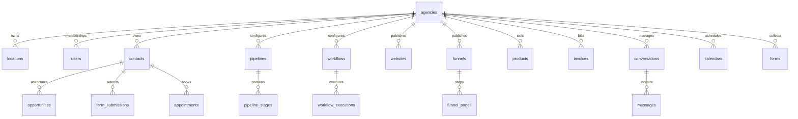

# Operza Database Architecture, Relational Schema & RLS

## 1. Overview & Principles

PostgreSQL 15+ is the authoritative relational persistence engine for Operza in production. The database enforces:
- **Strict Multi-Tenancy:** Physically separated rows using PostgreSQL Row-Level Security (`FORCE ROW LEVEL SECURITY`).
- **Role Privilege Separation:** Complete separation of runtime application queries (`operza_app`) from administrative schema migrations (`operza_migrator`).
- **Connection Pool Isolation:** Setting transaction-scoped tenant parameters (`is_local=true`) to eliminate cross-tenant connection pooling data leaks.
- **Advisory Locked Migrations:** Managed under `pg_advisory_xact_lock(741029181)` with SHA-256 tamper-evident checksum tracking in `schema_migrations`.

---

## 2. Role Model & Security Boundaries

```sql
-- 1. Unprivileged runtime application user
CREATE ROLE operza_app WITH LOGIN NOSUPERUSER NOCREATEDB NOCREATEROLE NOBYPASSRLS;

-- 2. DDL Schema Migrator user
CREATE ROLE operza_migrator WITH LOGIN NOSUPERUSER NOCREATEDB NOCREATEROLE;
```

- `operza_app` has `USAGE` on schema `public` and `SELECT, INSERT, UPDATE, DELETE` on application tables. It has **zero DDL privileges** (`CREATE TABLE`, `DROP TABLE`, `ALTER TABLE` are strictly forbidden).
- `operza_app` cannot bypass Row-Level Security under any circumstance (`NOBYPASSRLS`).

---

## 3. Relational Table Topology (Migration 008)

Migration `008_comprehensive_relational_schema.sql` establishes 30+ normalized relational tables:



### Row-Level Security Policy Pattern
Every tenant table enforces fail-closed RLS:
```sql
ALTER TABLE contacts ENABLE ROW LEVEL SECURITY;
ALTER TABLE contacts FORCE ROW LEVEL SECURITY;

CREATE POLICY tenant_isolation_policy ON contacts
  USING (agency_id = current_app_agency_id())
  WITH CHECK (agency_id = current_app_agency_id());
```

---

## 4. Migration Execution & Integrity

To run pending migrations:
```bash
npm run db:migrate
```
The migration runner:
1. Acquires transactional advisory lock `741029181`.
2. Validates existing checksums against `schema_migrations`.
3. Executes pending SQL scripts in an atomic transaction.
4. Records migration name, execution duration, and SHA-256 checksum.
