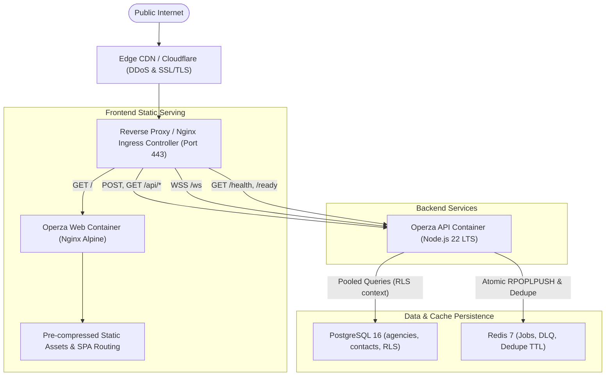

# OPERZA — ENTERPRISE PRODUCTION DEPLOYMENT GUIDE

> **Target Audience:** DevOps Engineers, Site Reliability Engineers (SRE), Cloud Architects  
> **Repository:** `https://github.com/MuhammadAsimdeveloper/operza-growth`  
> **Active Release Branch:** `repair/production-hardening`  
> **Minimum Node Version:** `>= 20.0.0` (LTS)  
> **Database:** PostgreSQL 15+ (with Row-Level Security enabled)  
> **Queue & Deduplication:** Redis 7+ (AOF enabled, LRU eviction policy)

---

## 1. Pre-Deployment Readiness Checklist

Before promoting any release to production, verify every checkpoint below:

- [ ] **Entropy Audit:** `SESSION_SECRET` is generated using at least 64 random hexadecimal characters (`openssl rand -hex 32`).
- [ ] **Cross-Origin Security:** `ALLOWED_ORIGINS` explicitly lists exact production domains (e.g. `https://operza.io,https://app.operza.io`) without wildcards.
- [ ] **Tenant Isolation (RLS):** Database user for runtime is `operza_app` (restricted role without `BYPASSRLS`). Privileged schema modifications use `operza_migrator`.
- [ ] **Queue Fail-Closed Mode:** `ALLOW_IN_MEMORY_QUEUE=false` is enforced in production so the cluster refuses to boot if Redis is unreachable.
- [ ] **Webhook Signatures Configured:** `STRIPE_WEBHOOK_SECRET`, `WHATSAPP_VERIFY_TOKEN`, `WHATSAPP_APP_SECRET`, `META_VERIFY_TOKEN`, `META_APP_SECRET` are injected from secure secrets vaults.
- [ ] **Container Isolation:** `.dockerignore` is present, excluding `.git`, `node_modules`, and `.env` from Docker build contexts.
- [ ] **Automated Tests Passing:** All 200 automated tests pass cleanly (`npm test`).
- [ ] **TypeScript Static Verification:** `npm run typecheck` exits with 0 errors.
- [ ] **Asset Bundling:** `npm run build` succeeds with optimized gzip asset distribution.

---

## 2. Infrastructure Topology



---

## 3. Production Environment Variables Reference

Store these in your secure secrets manager (AWS Secrets Manager, HashiCorp Vault, Doppler, or Kubernetes Secrets):

```bash
# ─── CORE RUNTIME ─────────────────────────────────────────────────────────────
NODE_ENV=production
PORT=4000
HOST=0.0.0.0
ALLOWED_ORIGINS=https://operza.io,https://app.operza.io
PUBLIC_BASE_URL=https://app.operza.io
SESSION_SECRET=<64-char-hex-generated-secret>

# ─── DATABASE (PostgreSQL 16 with RLS) ────────────────────────────────────────
# Runtime App Connection (RLS enforced, unprivileged):
DATABASE_URL=postgresql://operza_app:<strong-app-password>@postgres-host:5432/operza_prod?sslmode=require
# Migration Connection (DDL permissions only):
MIGRATION_DATABASE_URL=postgresql://operza_migrator:<strong-migrator-password>@postgres-host:5432/operza_prod?sslmode=require
PG_MAX_POOL=20
DATABASE_SSL=true

# ─── DISTRIBUTED REDIS QUEUE ──────────────────────────────────────────────────
REDIS_URL=redis://:<strong-redis-password>@redis-host:6379
ALLOW_IN_MEMORY_QUEUE=false

# ─── WEBHOOKS & INGRESS INTEGRITY ─────────────────────────────────────────────
STRIPE_SECRET_KEY=sk_live_...
STRIPE_WEBHOOK_SECRET=whsec_...
WHATSAPP_VERIFY_TOKEN=<high-entropy-token>
WHATSAPP_APP_SECRET=<meta-app-secret>
META_VERIFY_TOKEN=<high-entropy-token>
META_APP_SECRET=<meta-app-secret>
TWILIO_ACCOUNT_SID=AC...
TWILIO_AUTH_TOKEN=<twilio-token>

# ─── RATE LIMITING & SECURITY ─────────────────────────────────────────────────
RATE_LIMIT_MAX_REQUESTS=180
RATE_LIMIT_AUTH_MAX=15
```

---

## 4. Single-Node Production Deployment (Docker Compose)

### 1. Clone Release Branch
```bash
git clone https://github.com/MuhammadAsimdeveloper/operza-growth.git
cd operza-growth
git checkout repair/production-hardening
```

### 2. Configure Environment Secrets
```bash
cp .env.example .env.production
# Edit secrets in .env.production
chmod 600 .env.production
```

### 3. Run Database Migrations
```bash
# Run schema migrations using privileged migrator connection
node scripts/migrate.mjs
```

### 4. Boot Stack
```bash
docker compose -f docker-compose.prod.yml --env-file .env.production up -d --build
```

### 5. Verify Health Probes
```bash
# Liveness probe:
curl -f http://localhost:4000/health
# Response: {"name":"Operza Unified API","status":"healthy",...}

# Readiness probe (DB & Redis verified):
curl -f http://localhost:4000/ready
# Response: {"status":"ready","database":"connected","queueEngine":"redis_distributed",...}
```

---

## 5. Kubernetes & Cloud Native Architecture

When deploying on AWS EKS, Google Cloud GKE, or Azure AKS:

### Pod Architecture & Probes
- **Frontend Deployment:** 2+ replicas running `apps/web/Dockerfile`.
- **Backend Deployment:** 2+ replicas running `apps/api/Dockerfile`.
- **Liveness Probe:** `httpGet: { path: /health, port: 4000 }` (initialDelaySeconds: 10, periodSeconds: 10).
- **Readiness Probe:** `httpGet: { path: /ready, port: 4000 }` (initialDelaySeconds: 15, periodSeconds: 10). Fails traffic routing if PostgreSQL or Redis connection drops.
- **PreStop Hook:** Sends `SIGTERM` allowing the Node process up to 30 seconds to drain active writes in `writeQueue` and cleanly disconnect WebSockets.

### Database Migration Job
Run migrations as a Kubernetes `Job` or Helm `pre-install,pre-upgrade` hook before rolling updates:
```yaml
apiVersion: batch/v1
kind: Job
metadata:
  name: operza-db-migrate
spec:
  template:
    spec:
      containers:
        - name: migrator
          image: operza/api:latest
          command: ["node", "scripts/migrate.mjs"]
          envFrom:
            - secretRef:
                name: operza-db-secrets
      restartPolicy: OnFailure
```

---

## 6. Backup & Disaster Recovery Procedures

### 1. PostgreSQL Relational Backup (with RLS)
Perform regular backups using `pg_dump` with transaction consistency:
```bash
pg_dump \
  -h <postgres-host> \
  -U operza_admin \
  -d operza_prod \
  -F c \
  -b \
  -v \
  -f "/backups/operza_backup_$(date +%Y%m%d_%H%M%S).dump"
```

### 2. Point-in-Time Recovery (PITR)
To restore a snapshot:
```bash
pg_restore \
  -h <postgres-host> \
  -U operza_admin \
  -d operza_prod \
  --clean \
  --if-exists \
  "/backups/operza_backup_YYYYMMDD_HHMMSS.dump"
```

### 3. Redis Queue State
Redis is configured with Append-Only File (`appendonly yes`, `appendfsync everysec`). Daily backups should archive `/data/appendonly.aof` and `/data/dump.rdb`.

---

## 7. Zero-Downtime Rolling Update Strategy

1. **Schema Additions First:** Add columns, tables, and non-breaking migrations (Migration scripts must always be backward compatible).
2. **Execute Migrations:** Run `node scripts/migrate.mjs`.
3. **Deploy New Backend Pods:** Rolling update with `maxSurge: 25%` and `maxUnavailable: 0`.
4. **Deploy New Frontend Pods:** Static assets are hashed (`assets/index-*.js`) so existing client sessions do not break while cache purges.
5. **Verify Synthetic Health Check:** Run automated smoke test against `/ready`.

---

## 8. Incident Response & Emergency Rollback

### If API Readiness Fails (`HTTP 503`):
1. Inspect container logs:
   ```bash
   docker logs operza-prod-api --tail 100
   ```
2. Verify PostgreSQL connectivity and connection limit:
   ```sql
   SELECT count(*), state FROM pg_stat_activity WHERE datname = 'operza_prod' GROUP BY state;
   ```
3. If Redis experiences temporary unrecoverable partition, emergency fallback mode can be enabled temporarily:
   ```bash
   ALLOW_IN_MEMORY_QUEUE=true
   ```
4. Rollback deployment to prior git SHA:
   ```bash
   git checkout <last-known-stable-sha>
   docker compose -f docker-compose.prod.yml up -d --build
   ```
