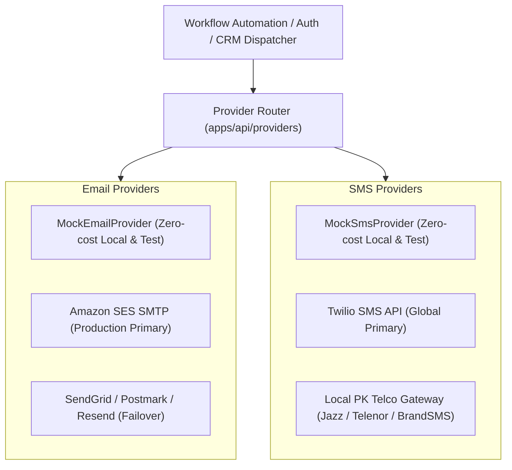

# Operza Email & SMS Communications Architecture

## 1. Multi-Provider Communications Engine

Operza uses decoupled provider adapters for all transactional emails, SMS notifications, and marketing automations. The system can swap between local development simulators, cloud transactional providers, and regional telco gateways through simple environment variable configuration.

---

## 2. Email Provider Implementations

### Abstract Interface (`apps/api/providers/email.mjs`)
Every email adapter implements:
- `sendEmail(options: { to, subject, html, text, from? }): Promise<{ messageId: string }>`

### Available Implementations
1. **`MockEmailProvider` (Default in Test/Dev):**
   - Keeps sent emails in an in-memory queue.
   - Requires zero cloud credentials and incurs **$0.00** cost.
   - Fully inspectable in automated test suites via `GET /api/test/emails`.
2. **`SmtpEmailProvider` (Production):**
   - Connects to any standard SMTP server (AWS SES, SendGrid, Postmark, Resend).
   - Configured via:
     - `SMTP_HOST` (e.g., `email-smtp.ap-south-1.amazonaws.com`)
     - `SMTP_PORT` (e.g., `587`)
     - `SMTP_USER` & `SMTP_PASS`
     - `SMTP_FROM` (e.g., `Operza Notifications <no-reply@operza.io>`)

### Email Deliverability & DNS Setup
To ensure global inbox placement without hitting spam folders:
- **SPF:** `v=spf1 include:amazonses.com ~all`
- **DKIM:** 2048-bit CNAME records pointing to AWS SES or chosen provider.
- **DMARC:** `v=DMARC1; p=reject; rua=mailto:dmarc-reports@operza.io; pct=100;`
- **Bounce & Complaint Webhooks:** SNS webhooks update contact suppression lists automatically to protect sender reputation.

---

## 3. SMS Provider Implementations

### Abstract Interface (`apps/api/providers/sms.mjs`)
Every SMS adapter implements:
- `sendSms(options: { to, message, from? }): Promise<{ messageId: string }>`

### Available Implementations
1. **`MockSmsProvider` (Default in Test/Dev):**
   - In-memory simulator tracking sent SMS messages.
   - Normalizes input to E.164 and confirms phone formatting without consuming telecom credits.
2. **`TwilioSmsProvider` (Global Production):**
   - Dispatches via Twilio REST API.
   - Configured via `TWILIO_ACCOUNT_SID`, `TWILIO_AUTH_TOKEN`, and `TWILIO_PHONE_NUMBER`.
3. **Pakistan Domestic SMS Gateways (BrandSMS / Telco HTTP):**
   - For high-volume domestic OTPs and alerts in Pakistan, local gateways (BrandSMS, PayFast SMS, Jazz Business) offer masking rates of ~PKR 0.50/SMS compared to international carrier rates.

### Compliance & Telecom Regulations
- **Pakistan (PTA):** Sender ID masking requires PTA registration. Promotional SMS must respect the national Do-Not-Call (DND) registry.
- **United States:** A2P 10DLC campaign registration is required before sending SMS to US numbers.
- **United Kingdom & EU:** GDPR opt-in consent must be captured prior to marketing SMS.
