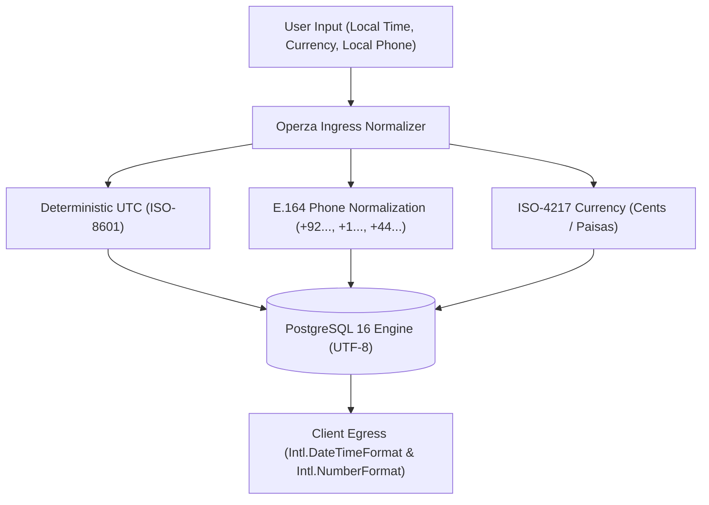

# Operza Internationalization (i18n) & Global Readiness

## 1. Architectural Principles

Operza is engineered from the ground up for cross-border operations. Whether an agency is managing clients in Lahore, London, New York, or Dubai, all data representations remain deterministic, locale-aware, and mathematically precise.



---

## 2. Temporal Architecture (UTC & Timezones)

### Database Storage
- **Rule:** Every timestamp stored in PostgreSQL or state storage is in **UTC** using ISO-8601 representation:
  ```sql
  created_at TIMESTAMPTZ NOT NULL DEFAULT CURRENT_TIMESTAMP,
  scheduled_at TIMESTAMPTZ NOT NULL
  ```
- No server-local timestamps are ever written to persistent storage.

### Presentation Layer
- The agency or user profile specifies their operational timezone (e.g., `Asia/Karachi`, `America/New_York`, `Europe/London`, `Asia/Dubai`).
- All timestamps sent over the API are in UTC (`Z`).
- The frontend formats dates on the client side using browser native `Intl.DateTimeFormat`:
  ```typescript
  export function formatTimestamp(isoString: string, timezone: string, locale: string = 'en-US'): string {
    return new Intl.DateTimeFormat(locale, {
      timeZone: timezone,
      dateStyle: 'medium',
      timeStyle: 'short'
    }).format(new Date(isoString));
  }
  ```

---

## 3. Financial & Multi-Currency Engine

Operza avoids floating-point precision errors by strictly storing currency amounts in minor currency units (cents, pence, paisas) alongside the explicit ISO 4217 currency code.

### Supported Currencies
| Code | Currency Name | Symbol | Minor Unit Divisor | Typical Markets |
|---|---|---|---|---|
| `USD` | US Dollar | `$` | 100 | United States, International |
| `EUR` | Euro | `€` | 100 | European Union |
| `GBP` | British Pound | `£` | 100 | United Kingdom |
| `CAD` | Canadian Dollar | `CA$` | 100 | Canada |
| `AUD` | Australian Dollar | `A$` | 100 | Australia |
| `AED` | UAE Dirham | `AED` | 100 | United Arab Emirates |
| `SAR` | Saudi Riyal | `SAR` | 100 | Saudi Arabia |
| `PKR` | Pakistani Rupee | `₨` | 100 | Pakistan |
| `SGD` | Singapore Dollar | `SG$` | 100 | Singapore |
| `JPY` | Japanese Yen | `¥` | 1 (zero-decimal) | Japan |

### Formatting Utility
```javascript
import { formatCurrencyAmount } from './providers/payments.mjs';

// Outputs "$1,500.00"
formatCurrencyAmount(150000, 'USD', 'en-US');

// Outputs "₨ 150,000.00"
formatCurrencyAmount(15000000, 'PKR', 'ur-PK');
```

---

## 4. International Phone Normalization (E.164)

All telephone inputs are sanitized and normalized to the **ITU-T E.164** standard before persisting to the database or initiating SMS/Call workflows.

### Normalization Logic (`apps/api/providers/sms.mjs`)
1. **Pakistan Local Format:** Numbers starting with `03XX` are automatically expanded to `+923XX`.
2. **UK Local Format:** Numbers starting with `07XX` or `0044` are normalized to `+447XX`.
3. **North America Format:** Numbers formatted as `(555) 019-0100` are normalized to `+15550190100`.
4. **General International:** Strips spaces, dashes, parentheses, and prefixes the appropriate country code.

Validation regex: `^\+[1-9]\d{1,14}$`.

---

## 5. Multilingual and UTF-8 Encoding

- **Database Encoding:** Database created with `ENCODING = 'UTF8'` and `LC_COLLATE = 'C.UTF-8'`.
- **HTTP Transport:** All JSON responses explicitly send `Content-Type: application/json; charset=utf-8`.
- **Character Set Support:** Full support for non-Latin scripts including Urdu (Nastaliq characters), Arabic, Japanese (Kanji/Hiragana), and extended Latin characters with accents.
- **Frontend Architecture:** Clean string abstraction allowing rapid integration of i18next or react-intl bundles for localized UI strings.
