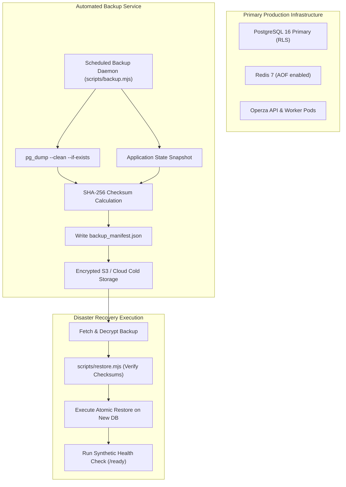

# OPERZA — BACKUP, RESTORE & DISASTER RECOVERY RUNBOOK

> **Standard Operating Procedure (SOP) for Business Continuity**  
> **Repository:** `https://github.com/MuhammadAsimdeveloper/operza-growth`  
> **Active Branch:** `release/production-launch`  
> **Recovery Point Objective (RPO):** < 1 hour (PostgreSQL point-in-time recovery & hourly dumps)  
> **Recovery Time Objective (RTO):** < 15 minutes (Automated restore scripts with checksum validation)

---

## 1. Disaster Recovery Topology



---

## 2. Automated Backup Execution

Operza includes an automated, self-pruning backup engine in [`scripts/backup.mjs`](file:///C:/Users/Muhammad%20Asim/.gemini/antigravity/scratch/operza/scripts/backup.mjs).

### Executing a Backup
```bash
# Trigger backup manually or via cron
node scripts/backup.mjs
# Or via npm shortcut:
npm run db:backup
```

### What the Backup Engine Performs:
1. **PostgreSQL Relational Dump:** Dumps tables, schemas, indexes, and RLS policies using `pg_dump` with `--clean --if-exists --no-owner --no-privileges`.
2. **State Archive:** Captures any active tenant store files.
3. **Cryptographic Checksumming:** Computes SHA-256 hash of each dumped file to detect bit-rot or tampering.
4. **Manifest Generation:** Creates `<backup_id>_manifest.json` detailing timestamps, file sizes, and verification hashes.
5. **Retention Pruning:** Automatically retains the most recent `BACKUP_RETENTION_COUNT` sets (default: 14) and purges older backups to prevent disk saturation.

---

## 3. Restoration Procedure & Verification

A backup is **unverified until restoration succeeds**. Use [`scripts/restore.mjs`](file:///C:/Users/Muhammad%20Asim/.gemini/antigravity/scratch/operza/scripts/restore.mjs) to restore a database snapshot.

### Step 1: Verify Checksums & Restore
```bash
# Point restore tool to the specific manifest:
node scripts/restore.mjs backups/operza_backup_YYYY-MM-DDTHH-MM-SS-MSZ_manifest.json
# Or via npm shortcut:
npm run db:restore -- backups/operza_backup_YYYY-MM-DDTHH-MM-SS-MSZ_manifest.json
```

### Step 2: What the Restoration Tool Validates:
1. Re-reads each artifact and computes its SHA-256 hash.
2. Compares hash against the manifest. **If a single byte was altered, it immediately halts restoration and aborts.**
3. Restores schema and rows into the target database.
4. Restores application state snapshots into `data/store.json`.

---

## 4. Manual Fallback Commands

If restoring directly using native command-line tools without Node.js:

```bash
# PostgreSQL Direct SQL Restore
psql "$DATABASE_URL" < backups/operza_backup_2026-10-31T19-00-00-000Z.sql

# PostgreSQL Custom Archive Format Restore (if using pg_dump -F c)
pg_restore -d "$DATABASE_URL" --clean --if-exists backups/operza_backup.dump
```

---

## 5. Testing Backup Restoration in CI/CD

To prove that backup restoration works on every release:
1. CI executes `npm run db:backup` after the test suite seeds database records.
2. CI provisions a secondary clean PostgreSQL database `operza_verify_db`.
3. CI runs `DATABASE_URL=postgresql://.../operza_verify_db node scripts/restore.mjs <manifest>`.
4. CI runs queries against `operza_verify_db` to verify that record counts match the primary database.
