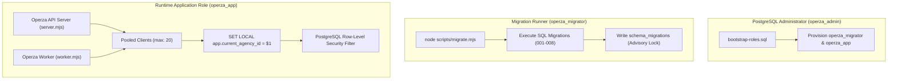

# OPERZA — DATABASE ARCHITECTURE & RELATIONAL SCHEMA MANUAL

> **Authoritative Persistence Specification**  
> **Repository:** `https://github.com/MuhammadAsimdeveloper/operza-growth`  
> **Active Branch:** `release/production-launch`  
> **Database Engine:** PostgreSQL 15+ (PostgreSQL 16 recommended)  
> **Isolation Pattern:** PostgreSQL Row-Level Security (RLS) with Fail-Closed Policies  
> **Schema Migrations:** 8 Ordered, Versioned, Transactional Migrations

---

## 1. Database Topology & Access Roles

Operza enforces the principle of least privilege through 3 distinct database roles:



### Role Privilege Matrix

| Role Name | Superuser | DDL (`CREATE TABLE`, `DROP`, `ALTER`) | DML (`SELECT`, `INSERT`, `UPDATE`, `DELETE`) | Sequence Access | RLS Bypass (`BYPASSRLS`) |
| :--- | :---: | :---: | :---: | :---: | :---: |
| `operza_admin` | Yes | Yes (all schemas) | Yes | Yes | Yes |
| `operza_migrator` | No | Yes (public schema only) | Yes | Yes | No |
| `operza_app` | **No** | **No (FORBIDDEN)** | **Yes (Tenant tables)** | **Yes (USAGE/SELECT)**| **No (FAIL-CLOSED)** |

---

## 2. Row-Level Security (RLS) & Connection Pool Hygiene

### Standardized Tenant Resolution Function
```sql
CREATE OR REPLACE FUNCTION current_app_agency_id()
RETURNS uuid
LANGUAGE sql
STABLE
AS $$
  SELECT nullif(coalesce(
    current_setting('app.current_agency_id', true),
    current_setting('app.agency_id', true)
  ), '')::uuid;
$$;
```

### Fail-Closed Policy Standard
Every tenant-owned table enforces:
```sql
ALTER TABLE <table> ENABLE ROW LEVEL SECURITY;
ALTER TABLE <table> FORCE ROW LEVEL SECURITY;

CREATE POLICY <table>_tenant_isolation ON <table>
  FOR ALL
  USING (agency_id = current_app_agency_id())
  WITH CHECK (agency_id = current_app_agency_id());
```

### Connection Pool Context Clearing
To prevent context leakage when pooled connections are recycled:
```javascript
export async function sanitizePooledClient(client) {
  await client.query(`
    RESET app.current_agency_id;
    RESET app.agency_id;
    RESET app.current_location_id;
    RESET app.location_id;
    RESET app.current_user_id;
    RESET app.user_id;
  `);
}
```

---

## 3. Comprehensive Relational Table Inventory

Operza's relational schema is divided into functional domains across migrations `001` through `008`:

### A. Identity, Agency & Multi-Tenancy Core
- `agencies`: Root multi-tenant entity storing agency identity, subdomain, branding, and billing status.
- `users`: Global authenticated users (password hash, profile, MFA status).
- `agency_memberships`: Role-based access control binding users to agencies with roles (`owner`, `admin`, `member`, `viewer`).
- `locations`: Sub-accounts partitioned under agencies for multi-location businesses.
- `auth_sessions`: Active authentication sessions storing SHA-256 token hashes, CSRF hashes, and expirations.
- `agency_invitations`: Team member onboarding invites with time-bound acceptance tokens.
- `agency_tenant_states`: Partitioned tenant state snapshots keyed by `agency_id`.

### B. CRM & Revenue Engine
- `contacts`: Central customer directory (first name, last name, email, phone, company, tags, custom fields).
- `companies`: B2B account entities linked to multiple contacts.
- `pipelines`: Visual sales pipeline definitions.
- `pipeline_stages`: Ordered deal progression stages with win probability weighting.
- `opportunities`: Revenue deals tracked through pipeline stages.
- `tasks`: Action items assigned to team members with due dates and priority tiers.

### C. Omnichannel Communications & Telephony
- `conversations`: Unified communication threads across Email, SMS, Webchat, WhatsApp, and Meta Messenger.
- `messages`: Individual inbound and outbound messages with delivery receipts and channel metadata.
- `phone_numbers`: Virtual telephony numbers provisioned with IVR routing menus.
- `calls`: Inbound and outbound voice call records with duration, recording URLs, and outcome dispositions.
- `sms_events`: Twilio SMS webhook ingress and delivery status tracking.
- `email_events`: Transactional email delivery, open, click, bounce, and complaint logs.

### D. Commerce, Invoicing & Subscriptions
- `products`: Service retainers, courses, and one-off items.
- `orders`: Checkout orders tracking customer, amounts, items, and 1-click order bumps.
- `invoices`: Formal billing invoices with due dates, line items, and payment links.
- `payments`: Processed Stripe and external transactions with provider transaction references.
- `subscriptions`: Recurring SaaS billing plans with automated dunning intervals.
- `coupons`: Promotional discount codes with redemptions and minimum subtotal rules.

### E. Funnels, Websites & Marketing
- `websites`: Hosted websites and funnels with custom domains, maintenance mode toggles, and metadata.
- `funnel_pages`: Ordered funnel steps with conversion and visit counters.
- `campaigns`: Email and SMS broadcast sequences.
- `forms`: Custom drag-and-drop lead capture forms with JSON validation schemas.
- `form_submissions`: Raw captured form submission payloads with IP addresses.
- `documents`: E-signature legal agreements with cryptographic signature hashing.
- `calendars`: Booking calendars with availability schedules and round-robin allocation.
- `appointments`: Scheduled client sessions.

### F. Infrastructure, Integrations & Async Jobs
- `workflow_definitions`: Visual automation DAG workflows.
- `workflow_executions`: Automation run instances with state machine tracking.
- `workflow_execution_steps`: Granular step timeline logs with inputs, outputs, and checksums.
- `integrations`: Third-party service credentials (Stripe, Twilio, SendGrid, AI, Slack).
- `developer_keys`: Scoped API keys with SHA-256 hashing.
- `developer_webhooks`: Outbound webhook endpoints.
- `developer_webhook_deliveries`: Webhook delivery attempts and response codes.
- `background_jobs`: Redis-backed durable queue jobs for scheduled execution and DLQ recovery.
- `notifications`: User notifications with read receipts.
- `agency_audit_events`: Tamper-evident compliance audit trail.

---

## 4. Migration Execution & Checksum Verification

Migrations are tracked in `schema_migrations`:
```sql
CREATE TABLE schema_migrations (
  name text PRIMARY KEY,
  checksum text,
  applied_at timestamptz NOT NULL DEFAULT now()
);
```
- Each migration is executed inside a transaction guarded by PostgreSQL advisory lock `741029181`.
- If an error occurs, the transaction rolls back cleanly without dirtying the schema.
- Re-running migrations is 100% idempotent.
