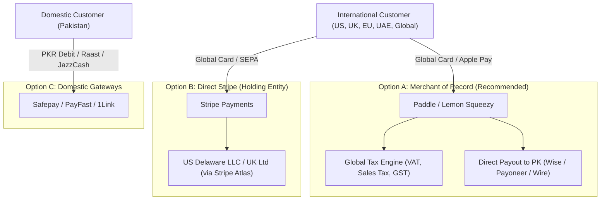

# Operza Payment Provider Integration & Monetization Strategy

## 1. Global Payment Architecture for Pakistan-Based SaaS

For an engineering team or SaaS business operating out of Pakistan, international payment processing requires a deliberate strategy to accept USD, GBP, EUR, AED, and PKR seamlessly while complying with State Bank of Pakistan (SBP) foreign exchange guidelines.



---

## 2. Integration Models

### 1. Merchant of Record (MoR) — Recommended
- **Providers:** Lemon Squeezy, Paddle.
- **Why It Fits:**
  - Operates as the legal reseller of the software.
  - Automatically calculates, files, and remits sales taxes and VAT in 100+ countries (EU VAT, UK VAT, US State Sales Tax).
  - Eliminates the need to form foreign legal entities immediately.
  - Supports payouts via Payoneer, Wise, or direct wire into Pakistani commercial bank accounts (HBL, Meezan, Bank Alfalah).

### 2. Direct Stripe (via International Holding Company)
- **Providers:** Stripe Payments & Stripe Billing.
- **Structure:** US Delaware LLC or UK Ltd incorporated via Stripe Atlas or 1st Formations.
- **Features:** Lowest transaction fees (2.9% + $0.30), direct integration with Operza webhooks, unified customer portal.

### 3. Domestic Pakistani Gateways
- **Providers:** Safepay, PayFast, 1Link.
- **Features:** Accepts Pakistani Visa/Mastercard debit cards, Raast instant transfers, and local digital wallets (JazzCash, Nayapay, Sadapay) in PKR.

---

## 3. Pluggable Payment Provider Interface

The Operza backend implements a provider abstraction in [`apps/api/providers/payments.mjs`](file:///C:/Users/Muhammad%20Asim/.gemini/antigravity/scratch/operza/apps/api/providers/payments.mjs):

```typescript
export interface BasePaymentProvider {
  name: string;
  createCustomer(params: { email: string; name: string; metadata?: Record<string, any> }): Promise<{ customerId: string }>;
  createCheckoutSession(params: { customerId?: string; lineItems: Array<{ name: string; amount: number; currency: string; quantity: number }>; successUrl: string; cancelUrl: string; metadata?: Record<string, any> }): Promise<{ sessionId: string; checkoutUrl: string }>;
  createSubscription(params: { customerId: string; planId: string; metadata?: Record<string, any> }): Promise<{ subscriptionId: string; status: string }>;
  cancelSubscription(subscriptionId: string): Promise<{ success: boolean; status: string }>;
  verifyWebhookSignature(payload: string, signatureHeader: string): boolean;
}
```

### Supported Implementations
1. **`MockPaymentProvider`:** Zero-cost in-memory payment simulator. Generates deterministic mock checkout URLs and subscription lifecycles during testing without communicating over the network or billing cards.
2. **`StripePaymentProvider`:** Full production implementation handling real Stripe API interactions and cryptographically verifying `stripe-signature` webhooks.

---

## 4. Webhook Security & Idempotency

- **Cryptographic Signature Verification:** Stripe webhooks are verified using HMAC-SHA256 against `STRIPE_WEBHOOK_SECRET`.
- **Clock Drift Tolerance:** Signatures older than 300 seconds are rejected to thwart replay attacks.
- **Deduplication:** Webhook event IDs (e.g., `evt_...`) are tracked in persistent deduplication storage; duplicates are safely acknowledged with `deduplicated: true` without double-crediting invoices or extending subscriptions.
