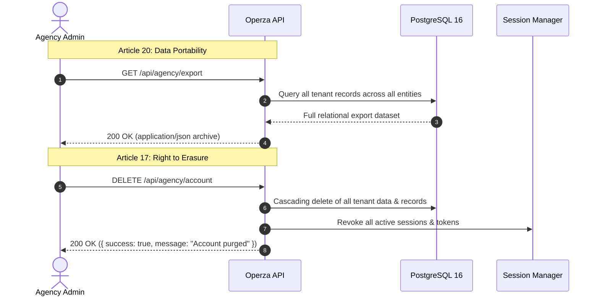

# Operza Privacy, Data Protection & Compliance Architecture

## 1. Compliance Framework Overview

Operza is designed to comply with global privacy regulations, including:
- **GDPR (EU & UK):** General Data Protection Regulation (Regulation 2016/679).
- **CCPA / CPRA (California):** California Consumer Privacy Act & Privacy Rights Act.
- **PDPL (Saudi Arabia & UAE):** Personal Data Protection Laws of the GCC region.
- **PECA (Pakistan):** Prevention of Electronic Crimes Act and data sovereignty guidelines.

---

## 2. GDPR Data Subject Rights

### Article 20: Right to Data Portability (`GET /api/agency/export`)
Agency administrators can request an authoritative machine-readable export of all data stored within their tenant boundary:
- Agency metadata and profile settings.
- CRM Contacts, Companies, and Custom Field Values.
- Opportunities, Pipelines, and Pipeline Stages.
- Appointments, Calendars, and Availability Schedules.
- Conversations, Messages, and Omnichannel logs.
- Invoices, Orders, Products, and Payment Records.
- Workflows, Workflow Executions, and Audit Trails.

### Article 17: Right to Erasure / Right to be Forgotten (`DELETE /api/agency/account`)
- Completely removes the agency and all associated records from persistent storage.
- Cascades through all sub-accounts, contacts, notes, and uploaded media.
- Immediately revokes all active session cookies and JWT bearer tokens.
- Confirmed by automated integration test: `[TEST 91] GDPR Data Portability & Right to Erasure`.

---

## 3. Consent Management & Auditability

When an agency or end-user registers (`POST /api/auth/signup`), an immutable consent record is created with:
- `termsAcceptedAt`: UTC ISO timestamp of Terms of Service acceptance.
- `privacyPolicyAcceptedAt`: UTC ISO timestamp of Privacy Policy acceptance.
- `marketingOptIn`: Explicit boolean opt-in flag for product announcements.
- `ip`: IP address of the client at the time consent was recorded.
- `userAgent`: Client user agent string for non-repudiation.

---

## 4. Cryptographic Security & Secret Handling

1. **Password Security:**
   - Hashed using Node.js native `crypto.scryptSync` with unique 16-byte random salt per user.
   - Cost parameters: $N=16384, r=8, p=1$, key length 64 bytes.
   - Constant-time timing-safe comparison (`crypto.timingSafeEqual`) prevents timing attacks.

2. **Session Integrity:**
   - 32-byte cryptographically secure session IDs generated via `crypto.randomBytes(32)`.
   - Stored in `httpOnly`, `secure`, `sameSite=strict` cookies.
   - HMAC-SHA256 signature verification on every request.

3. **In-Transit and At-Rest Encryption:**
   - All external HTTP connections enforced with TLS 1.3.
   - Database storage volumes encrypted at rest using AES-256 (AWS EBS or local LUKS).
   - Third-party integration API keys encrypted at rest.
