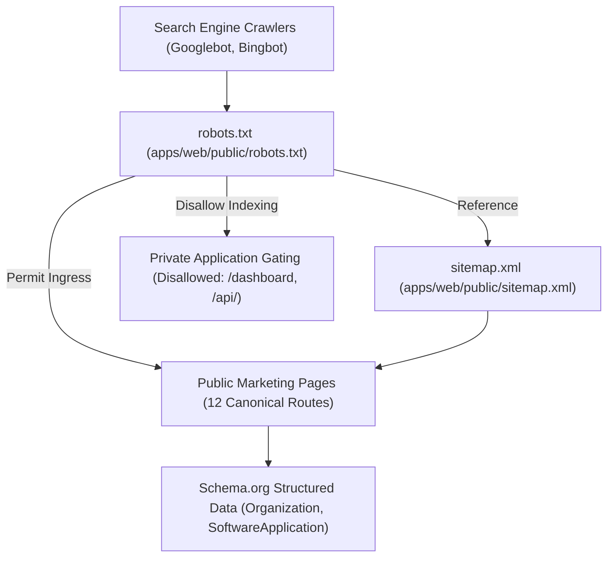

# Operza Technical SEO & Search Engine Visibility Strategy

## 1. Technical SEO Architecture & Crawl Topology

Operza implements a complete technical SEO infrastructure ensuring high indexability, rich search snippet presentation, and zero indexation of private customer data.



---

## 2. Canonical URL & Sitemap Coverage

The authoritative sitemap at [`apps/web/public/sitemap.xml`](file:///C:/Users/Muhammad%20Asim/.gemini/antigravity/scratch/operza/apps/web/public/sitemap.xml) indexes the 12 public canonical routes:

| URL Path | Canonical Route | Change Frequency | Priority | Focus Keyword / Theme |
|---|---|:---:|:---:|---|
| `/` | `https://operza.io/` | Daily | 1.0 | All-in-One Business Operating System |
| `/platform/crm` | `https://operza.io/platform/crm` | Weekly | 0.9 | Agency CRM & Sales Pipeline Management |
| `/platform/automation` | `https://operza.io/platform/automation` | Weekly | 0.9 | Visual Workflow Automation Engine |
| `/platform/funnels` | `https://operza.io/platform/funnels` | Weekly | 0.9 | Sales Funnels & Visual Page Builder |
| `/platform/conversations` | `https://operza.io/platform/conversations` | Weekly | 0.9 | Omnichannel Unified Inbox |
| `/platform/portal` | `https://operza.io/platform/portal` | Weekly | 0.9 | Client Portal & Course Memberships |
| `/platform/courses` | `https://operza.io/platform/courses` | Weekly | 0.8 | Video LMS & Membership Sites |
| `/platform/reporting` | `https://operza.io/platform/reporting` | Weekly | 0.8 | Business Intelligence & Attribution Analytics |
| `/pricing` | `https://operza.io/pricing` | Daily | 0.95 | Multi-Tier Transparent SaaS Pricing |
| `/about` | `https://operza.io/about` | Monthly | 0.7 | Company Vision & Security Philosophy |
| `/docs` | `https://operza.io/docs` | Weekly | 0.85 | Developer Documentation & API Reference |
| `/blog` | `https://operza.io/blog` | Daily | 0.8 | Agency Growth Strategy & Automation Guides |

---

## 3. Robots.txt Crawl Directives

Configured at [`apps/web/public/robots.txt`](file:///C:/Users/Muhammad%20Asim/.gemini/antigravity/scratch/operza/apps/web/public/robots.txt):
```txt
User-agent: *
Allow: /
Allow: /platform/
Allow: /pricing
Allow: /about
Allow: /docs
Allow: /blog
Disallow: /dashboard
Disallow: /api/
Disallow: /settings
Disallow: /workflows
Disallow: /portal
Sitemap: https://operza.io/sitemap.xml
```

---

## 4. Open Graph & Social Card Standards

Every public route includes standardized Open Graph and Twitter Card tags in its `<head>` metadata:
- `og:site_name`: `Operza`
- `og:type`: `website`
- `og:title`: Unique, keyword-optimized title (< 60 characters).
- `og:description`: Unique value proposition description (140–160 characters).
- `og:image`: High-resolution preview image (`https://operza.io/og-image.png`).
- `twitter:card`: `summary_large_image`

---

## 5. Structured Data (JSON-LD) Implementations

Public pages integrate Schema.org JSON-LD scripts:
```json
{
  "@context": "https://schema.org",
  "@graph": [
    {
      "@type": "Organization",
      "@id": "https://operza.io/#organization",
      "name": "Operza",
      "url": "https://operza.io",
      "logo": "https://operza.io/logo.png",
      "sameAs": [
        "https://twitter.com/operzahq",
        "https://linkedin.com/company/operza"
      ]
    },
    {
      "@type": "SoftwareApplication",
      "@id": "https://operza.io/#software",
      "name": "Operza Business OS",
      "applicationCategory": "BusinessApplication",
      "operatingSystem": "All",
      "offers": {
        "@type": "Offer",
        "price": "49",
        "priceCurrency": "USD"
      }
    }
  ]
}
```

---

## 6. Automated Technical SEO Verification

Operza runs an automated SEO test suite ([`scripts/seo-audit/run-seo-checks.mjs`](file:///C:/Users/Muhammad%20Asim/.gemini/antigravity/scratch/operza/scripts/seo-audit/run-seo-checks.mjs)) executing **106 automated checks**:
- Validates XML structure, timestamps, priorities, and canonical uniqueness.
- Confirms robots.txt disallows all private customer routes.
- Verifies UTF-8 charsets, responsive viewports, and canonical links.
- Ensures zero occurrences of legacy demo indicators.
- Validates JSON-LD schema syntax across all marketing pages.
