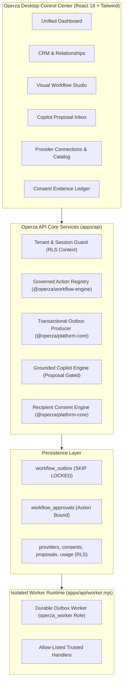

# Unified Operza + Atlas Architecture Specification

**Product Destination:** Operza — The Unified Business Operating System  
**Canonical Repository:** `operza-growth` (`feat/operza-unified-atlas-automation`)  
**Architectural Baseline:** Operza React 18 + Node.js ESM + PostgreSQL RLS Multi-Tenant Architecture  
**Selected Reference Repositories:**  
- `Atlas-` (Enterprise Business Operating System, Action Governance & Domain Services)  
- `Visual Workflow Automation Reference` (Visual Workflow Automation & Node Execution Reference — Clean-Room Implementation)  

---

## 1. Architectural Philosophy: The Single Destination Principle

Operza Growth is the single destination application. Sub-projects or external automation tools are not deployed as secondary applications, separate backends, or competing frameworks.

### What Operza Retains (The Core Pillar):
1. **Frontend Architecture:** React 18 + TypeScript + Vite Single Page Application with Tailwind CSS, Lucide icons, and unified state/store patterns.
2. **Backend Architecture:** Native Node.js 22 (ESM) REST API, WebSocket server for real-time telemetry, and correlation IDs (`x-request-id`).
3. **Dual-Mode Persistence:**
   - *Zero-Config Atomic JSON Store (`data/store.json`)* for friction-free local development and CI testing.
   - *Normalized PostgreSQL 16 with Row-Level Security (RLS)* (Migrations 001–009) enforcing tenant (`agency_id`) and workspace (`location_id`) isolation via transaction-scoped `set_config`.
4. **CRM, Growth & Commerce:** Native Contacts, Pipelines, Deals, Forms, Funnels, Landing Pages, Calendars, Client Portal, and LMS modules.
5. **Durable Governance:** Action-bound workflow approvals, pinned workflow version execution snapshots, and fail-closed security gates.

---

## 2. Atlas Domain Capabilities Integration Architecture

Atlas provides battle-tested patterns for enterprise software architecture, typed contracts, and action governance. We adapt these into Operza without importing Atlas's divergent command-center monolith.

### 2.1 Adapted Atlas Subsystems:
1. **Action Fabric:** Deterministic SHA-256 action hashes binding tenant ID, workflow ID, execution ID, actor, node, provider status, and input.
2. **Approval Model:** Strict requester/approver separation, single-node grant consumption, expiry timeouts, and tamper-resistant checksums.
3. **Safe Data Mapping (`safe-data-mapping.mjs`):** Path traversal restricted to allowlisted roots (`input`, `trigger`, `contact`, `appointment`, `workflow`) without `eval()`, prototype pollution protection, and sensitive credential field filtering.
4. **Clean-Room Node Transformations:** In-memory loop batching, array splitting, filtering, aggregation, deduplication, sorting, and field editing.

---

## 3. Clean-Room Visual Automation Architecture

### 3.1 Provenance & Clean-Room Standard
- Operza strictly enforces original, first-principles implementations across all workflow execution and visual canvas code.
- Zero external proprietary or copyleft-restricted source code is imported into Operza.
- Operza implements original, clean-room TypeScript/ESM components delivering visual ergonomics, node-based branching, and high-performance workflow execution.

### 3.2 Visual Automation Canvas
- Built on top of Operza's existing `WorkflowCanvas.tsx`.
- Infinite 2D grid pan/zoom with smooth SVG viewport matrix math.
- Node palette with categorized search: Triggers, Logic & Flow Control, Data Transformations, CRM & Business Actions, AI & Human Gates.
- Drag-and-drop node instantiation with auto-connecting typed ports.
- Side-panel node inspector with live validation, expression preview, and execution state telemetry.

### 3.3 Safe Node Runtime Execution
- Standardized node execution envelope: deterministic execution identity, bounded item arrays (max 1,000 items), maximum recursion steps (max 500 steps).
- Fail-closed SSRF protection: direct-URL outbound HTTP nodes remain blocked until connector-scoped egress gateways are configured.
- Secret references remain server-side: no credentials in workflow JSON exports, client state, or logs.

---

## 4. Security & Isolation Boundaries

1. **Multi-Tenancy:** All queries, outbox jobs, and consent records require explicit `agency_id` and `location_id`. Cross-tenant reads and mutations fail closed with 0 rows or HTTP 403 Forbidden.
2. **Worker Role Separation:** Workers connect with a restricted `operza_worker` PostgreSQL role that has table access strictly limited to outbox and action receipt operations.
3. **Human Approval Gate:** Approving a Copilot proposal or workflow action records the review decision only; mutations are held in `not_executed` until verified executors run.
4. **Consent Gating:** Every outbound communication checks recipient consent immediate to dispatch. No implicit consent from telephone numbers or email addresses alone.
