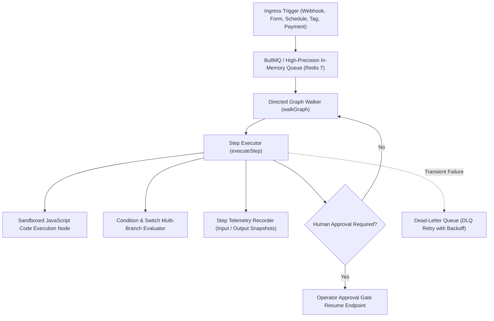

# Operza Workflow Automation Engine Specification

## 1. Architectural Philosophy & Engine Overview

The Operza Workflow Engine combines visual node-based workflow design with resilient, durable execution. Located across [`packages/workflow-engine`](file:///C:/Users/Muhammad%20Asim/.gemini/antigravity/scratch/operza/packages/workflow-engine) and [`apps/web/src/pages/Workflows.tsx`](file:///C:/Users/Muhammad%20Asim/.gemini/antigravity/scratch/operza/apps/web/src/pages/Workflows.tsx), the engine executes directed graphs of automation nodes with deterministic state transitions, idempotency guarantees, and human-in-the-loop approval gates.



---

## 2. Complete Node Category Inventory

### A. Triggers
- **`webhook`:** Inbound HTTP webhook endpoint receiving JSON or form payloads at custom slugs (`/api/webhooks/ingress/:slug`).
- **`schedule`:** Recurring interval timer (`days`, `hours`, `minutes`) executing automated workflows for enrolled contacts.
- **`form`:** Fires when a lead submits a public form or visual funnel landing page.
- **`tag`:** Triggered upon contact tag addition or removal (`hot-lead`, `promoter`, `vip`).
- **`appointment`:** Booked, rescheduled, or cancelled calendar bookings.
- **`payment`:** Successful public checkout, invoice settlement, or subscription charge.
- **`invoice`:** Overdue invoice trigger for automated payment reminders.
- **`trigger_link_clicked`:** Inbound clicks on tracked trigger links (`/api/links/click/:slug`).
- **`incoming_message`:** Inbound omnichannel customer communications (Twilio SMS, WhatsApp, Email).

### B. Actions
- **`send_email`:** Outbound transactional email dispatched through configured provider (SES SMTP, SendGrid, or zero-cost local mock).
- **`send_sms`:** Outbound SMS with ITU-T E.164 phone normalization via Twilio or local mock.
- **`add_tag` / `remove_tag`:** Atomic contact tag mutations.
- **`create_task`:** Creates prioritized, due-date-tracked follow-up tasks for team members.
- **`update_stage` / `create_opportunity`:** Manages sales deals across visual Kanban pipeline stages with monetary values.
- **`update_contact`:** Updates custom fields, company associations, and contact attributes.
- **`http_request`:** Makes outbound HTTP requests with custom headers, JSON body, and status code verification.
- **`slack_notify`:** Dispatches formatted webhook notifications to Slack channels.
- **`send_review_request`:** Dispatches automated review requests with review portal routing.

### C. Logic & Transformation Nodes
- **`code` / `javascript`:** Sandboxed JavaScript evaluation allowing programmatic payload manipulation. Exposes `$json`, `$input`, `$vars`, and `items` to the execution context.
- **`switch`:** Multi-branch conditional routing evaluating an array of rules and routing down branch keys (`branch: "0"`, `"1"`, `"enterprise"`), with fallback routing.
- **`condition` / `if_else`:** Binary conditional branching evaluating equality, containment, numerical boundaries, regex, and presence.
- **`merge`:** Combines upstream execution outputs, context variables, and parallel branches.
- **`split_test`:** Statistical $A/B$ weighted traffic splitting.
- **`loop`:** Iterates over arrays in contextual payloads.
- **`filter`:** Dynamic array filtering and property projection.
- **`math`:** Arithmetic transformations (`add`, `subtract`, `multiply`, `divide`, `round`).
- **`set_variable`:** Scoped variable assignment persisted across step transitions.
- **`wait` / `delay`:** Scheduled resumption with configurable durations in minutes, hours, or days.
- **`approval_gate`:** Suspends workflow execution in `waiting_approval` status, requiring human operator authorization.

---

## 3. Data Expression Engine & Syntax

The template engine in [`packages/workflow-engine/src/engine.mjs`](file:///C:/Users/Muhammad%20Asim/.gemini/antigravity/scratch/operza/packages/workflow-engine/src/engine.mjs) supports expressive data access:

| Expression Syntax | Resolved Value | Example |
|---|---|---|
| `{{ $json.fieldName }}` | Value from current node payload / contact | `{{ $json.email }}` $\rightarrow$ `marcus@nexus.test` |
| `{{ $vars.variableName }}` | Value from workflow-scoped variable store | `{{ $vars.discountRate }}` $\rightarrow$ `25` |
| `{{ $now }}` | Dynamic UTC ISO-8601 timestamp | `{{ $now }}` $\rightarrow$ `2026-11-01T02:00:00.000Z` |
| `{{ $today }}` | Dynamic UTC date string | `{{ $today }}` $\rightarrow$ `2026-11-01` |
| `{{ items[0].id }}` | Indexed access to contextual arrays | `{{ items[0].name }}` $\rightarrow$ `Starter Pack` |
| `{{ contact.firstName }}` | Standard CRM dot notation | `{{ contact.firstName }}` $\rightarrow$ `Marcus` |

---

## 4. Execution Telemetry & Interactive Step Inspector

When inspecting past workflow runs, each execution step captures an immutable telemetry record:
```json
{
  "nodeId": "n_code_transform",
  "nodeName": "Format Customer Payload",
  "nodeType": "code",
  "status": "completed",
  "durationMs": 4,
  "input": {
    "config": { "resultVariable": "formattedCustomer" },
    "contactId": "c_9082",
    "contactEmail": "marcus@nexus.test"
  },
  "output": {
    "codeOutput": { "displayName": "Marcus Vance", "vip": true }
  },
  "executedAt": "2026-11-01T02:00:00.120Z"
}
```
Operators can click any step in the frontend modal to toggle side-by-side **INPUT DATA** and **OUTPUT DATA** JSON inspectors.

---

## 5. Resilient Queue Processing & Dead-Letter Recovery (DLQ)

- **Worker Concurrency & Locking:** Redis BullMQ queue ensures tasks are executed with at-least-once semantics without concurrent double-execution.
- **Exponential Backoff:** Failed network integrations retry with configurable exponential backoff and jitter ($1\text{s}, 2\text{s}, 4\text{s}, \dots$).
- **Dead-Letter Queue:** Tasks exceeding maximum retries route to the DLQ (`operza:dlq:queue`) preserving failure reason and original payload for operator remediation.
