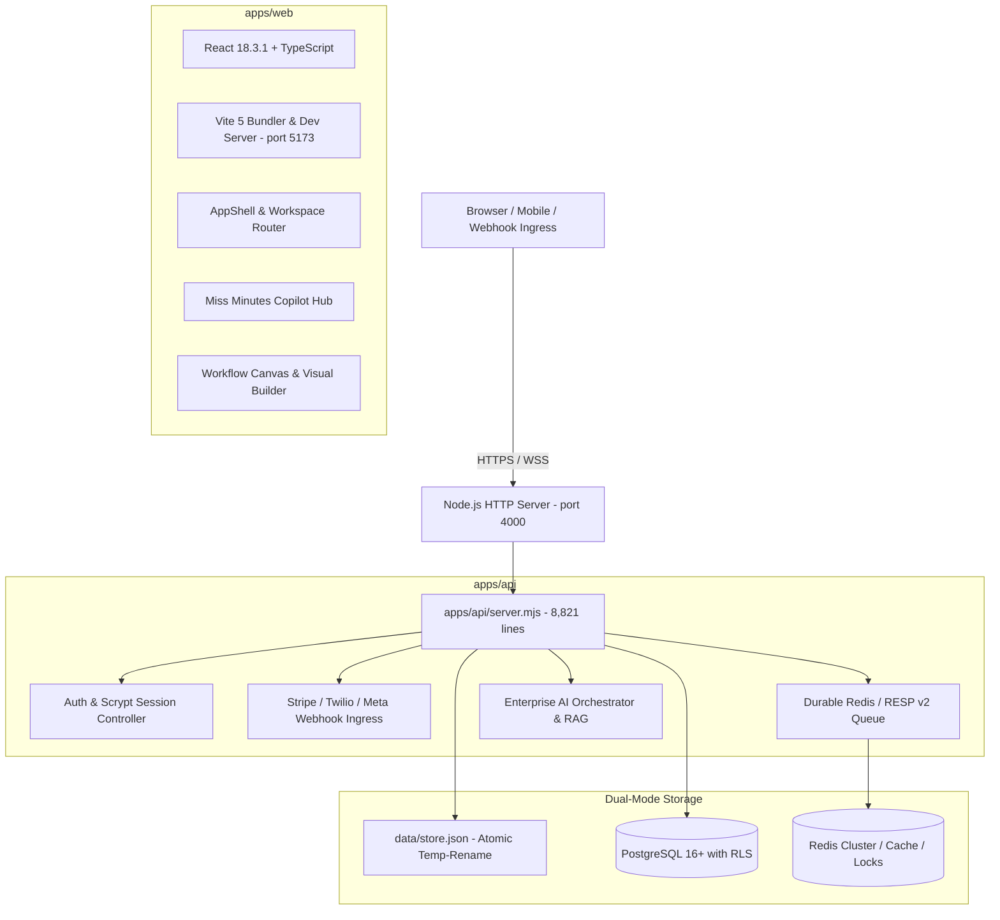

# OPERZA — ARCHITECTURE BASELINE & SYSTEM DESIGN

**Version:** 2.0.0-Baseline  
**Date:** November 5, 2026  

---

## 1. System Topology

---

## 2. Package & Dependency Inventory

| Package / Workspace | Declared Version | Actual Runtime Version | Purpose |
| :--- | :--- | :--- | :--- |
| `operza` (root) | 1.0.0 | Node >= 20.0.0, npm >= 10.0.0 | Monorepo root, unified scripts |
| `@operza/web` | 0.1.0 | React 18.3.1, Vite 5.4.9, TS 5.6.3 | Frontend Single Page Application |
| `@operza/api` | 2.0.0 | Node ESM, `pg` 8.23.1, `ws` 8.22.0 | Central Backend REST & WebSocket Server |
| `@operza/db` | 1.0.0 | `pg` 8.23.1, PostgreSQL SQL migrations | Database migration runner & pool management |
| `@operza/shared` | 1.0.0 | Pure TypeScript / ESM contracts | Cross-workspace schemas & types |
| `@operza/workflow-engine` | 1.0.0 | Pure Node ESM | DAG workflow traversal & execution |

---

## 3. Database Schema Baseline

The database package (`packages/db`) contains 8 SQL migrations:
1. `001_agency_tenant_core.sql`: Core `agencies`, `locations`, `users`, `memberships`.
2. `002_public_form_registry.sql`: Forms, custom fields, form submissions.
3. `003_workflow_executions.sql`: Workflows, executions, step logs.
4. `004_workflow_templates.sql`: Preset workflow templates.
5. `005_agency_snapshots.sql`: Agency cloning & snapshot diffs.
6. `006_ecosystem_and_telephony.sql`: Telephony numbers, phone calls, SMS messages, carrier trust.
7. `007_standardize_rls_and_tenant_state.sql`: `agency_tenant_states` JSONB snapshot store with RLS.
8. `008_comprehensive_relational_schema.sql`: Normalized relational tables for `companies`, `pipelines`, `pipeline_stages`, `conversations`, `messages`, `calendars`, `appointments`, `products`, `orders`, `invoices`, `subscriptions`, `reviews`, `courses`, `media`.

---

## 4. Key Security Boundaries
- **CSRF Token:** Required on mutating requests (`POST`, `PUT`, `DELETE`).
- **SSRF Defense:** `isSafeOutboundUrl` validates protocols (HTTP/HTTPS only) and blocks RFC 1918 private subnets, localhost, and AWS metadata IP (`169.254.169.254`).
- **Tenant Isolation:** Enforced via `agencyId` scoping in all session-based requests and PostgreSQL session config variables (`app.current_agency_id`, `app.current_location_id`).
