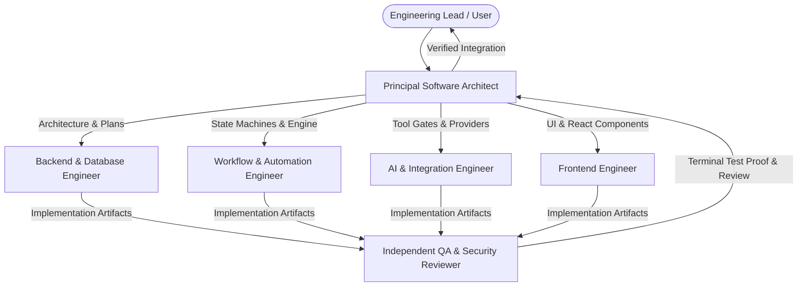

# Operza Agent Team Operating Model & Protocols

This document defines the specialized agent team profiles, their authority boundaries, collaboration workflows, and review gates for the Operza development lifecycle.

---

## 1. Operating Model: Disciplined Engineering Swarm

Rather than treating AI as a monolithic code generator, development work is distributed across specialized agent personas. Each agent possesses bounded authority, a defined scope of responsibility, and strict preconditions before handing off work.

---

## 2. Specialized Agent Roles & Ownership

### 1. Principal Software Architect (`principal-architect`)
- **Profile:** `.agents/agents/principal-architect.md`
- **Ownership:**
  - Platform architecture, monorepo boundaries, package topology, and ADRs.
  - Convergence strategy: ensuring Operza is the sole application and Atlas is strictly a donor.
  - Rejecting duplicate subsystems (no second tenant model, no competing workflow engines).
- **Required Skills:** `brainstorming`, `writing-plans`, `domain-modeling`, `codebase-design`, `improve-codebase-architecture`, `documentation-and-adrs`, `writing-for-agents`.
- **Authority Gate:** Approves all new package seams, database schema paradigms, and cross-package contracts.

### 2. Backend & Database Engineer (`backend-database-engineer`)
- **Profile:** `.agents/agents/backend-database-engineer.md`
- **Ownership:**
  - Fastify/Express HTTP APIs in `apps/api`.
  - PostgreSQL schema, table structures, indexing, and migrations in `packages/db`.
  - Multi-tenant Row-Level Security (RLS) enforcement and tenant isolation filters.
  - Transaction boundaries, concurrency control, and database performance.
- **Required Skills:** `api-and-interface-design`, `test-driven-development`, `systematic-debugging`, `deprecation-and-migration`, `security-and-hardening`.
- **Authority Gate:** Rejects queries or mutations lacking validated tenant context (`agency_id` / `location_id`).

### 3. Workflow & Automation Engineer (`workflow-automation-engineer`)
- **Profile:** `.agents/agents/workflow-automation-engineer.md`
- **Ownership:**
  - Visual builder graph compiler and validation runtime in `packages/workflow-engine`.
  - Typed node registry (triggers, actions, conditions, delays, routers).
  - Durable execution state machine, execution leases, step idempotency, and retry limits.
  - Human-in-the-loop approval queues and async background queues (Redis / BullMQ).
- **Required Skills:** `api-and-interface-design`, `test-driven-development`, `systematic-debugging`, `observability-and-instrumentation`.
- **Authority Gate:** Ensures execution state cannot be corrupted by premature status mutations or missing idempotency keys.

### 4. AI & Integration Engineer (`ai-integration-engineer`)
- **Profile:** `.agents/agents/ai-integration-engineer.md`
- **Ownership:**
  - Copilot runtime, prompt orchestrator, context retrieval, and LLM gateways.
  - Agent tool capability registry and permission evaluation.
  - Proposal-only mode for dangerous/external actions pending human approval.
  - External SaaS provider integrations (Stripe, Twilio, SendGrid, Meta, Google).
  - Provider lifecycle state management and SSRF security defenses.
- **Required Skills:** `api-and-interface-design`, `security-and-hardening`, `test-driven-development`, `observability-and-instrumentation`.
- **Authority Gate:** Blocks raw credentials in logs/prompts; blocks outbound requests to private/loopback IP ranges.

### 5. Frontend Engineer (`frontend-engineer`)
- **Profile:** `.agents/agents/frontend-engineer.md`
- **Ownership:**
  - React 19 / Vite client application in `apps/web`.
  - Preserving established Operza screen layouts, responsive design, and visual polish.
  - Refactoring brittle UI logic using compound components and clean state lifting.
  - Connecting UI components to backend APIs with typed contracts.
  - Eliminating network waterfalls and minimizing bundle footprints.
- **Required Skills:** `vercel-react-best-practices`, `vercel-composition-patterns`, `browser-testing-with-devtools`, `test-driven-development`.
- **Authority Gate:** Prevents breaking existing Operza UI workflows during backend transitions.

### 6. Independent QA & Security Reviewer (`qa-security-reviewer`)
- **Profile:** `.agents/agents/qa-security-reviewer.md`
- **Ownership:**
  - Objective verification gatekeeper across all pull requests and migrations.
  - Sandboxed security audits (OWASP Top 10, SSRF, SQLi, RLS leakage).
  - Independent terminal execution of test suites; verifying test results directly.
  - Verifying TDD discipline (ensuring regression tests were written and failed first).
- **Required Skills:** `security-audit`, `security-and-hardening`, `requesting-code-review`, `receiving-code-review`, `verification-before-completion`, `systematic-debugging`.
- **Authority Gate:** Mandatory sign-off required before any branch is integrated. An implementer cannot review its own work.

---

## 3. Coordination Protocols & Quality Handshakes

### A. Task Delegation & Handoff Contract
1. Every task must declare:
   - Owning agent role.
   - Files and modules within scope.
   - Preconditions and blocking dependencies.
   - Exact acceptance criteria and test expectations.
2. Parallel agent tasks must run in isolated Git worktrees (`git worktree add`) to prevent concurrent modification collisions.

### B. Two-Sided Review Discipline
- **Author:** Prepares diff, runs local tests, generates completion report using `verification-before-completion`.
- **Reviewer (`qa-security-reviewer`):** Independently checks out branch, executes test commands in the terminal, reviews diff against `01-architecture-principles.md` and `04-security-and-privacy.md`, and outputs an evidence-backed PASS or FAIL verdict.

### C. Conflict Resolution
- If an architectural conflict arises (e.g., whether to adopt an Atlas pattern vs. preserve an Operza pattern), the **Principal Architect** evaluates against the Convergence Laws in `00-product-direction.md` and issues a binding ADR.
