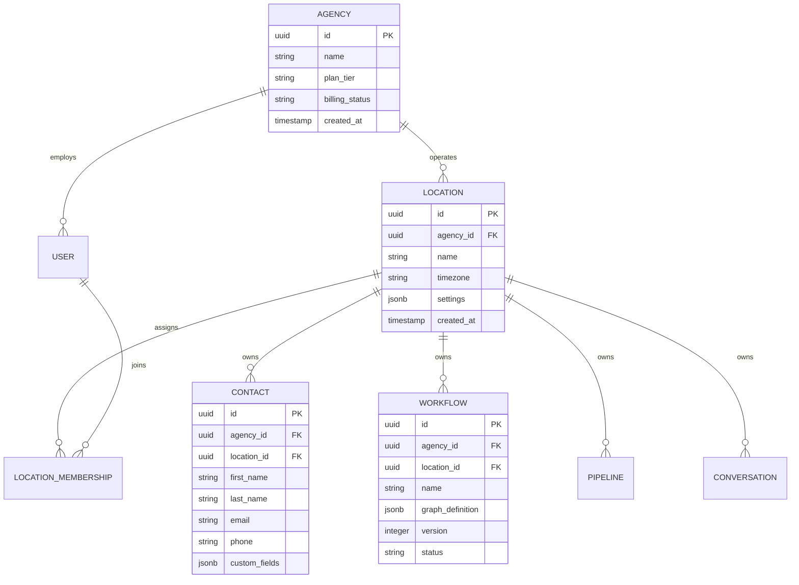

# Operza Target Architecture & Convergence Blueprint

This document defines the permanent target architecture for **Operza Growth**, detailing subsystem boundaries, data models, and the convergence strategy for migrating selected capabilities from Atlas.

---

## 1. Executive Architecture Summary

Operza is an open-source, multi-tenant business operating system, agency CRM, and visual automation engine. 

### Permanent Convergence Decisions
1. **Operza (`operza-growth`) is the single canonical product and destination codebase.**
2. **Atlas (`Atlas-`) is an architectural reference and donor codebase.** Atlas will never be launched as an independent product.
3. **Operza's React frontend and existing product modules are preserved.**
4. **Better Atlas implementations replace weaker Operza counterparts** (e.g., typed action registries, durable state machines, in-memory PGlite test harnesses).
5. **Zero duplicate systems survive convergence.** One database, one identity model, one workflow runtime, one AI gateway, one deployment topology.

---

## 2. Monorepo Subsystem Topology

```text
operza-growth/
│
├── apps/
│   ├── web/                     # React 19 / Vite UI application
│   │   ├── src/pages/           # CRM, Automation Builder, Funnels, Copilot, Inbox
│   │   └── src/components/      # Reusable design system & UI components
│   │
│   ├── api/                     # Fastify/Node.js HTTP API server
│   │   ├── src/routes/          # Tenant-scoped REST API route controllers
│   │   └── src/middleware/      # Auth, tenant resolution, rate limiting, RLS setup
│   │
│   └── worker/                  # Background worker daemon
│       ├── src/runners/         # Workflow step executors & background job processors
│       └── src/schedulers/      # Cron, delay timers, and lease renewal pollers
│
├── packages/
│   ├── shared/                  # Common TypeScript interfaces, Zod schemas, utilities
│   ├── db/                      # PostgreSQL client, migration history, RLS policies
│   ├── customer-domain/         # Canonical CRM (Contacts, Companies, Pipelines, Deals)
│   ├── workflow-engine/         # Graph validation, compiler, and node registry
│   ├── action-governance/       # Typed action registry, approval gates, policy checks
│   ├── integrations/            # Verified provider adapters (Stripe, Twilio, GHL, etc.)
│   ├── ai-runtime/              # Copilot engine, prompt grounding, tool permission gateway
│   ├── customer-operations/     # Unified multichannel inbox (Email, SMS, Voice, Chat)
│   └── observability/           # Structured telemetry, OpenTelemetry, audit ledger
│
└── infrastructure/              # Docker, deployment manifests, Caddy/ingress configs
```

---

## 3. Subsystem Boundaries & Responsibilities

### A. Presentation Layer (`apps/web`)
- **Technology:** React 19, Vite, Tailwind CSS, Lucide icons.
- **Scope:** Full-featured agency and business web portal.
- **Boundaries:** Consumes backend solely via typed REST API endpoints and Server-Sent Events (SSE) / WebSockets for live execution updates. Contains zero direct database access or private provider secrets.

### B. API Layer (`apps/api`)
- **Technology:** Fastify / Node.js (ESM).
- **Scope:** Request routing, session authentication, tenant resolution, input validation, and authorization.
- **Boundaries:** Resolves active `agency_id` and `location_id` on every authenticated request, configures PostgreSQL transaction context for RLS, and delegates domain mutations to domain packages.

### C. Domain Layer (`packages/customer-domain`)
- **Technology:** TypeScript domain logic, Zod validation.
- **Scope:** Manages business entities: contacts, leads, companies, pipeline opportunities, appointments, custom fields, and tags.
- **Boundaries:** Pure domain logic; persists state exclusively via `packages/db`.

### D. Automation & Action Governance (`packages/workflow-engine` & `packages/action-governance`)
- **Technology:** Directed Acyclic Graph (DAG) state machine, typed action schemas.
- **Scope:**
  - Graph compilation, validation, and node execution planning.
  - Durable execution state machine (pending, running, waiting_approval, paused, completed, failed).
  - Human approval gates: pausing execution pending human review with tamper-proof action tokens.
  - Step idempotency, retry backoffs, and execution lease recovery.
- **Boundaries:** Independent of specific delivery protocols; dispatches concrete work via provider adapters.

### E. Worker Layer (`apps/worker`)
- **Technology:** Node.js background process, Redis/BullMQ or PostgreSQL-backed task queues.
- **Scope:** Asynchronous step execution, scheduled delays, webhook processing, recurring cron jobs.
- **Boundaries:** Runs background jobs with tenant context; updates execution history in `packages/db`.

### F. AI Runtime Layer (`packages/ai-runtime`)
- **Technology:** Multi-model gateway (Gemini, Claude, OpenAI), vector grounding, prompt compiler.
- **Scope:** Copilot conversational interface, smart CRM assistants, autonomous agent workflows.
- **Boundaries:** Bounded by user permissions and location entitlements. Tools operate in **proposal-only mode** for sensitive mutations until explicit human approval is received.

### G. Infrastructure & Persistence Layer (`packages/db`)
- **Technology:** PostgreSQL with Row-Level Security (RLS), connection pooling, PGlite for local testing.
- **Scope:** Schema migrations, RLS security policies, relational integrity, audit ledgers.
- **Boundaries:** The single persistent store for all Operza data.

---

## 4. Canonical Tenant & Identity Model

Operza maintains a strict two-tier hierarchical tenancy model:



### Tenancy Rules
1. **Canonical Model:** All data belongs to an `agency_id` and a `location_id`.
2. **Atlas Org Abolition:** Atlas had an independent `organization_id` concept. All migrated capabilities must be refactored to bind strictly to Operza's `agency_id` / `location_id`.
3. **RLS Isolation:** Every tenant query sets local session parameters (`operza.current_agency_id`, `operza.current_location_id`) to enforce strict PostgreSQL RLS.

---

## 5. Phased Convergence Roadmap

- **Phase 0: Environment & Engineering Foundation (CURRENT TASK)**
  - Establish Antigravity operating system, rules, skills, agent profiles, and documentation.
- **Phase 1: Architecture Alignment & Core Domain Consolidation**
  - Align CRM entity schemas, verify RLS policies, integrate Atlas PGlite test patterns into Operza.
- **Phase 2: Action Governance & Typed Node Registry Migration**
  - Port Atlas typed action registry and approval token verification into `packages/action-governance`.
- **Phase 3: Durable Automation Engine & Worker Unification**
  - Consolidate visual builder compiler and worker queue into one robust execution engine.
- **Phase 4: AI Copilot & Provider Integrations Convergence**
  - Unify external SaaS adapters (Stripe, Twilio) with lifecycle states and SSRF guardrails.
- **Phase 5: Production Hardening, Security Audits & Release Readiness**
  - Comprehensive Cloudflare security audit, performance optimization, and final deployment preflight.
