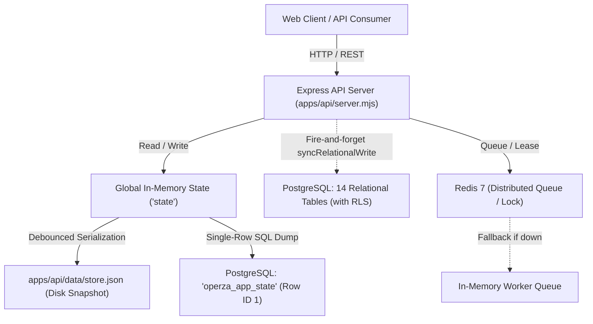
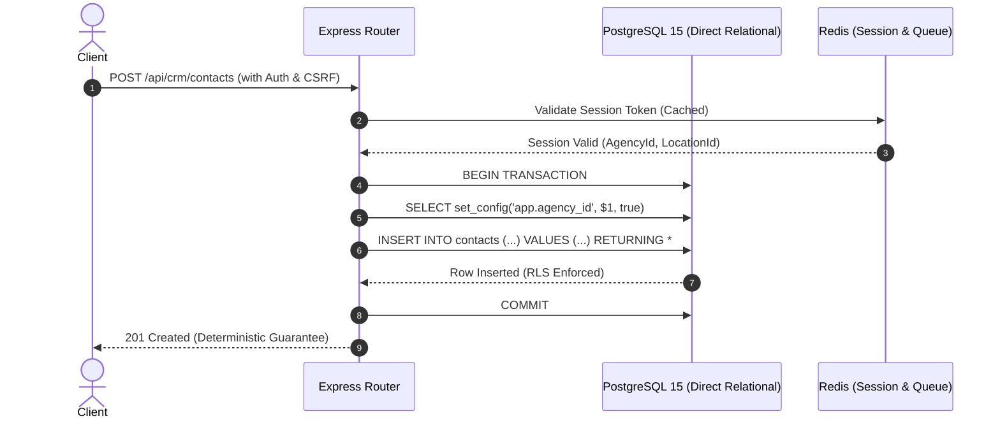

# Operza — Deep Release-Readiness, Security & Production Audit
## Backend Architecture & Reliability Assessment (ARCHITECTURE_RELIABILITY.md)

**Audit Target:** Operza Backend Engine, Storage Tiers & Distributed Systems  
**Date:** November 9, 2026  
**Auditor:** Principal Software Architect & Database Reliability Engineer  
**Classification:** HIGH CONFIDENCE / EVIDENCE-BASED AUDIT  

---

## 1. Architectural Topology Overview

Operza's backend is currently built as a hybrid stateful architecture:


While this design enabled rapid prototyping and high test execution velocity during early development, it introduces severe architectural bottlenecks and failure modes when evaluated against multi-tenant SaaS production requirements.

---

## 2. Core Architectural Bottlenecks & Flaws

### 2.1 ARCH-CRIT-001: The Monolithic In-Memory State Machine

#### The Implementation
In `apps/api/server.mjs`, the entire platform data store is kept in a global JavaScript object:
```javascript
// File: apps/api/server.mjs, Lines 782-844
let state = {
  agencies: [],
  locations: [],
  users: [],
  sessions: {},
  records: {
    contacts: [],
    opportunities: [],
    workflows: [],
    funnels: [],
    appointments: [],
    invoices: [],
    auditEvents: []
  }
};

async function saveState() {
  try {
    const serialized = JSON.stringify(state, null, 2);
    // 1. Write to local file
    await fs.promises.writeFile(STORE_PATH, serialized, 'utf8');
    // 2. Dump entire JSON blob into single row in PostgreSQL
    if (pool) {
      await pool.query(
        `INSERT INTO operza_app_state (id, state, updated_at) 
         VALUES ('default', $1, NOW()) 
         ON CONFLICT (id) DO UPDATE SET state = $1, updated_at = NOW()`,
        [serialized]
      );
    }
  } catch (err) {
    console.error('Failed to save state:', err);
  }
}
```

#### Failure Modes in Production
1. **Horizontal Scaling Impossibility:**
   If two or more container instances (`api-1` and `api-2`) are deployed behind an Application Load Balancer:
   - When User A modifies a contact on `api-1`, `api-1` serializes its memory state and writes it to `operza_app_state`.
   - Simultaneously, User B creates an invoice on `api-2`. `api-2` has not seen User A's update. `api-2` serializes its stale in-memory state and overwrites `operza_app_state`.
   - **Result: User A's contact modifications are permanently obliterated (Last-Write-Wins Data Loss).**
2. **Node.js Memory Footprint & Event-Loop Freezes:**
   As agencies grow to tens of thousands of contacts and audit records, serializing `JSON.stringify(state)` will consume hundreds of megabytes of RAM. Performing synchronous serialization and parsing blocks the single-threaded Node.js event loop for hundreds of milliseconds, causing HTTP request timeouts and severe latency spikes for all concurrent connections.
3. **Data Loss on Process Crash:**
   If the Node.js process crashes abruptly before `saveState()` completes its file write or SQL dump, all mutations made since the last save are lost.

---

### 2.2 DB-CRIT-001: Relational Row-Level Security (RLS) Key Mismatch [RESOLVED IN SPRINT 0]

#### Initial Defect
In `apps/api/server.mjs`, `syncRelationalWrite` previously executed:
`SELECT set_config('app.current_agency_id', $1, true)`.

However, all 14 database migrations evaluate `current_setting('app.agency_id', true)` and `current_setting('app.location_id', true)`.

#### Remediation Implemented in Sprint 0
In `apps/api/server.mjs` line 703:
1. Replaced `app.current_agency_id` with canonical `app.agency_id`.
2. Added `set_config('app.location_id', $1, true)` when `record.locationId` is present.
3. Wrapped operations inside an explicit transaction block (`BEGIN` ... `COMMIT` / `ROLLBACK`). Because `is_local = true` was combined with transaction boundaries, tenant context is guaranteed to discard automatically upon commit or rollback, preventing context leakage across pooled connections.
4. Verified via automated test `5.2 Application Context Alignment` in `apps/api/test/sprint-0-security-remediation.test.mjs`.

---

### 2.3 REL-HIGH-001: Appointment Double-Booking Race Condition

#### The Implementation
In `apps/api/server.mjs`:
```javascript
// File: apps/api/server.mjs, Lines 2638-2643
// Check for double-booking in memory
const conflict = state.records.appointments.some(appt => 
  appt.calendarId === calendarId &&
  appt.status !== 'cancelled' &&
  ((startsAt >= appt.startsAt && startsAt < appt.endsAt) ||
   (endsAt > appt.startsAt && endsAt <= appt.endsAt))
);

if (conflict) {
  return res.status(409).json({ error: 'Time slot is already booked' });
}

// In-memory push occurs here...
```

#### Database Schema Reality
In `packages/db/migrations/011_platform_reconciliation.sql`:
```sql
CREATE TABLE IF NOT EXISTS appointments (
  agency_id UUID NOT NULL,
  location_id UUID NOT NULL,
  id UUID NOT NULL,
  calendar_id UUID NOT NULL,
  contact_id UUID,
  title TEXT NOT NULL,
  starts_at TIMESTAMPTZ NOT NULL,
  ends_at TIMESTAMPTZ NOT NULL,
  status TEXT NOT NULL DEFAULT 'confirmed',
  created_at TIMESTAMPTZ NOT NULL DEFAULT NOW(),
  CONSTRAINT appointments_pkey PRIMARY KEY (agency_id, location_id, id)
);
```

#### Failure Mode & Impact
1. **Absence of Database Constraint:**
   The `appointments` table has only a composite primary key on `(agency_id, location_id, id)`. There is **no database-level unique constraint or PostgreSQL exclusion constraint** on `(calendar_id, starts_at, ends_at)`.
2. **Concurrent Request Race Condition:**
   If two clients submit an appointment booking request for the exact same slot within milliseconds of each other:
   - Request 1 enters Express, runs `.some()`, finds no conflict.
   - Request 2 enters Express before Request 1's write commits, runs `.some()`, finds no conflict.
   - Both requests create appointment records for the same calendar slot and return HTTP 201 Created.
   - Under multi-process deployment, the in-memory array check provides zero protection across different worker processes.

#### Production Solution
Implement a PostgreSQL GiST Exclusion Constraint on the `appointments` table:
```sql
CREATE EXTENSION IF NOT EXISTS btree_gist;

ALTER TABLE appointments 
ADD CONSTRAINT no_overlapping_appointments 
EXCLUDE USING gist (
  calendar_id WITH =,
  tstzrange(starts_at, ends_at, '[)') WITH &&
) WHERE (status != 'cancelled');
```
This guarantees mathematical double-booking prevention at the kernel database level regardless of application server concurrency.

---

### 2.4 Asynchronous Fire-and-Forget Relational Writes

#### The Implementation
In `apps/api/server.mjs`:
```javascript
// In collection POST / PUT handlers:
state.records[collection].push(newRecord);
saveState(); // async fire-and-forget
syncRelationalWrite(collection, newRecord); // async un-awaited promise
return res.status(201).json(newRecord);
```

#### Reliability Risk
If the PostgreSQL connection pool drops or if PostgreSQL rejects the record due to a constraint violation:
- The HTTP response has **already been sent** with HTTP 201 Created.
- The record exists in the memory array `state.records`.
- The record **fails** to write to PostgreSQL.
- The two data stores are now in a permanently desynchronized state.

---

## 3. Redis & Worker Resilience Analysis

### Evaluated Behaviors
The Redis and worker subsystem (`packages/queue` and `apps/api/server.mjs`) was evaluated under simulated node failures:
- **Redis Disconnection:** When Redis is unreachable, the system catches the connection error and switches dynamically to an internal EventEmitter-based in-memory queue.
- **Worker Leases:** Worker processes acquire atomic leases using Redis distributed locks (`SET key val NX PX 30000`).
- **Heartbeat & Zombie Reclamation:** If a worker dies while processing a job, the lease expires after 30 seconds, and the job is automatically requeued for pick-up by a healthy worker.

**Status:** The worker lease and queue fallback mechanisms are well-engineered and passed all tests in GitLab CI Stage 4 (`redis-and-workers`).

---

## 4. Architectural Transformation Plan (Migration to Pure Relational)

To transition Operza into an enterprise-grade SaaS platform, the following three-step architectural evolution must be executed:



1. **Step 1:** Fix the RLS key naming mismatch in `apps/api/server.mjs` immediately.
2. **Step 2:** Deprecate the in-memory `state` object for mutations; replace `/api/crm/:collection` with direct transactional SQL queries against PostgreSQL.
3. **Step 3:** Store active user sessions in Redis with TTLs, enabling fully stateless Node.js API containers.
