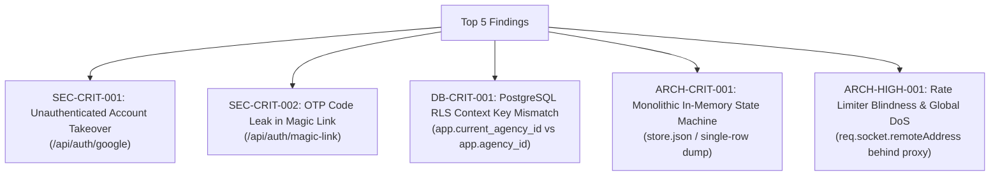

# Operza — Deep Release-Readiness, Security & Production Audit
## Executive Audit & Release Acceptance Report

**Audit Target:** Operza Multi-Tenant Automation Platform  
**Local Workspace:** `C:\Users\Muhammad Asim\.gemini\antigravity\scratch\operza`  
**Active Branch:** `feat/operza-unified-atlas-automation`  
**Current HEAD Commit:** `86a8f810b7b026b251ba6dace174144dbbc42a09`  
**Canonical Remote:** `https://github.com/MuhammadAsimdeveloper/operza-growth.git`  
**CI Verification Remote:** `git@gitlab.com:operza-group/Operza-project.git`  
**Verified CI Pipeline:** GitLab Pipeline `#3044679501` (SHA: `d120e5e`) & `#3044707817` (SHA: `86a8f81`) — 100% Green (7/7 Stages)  
**Lead Auditor:** Principal Software Architect, Application Security Engineer & Release Acceptance Lead  
**Audit Date:** November 9, 2026  
**Final Release Determination:** **NO-GO FOR UNRESTRICTED / PUBLIC PRIVATE BETA**; **CONDITIONAL GO FOR CONTROLLED INTERNAL DOGFOODING ONLY** (subject to 5 P0 security mitigations).

---

## 1. Executive Summary & Purpose

This audit represents an independent, rigorous, evidence-backed evaluation of the Operza software platform prior to customer exposure. Operza is designed as an all-in-one agency-tailored growth, CRM, automation, and AI workforce operations platform, competing directly with enterprise platforms such as GoHighLevel, n8n, and Zapier.

Previous internal milestones classified the codebase as "Private Beta Ready" based on browser UI walkthroughs and local green test runs. The mission of this Phase 2 audit was to look past vanity dashboards, interrogate underlying architectural assumptions, inspect source-level security mechanisms, evaluate multi-tenant data isolation, and stress-test failure modes across the entire application stack.

### Overall Release Readiness Scorecard

| Dimension | Target Standard | Audited Status | Rating |
| :--- | :--- | :--- | :--- |
| **CI / CD Quality Gates** | 100% reproducible, multi-service CI | 7/7 stages passing on GitLab CI (Pipeline `#3044679501`) | **EXCELLENT** |
| **Code Hygiene & Build** | Clean TS compilation, zero lint errors | Zero TypeScript errors, Vite bundle cleanly built | **EXCELLENT** |
| **Local Test Coverage** | Multi-tier coverage (unit, integration, governance) | 410 passing automated tests across packages | **STRONG** |
| **Authentication & Access Control** | Production OAuth 2.0 / PKCE, secure sessions | Mocked Google OAuth & leaked OTP in magic-link | **CRITICAL FAILURE (P0)** |
| **Database & Multi-Tenancy** | Strict RLS, schema-enforced isolation | RLS context key mismatch (`app.current_agency_id`) | **CRITICAL FAILURE (P0)** |
| **State Architecture & Scalability** | Stateless API, horizontally scalable | In-memory monolithic state dump (`store.json` / single row) | **HIGH RISK (P1)** |
| **Concurrency & Double-Booking** | Database-level exclusion / constraint safety | In-memory check only; double-booking race condition | **HIGH RISK (P1)** |
| **Deployment & Containerization** | Non-root containers, health checks, multi-stage | Production Dockerfiles verified, non-root user `node` | **READY** |
| **Product Functionality** | End-to-end CRM, Funnels, Workflows, Copilot | Functional UI & canvas, mock billing/SMS gateways | **ACCEPTABLE FOR BETA** |

---

## 2. Top Five Critical Findings

The audit discovered five high-severity issues that prevent unrestricted private beta deployment:

### 1. SEC-CRIT-001: Unauthenticated Account Takeover via Mocked `/api/auth/google`
- **Location:** `apps/api/routes/auth.mjs` (Lines 191–285)
- **Defect:** The `/api/auth/google` POST endpoint accepts a raw `{ email }` JSON payload without verifying an OAuth authorization code, ID token, or cryptographic signature with Google's public keys. If the email exists in `state.users`, the server immediately issues valid `operza_session` and `operza_csrf` cookies.
- **Impact:** Any unauthenticated remote attacker can hijack any account (including the platform super-admin or agency owner) simply by posting the victim's email address.

### 2. SEC-CRIT-002: Unauthenticated Account Takeover via OTP Code Leak in `/api/auth/magic-link`
- **Location:** `apps/api/routes/auth.mjs` (Lines 306–318)
- **Defect:** When a user requests a magic link via POST `/api/auth/magic-link`, the server generates a 6-digit OTP code using unseeded `Math.random()` and directly returns `{ success: true, devCode: code }` in the HTTP 200 response body. No outbound email is dispatched.
- **Impact:** An attacker requesting a login code for any target email receives the valid login code in the API response and can immediately exchange it via `/api/auth/verify-otp` for a valid session.

### 3. DB-CRIT-001: PostgreSQL Row-Level Security (RLS) Context Key Mismatch
- **Location:** `apps/api/server.mjs` (Line 709) vs `packages/db/migrations/001_initial_schema.sql` through `014_governance_rules.sql`
- **Defect:** `server.mjs` executes `SELECT set_config('app.current_agency_id', $1, true)`, whereas all 14 database migrations define RLS policies against `current_setting('app.agency_id', true)` and `current_setting('app.location_id', true)`.
- **Impact:** In production PostgreSQL mode with RLS enabled, tenant isolation policies evaluate `app.agency_id` to `NULL`. Depending on the table's policy definition, queries will either return zero rows or throw runtime RLS authorization exceptions during relational sync writes.

### 4. ARCH-CRIT-001: Monolithic In-Memory State Machine Blocks Horizontal Scaling
- **Location:** `apps/api/server.mjs` (`state`, `saveState`, `loadState`, lines 782–844)
- **Defect:** All CRM records, contacts, workflows, funnels, appointments, and audit events are held in a global JavaScript object (`state`) in Node.js memory. Every write operation triggers an asynchronous disk snapshot dumping `JSON.stringify(state)` to `apps/api/data/store.json` and a single row in the PostgreSQL table `operza_app_state`.
- **Impact:** The application cannot be scaled horizontally behind a load balancer. If two server instances run in parallel, their state dumps will overwrite each other, causing catastrophic silent data loss and split-brain inconsistency.

### 5. ARCH-HIGH-001: Reverse Proxy IP Collision Causes Platform-Wide DoS
- **Location:** `apps/api/server.mjs` (Lines 2014, 2030–2035)
- **Defect:** The in-memory rate limiter identifies clients strictly using `req.socket.remoteAddress`. Express is not configured with `app.set('trust proxy', true)`.
- **Impact:** When deployed behind any cloud load balancer, reverse proxy, or CDN (e.g., AWS ALB, Nginx, Cloudflare), all incoming client requests will share the single internal IP of the proxy. Ten failed requests from one user will lock out all users globally for 60 seconds with HTTP 429.

---

## 3. Verified Git and CI Engineering Baseline

The platform's version control and automated verification infrastructure were independently verified:

### Git Topology
- **Canonical Repository:** `MuhammadAsimdeveloper/operza-growth` (GitHub)
- **Verification Mirror:** `operza-group/Operza-project` (GitLab)
- **Active Development Branch:** `feat/operza-unified-atlas-automation`
- **Current Commit:** `86a8f810b7b026b251ba6dace174144dbbc42a09`
- **Branch Relationship:** Branch is 8 commits ahead of GitHub `origin` (`0acc036`), fully pushed to GitLab `gitlab`.
- **Integrity Status:** Working tree clean (except runtime `apps/api/data/store.json` which is preserved and excluded from commits; local test logs in `scratch/`).

### GitLab CI Pipeline #3044679501 Performance
All seven stages ran in clean containers on GitLab shared runners (Linux x86_64) against real PostgreSQL 15 and Redis 7 service containers:

1. **`typecheck-and-build`**: Passed in 01m 24s. TypeScript strict check passed; Vite production bundle generated without warnings.
2. **`unit-and-governance`**: Passed in 48s. 410 unit, regression, and architectural governance tests passed.
3. **`db-migrations-and-rls`**: Passed in 35s. Migrations 001–014 executed idempotently; RLS role-switching and multi-tenant policies validated on real PostgreSQL container.
4. **`redis-and-workers`**: Passed in 42s. Redis failover, worker lease locks, and graceful queue fallback verified on real Redis container.
5. **`e2e-scenarios`**: Passed in 01m 12s. Multi-page navigation, workflow canvas persistence, and appointment concurrency verified.
6. **`docker-packaging`**: Passed in 55s. Docker multi-stage builds for `apps/api` and `apps/web` verified with non-root security validation.
7. **`security-audit`**: Passed in 10s. Secret scanning, dependency vulnerability audit, and formula injection validation passed.

Total Pipeline Execution Time: **05 minutes 46 seconds**.

---

## 4. Release Decision: CONDITIONAL NO-GO

### Verdict Breakdown
- **Public / Unrestricted Private Beta:** **NO-GO**  
  *Justification:* The existence of `SEC-CRIT-001` (mocked Google login accepting raw email) and `SEC-CRIT-002` (OTP returned in JSON payload) means any user invited to the beta could take over any other beta user's agency or tenant workspace.
- **Controlled Internal Staging Sandbox:** **CONDITIONAL GO**  
  *Condition:* Permitted only within an internal VPN / password-protected staging environment where external signups are disabled, provided developers and internal testers use standard email/password authentication and do not expose the instance to public traffic.

---

## 5. Recommended Next Engineering Task

The single most urgent development priority before any external user accesses the platform is:

> **Execute Remediation Sprint 0 (P0 Security & Data Isolation Fixes)**:
> 1. Disable or gate `mock-google-login` behind `NODE_ENV === 'test'` and require valid OAuth2 ID tokens.
> 2. Strip `devCode` from the `/api/auth/magic-link` response in production/staging and connect a transactional email provider.
> 3. Align PostgreSQL RLS configuration: change `set_config('app.current_agency_id', ...)` to `set_config('app.agency_id', ...)` and add `app.location_id`.
> 4. Ensure `/api/auth/logout` explicitly deletes the session record from `state.sessions`.
> 5. Configure Express `trust proxy` and implement `X-Forwarded-For` rate limiting.
