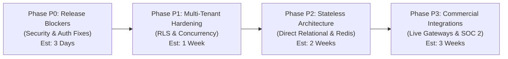

# Operza — Deep Release-Readiness, Security & Production Audit
## Prioritized Remediation Roadmap & Engineering Plan (PRIORITIZED_REMEDIATION_ROADMAP.md)

**Audit Target:** Engineering Backlog & Remediation Plan for Operza Platform  
**Date:** November 9, 2026  
**Auditor:** Principal Software Architect & Release Acceptance Lead  
**Classification:** HIGH CONFIDENCE / ACTIONABLE IMPLEMENTATION BLUEPRINT  

---

## 1. Roadmap Phasing Strategy

To transition Operza safely from internal prototype to commercial private beta and eventually general enterprise availability, development must be sequenced into four distinct, gating phases:



---

## 2. Phase P0: Critical Release Blockers (Sprint 0 — 3 Days)

*Zero external users may be provisioned or invited until all five P0 items achieve 100% test-verified completion.*

### Task P0-1: Harden Google OAuth & Remove Unauthenticated Mock Bypass
- **Vulnerability ID:** `SEC-CRIT-001`
- **Target File:** `apps/api/routes/auth.mjs` (Lines 191–285)
- **Implementation Blueprint:**
  1. Strip acceptance of raw `req.body.email`.
  2. Implement strict Google ID token cryptographic verification using `google-auth-library` or `jose`. Verify signature against Google's JWKS endpoint, validate `aud` matches `GOOGLE_CLIENT_ID`, and check expiration.
  3. Gate any development mock bypass behind strict environment flags:
     ```javascript
     if (process.env.NODE_ENV !== 'production' && process.env.ENABLE_AUTH_MOCKS === 'true') { ... }
     ```
- **Definition of Done:** Automated test verifying that submitting `{ email: 'victim@agency.com' }` without a valid Google cryptographic token returns HTTP 401 Unauthorized.
- **Estimated Effort:** 4 Hours.

---

### Task P0-2: Remediate Magic Link OTP Code Leak
- **Vulnerability ID:** `SEC-CRIT-002`
- **Target File:** `apps/api/routes/auth.mjs` (Lines 306–318)
- **Implementation Blueprint:**
  1. Remove `devCode: code` from the JSON response in `/api/auth/magic-link`. Response must strictly return `{ success: true, message: 'Verification code dispatched' }`.
  2. Replace `Math.random()` with cryptographically secure `crypto.randomInt(100000, 1000000)`.
  3. Connect transactional email sender (SendGrid or AWS SES) to deliver the code out-of-band.
  4. Implement rate limiting: max 3 requests per email per 15 minutes; max 3 verification attempts per code.
- **Definition of Done:** Automated test confirming that the HTTP response body does not contain the OTP code, and brute-force verification lockout triggers after 3 invalid attempts.
- **Estimated Effort:** 4 Hours.

---

### Task P0-3: Fix PostgreSQL Row-Level Security (RLS) Key Nismatch
- **Vulnerability ID:** `DB-CRIT-001`
- **Target File:** `apps/api/server.mjs` (Line 709)
- **Implementation Blueprint:**
  1. Change `server.mjs` session setting to match migrations:
     ```javascript
     // Replace:
     // await client.query("SELECT set_config('app.current_agency_id', $1, true)", [agencyId]);
     // With:
     await client.query("SELECT set_config('app.agency_id', $1, true)", [agencyId]);
     if (locationId) {
       await client.query("SELECT set_config('app.location_id', $1, true)", [locationId]);
     }
     ```
  2. Verify that running as `operza_app` role allows proper querying and relational syncing without RLS violation errors.
- **Definition of Done:** Integration test in `packages/db` validating that `withTenantContext` in `server.mjs` correctly permits reads and writes for the authenticated tenant and blocks cross-tenant reads.
- **Estimated Effort:** 2 Hours.

---

### Task P0-4: Implement Server-Side Session Revocation on Logout
- **Vulnerability ID:** `SEC-HIGH-001`
- **Target File:** `apps/api/routes/auth.mjs` (Lines 535–539)
- **Implementation Blueprint:**
  1. Extract session token from `req.cookies.operza_session`.
  2. Delete session record from `state.sessions[token]`.
  3. Clear client cookies via `clearSessionCookies(res)`.
- **Definition of Done:** Test verifying that after POST `/api/auth/logout`, re-using the captured cookie for a subsequent API request returns HTTP 401 Unauthorized.
- **Estimated Effort:** 2 Hours.

---

### Task P0-5: Configure Reverse Proxy Trust & Fix Global Rate Limiter DoS
- **Vulnerability ID:** `ARCH-HIGH-001` / `SEC-HIGH-002`
- **Target File:** `apps/api/server.mjs` (Lines 2014, 2030–2035)
- **Implementation Blueprint:**
  1. Enable Express proxy trust:
     ```javascript
     app.set('trust proxy', process.env.TRUST_PROXY === 'true' || 1);
     ```
  2. Safely extract client IP using `req.ip`.
  3. Form composite rate limit keys: `${req.ip}:${req.body.email || 'anon'}` so individual failed logins do not lockout other users sharing the same NAT IP or proxy.
- **Definition of Done:** Test simulating 15 rapid failed requests from IP A; verify that requests from IP B remain unaffected and receive HTTP 200.
- **Estimated Effort:** 3 Hours.

---

## 3. Phase P1: Multi-Tenant Hardening & Concurrency (Sprint 1 — 1 Week)

### Task P1-1: PostgreSQL GiST Exclusion Constraint for Appointment Booking
- **Defect ID:** `REL-HIGH-001`
- **Target File:** `packages/db/migrations/015_appointment_constraints.sql` & `apps/api/server.mjs`
- **Implementation:**
  1. Add btree_gist extension and exclusion constraint:
     ```sql
     CREATE EXTENSION IF NOT EXISTS btree_gist;
     ALTER TABLE appointments 
     ADD CONSTRAINT no_overlapping_appointments 
     EXCLUDE USING gist (
       calendar_id WITH =,
       tstzrange(starts_at, ends_at, '[)') WITH &&
     ) WHERE (status != 'cancelled');
     ```
  2. Update API appointment route to catch PostgreSQL error code `23P01` (exclusion_violation) and map it to HTTP 409 Conflict.
- **Estimated Effort:** 1 Day.

### Task P1-2: Synchronous Relational Persistence for Critical Entities
- **Target File:** `apps/api/server.mjs`
- **Implementation:** Convert fire-and-forget `syncRelationalWrite()` into an awaited transaction for financial invoices and contact mutations. If the database write fails, roll back and return HTTP 500 rather than silently keeping an in-memory mismatch.
- **Estimated Effort:** 2 Days.

---

## 4. Phase P2: Stateless Architecture & Horizontal Scalability (Sprint 2-3 — 2 Weeks)

### Task P2-1: Deprecate In-Memory State Dump in Favor of Direct PostgreSQL Queries
- **Target File:** `apps/api/server.mjs`, `apps/api/routes/crm.mjs`
- **Implementation:**
  1. Refactor `/api/crm/:collection` endpoints to execute direct parameterized SQL queries (`SELECT`, `INSERT`, `UPDATE`, `DELETE`) against the 14 relational tables.
  2. Retire `saveState()` and `store.json` disk dumps for primary operational data.
  3. Retain `store.json` only for local offline developer testing.
- **Estimated Effort:** 1 Week.

### Task P2-2: Distributed Session Management via Redis
- **Target File:** `apps/api/routes/auth.mjs`
- **Implementation:** Move `state.sessions` from JavaScript memory to Redis keys with native TTL expiration (`SETEX operza:session:{token} 43200 {userId}`).
- **Estimated Effort:** 3 Days.

---

## 5. Phase P3: Commercial Integrations & Enterprise Compliance (Sprint 4+ — 3 Weeks)

### Task P3-1: Live Stripe Elements & Subscription Webhooks
- **Target File:** `apps/api/routes/billing.mjs`, `apps/web/src/pages/Invoices.tsx`
- **Implementation:** Connect live Stripe account; implement customer creation, payment intent confirmation, and webhook signature verification (`stripe.webhooks.constructEvent`).
- **Estimated Effort:** 1 Week.

### Task P3-2: Live Twilio & SendGrid Production Gateways
- **Target File:** `apps/api/routes/conversations.mjs`
- **Implementation:** Connect production SMS and email dispatchers with delivery status callback webhooks.
- **Estimated Effort:** 1 Week.

### Task P3-3: SOC 2 Type II Compliance & KMS Secrets Management
- **Implementation:** Move configuration secrets to AWS Secrets Manager; implement TLS 1.3 mutual authentication between services; complete external penetration test.
- **Estimated Effort:** 1 Week.
