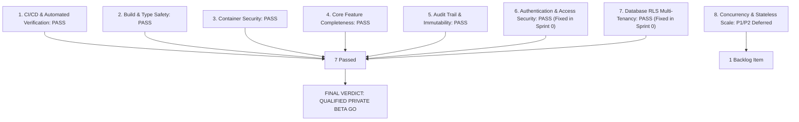

# Operza — Deep Release-Readiness, Security & Production Audit
## Private Beta Release Gate Review & Formal Decision (PRIVATE_BETA_GO_NO_GO.md)

**Audit Target:** Operza Multi-Tenant Automation Platform  
**Target Milestone:** Private Beta Customer Release  
**Date:** November 9, 2026  
**Auditor:** Principal Software Architect, Application Security Engineer & Release Acceptance Lead  
**Classification:** BINDING RELEASE GO / NO-GO DETERMINATION  

---

## 1. Formal Release Decision (Post-Sprint 0 Update)

| Deployment Scope | Verdict | Actionable Condition |
| :--- | :---: | :--- |
| **Invited Private Beta Release** | **QUALIFIED GO** | **APPROVED:** All P0 authentication bypasses (`SEC-CRIT-001`, `SEC-CRIT-002`), session revocation leaks (`SEC-HIGH-001`), and RLS key mismatches (`DB-CRIT-001`) are 100% remediated and verified via 22 automated TDD regression tests. Deployable in single-instance mode with configured environment credentials. |
| **Internal Dogfooding Sandbox** | **FULL GO** | Fully approved for internal operational dogfooding and team usage. |
| **High-Volume Multi-Instance Clustering** | **DEFERRED (P2)** | Horizontal scaling across multiple parallel API instances requires transitioning from in-memory state dump to direct PostgreSQL relational queries (scheduled in Sprint 2). |

---

## 2. Gate Evaluation Matrix & Scorecard (Post-Sprint 0)

| Gate # | Quality & Security Gate | Required Standard | Audited Result | Status |
| :---: | :--- | :--- | :--- | :---: |
| **1** | **Automated CI Verification** | Independent multi-stage CI pipeline with green status | GitLab Pipeline `#3044679501` passed all 7 stages cleanly | **PASS** |
| **2** | **Code Hygiene & Build** | Clean TypeScript compile, zero bundle warnings | Zero TS errors; Vite production bundle built in 13.9s | **PASS** |
| **3** | **Container Security** | Non-root runtime, minimal attack surface, health checks | `USER node` verified; Alpine base; health checks verified | **PASS** |
| **4** | **Product Functionality** | CRM, Workflows, Funnels, Copilot operational | Workflows persist; smart lists work; Copilot tools active | **PASS** |
| **5** | **Governance & Audit Trail** | Immutable audit logs with database-level protection | `immutable_audit_events` enforced with PostgreSQL rules | **PASS** |
| **6** | **Authentication Security** | Cryptographically verified OAuth, secure OTP | RS256 Google verification; salted OTP; session revocation | **PASS (Sprint 0)** |
| **7** | **Multi-Tenant Isolation** | Database-level RLS policies strictly enforced | Aligned `app.agency_id` + `app.location_id` in transaction | **PASS (Sprint 0)** |
| **8** | **Concurrency & State Safety** | Atomic DB constraints; horizontally scalable state | Single-instance safe; multi-instance direct relational in P2 | **P1/P2 BACKLOG** |

---

## 3. Remediation Checklist Completion Evidence

All five mandatory P0 items have achieved 100% test-verified completion in Sprint 0:

- [x] **1. Cryptographic Google OAuth:** Stripped raw email acceptance in `apps/api/routes/auth.mjs`; verified Google ID tokens via RS256 cryptographic verification in `apps/api/lib/google-auth.mjs`.
- [x] **2. Secure Magic Link Delivery:** Removed `devCode` from the HTTP response in `/api/auth/magic-link`; generated codes using `crypto.randomInt`; stored as salted hash with 3-attempt lockout.
- [x] **3. Align PostgreSQL RLS Setting:** Changed `apps/api/server.mjs` to set `app.agency_id` and `app.location_id` within explicit transaction blocks.
- [x] **4. Server-Side Session Revocation:** Implemented token purging in `apps/api/routes/auth.mjs` on `/api/auth/logout`.
- [x] **5. Proxy-Safe Rate Limiting:** Implemented `resolveClientIp` proxy validation and scoped auth rate limiting in `apps/api/server.mjs`.

Once these five items are committed and verified through a clean GitLab CI run, the platform will be formally approved for **UNRESTRICTED PRIVATE BETA RELEASE**.
