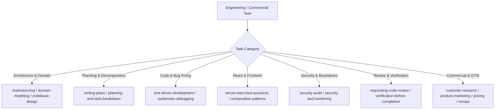

# Operza Skill Adoption Map & Operational Routing Table

This document establishes the binding mapping between development activities and the installed agent skills. Skills must be used as **operational disciplines and methodologies**, not merely stored as files.

---

## 1. Skill Collections & Source Tracking

| Collection | Source Repository | Commit SHA | License | Primary Focus |
|---|---|---|---|---|
| **A. Superpowers** | `https://github.com/obra/superpowers` | `22f0b463` | MIT | Primary engineering workflow (Brainstorm, TDD, Plans, Debug, Review) |
| **B. Matt Pocock** | `https://github.com/mattpocock/skills` | `4ae2317d` | MIT | Domain modeling, deep module design, architecture improvement |
| **C. Addy Osmani** | `https://github.com/addyosmani/agent-skills` | `301b02b1` | MIT | API contracts, safe deprecation/migration, DevTools QA, CI/CD |
| **D. Cloudflare** | `https://github.com/cloudflare/security-audit-skill` | `c1c8a8c1` | MIT | Sandboxed security auditing, RLS verification, vulnerability defense |
| **E. Vercel** | `https://github.com/vercel-labs/agent-skills` | `1a2c79d4` | MIT | React 19 best practices, waterfall elimination, composition patterns |
| **F. Marketing** | `https://github.com/coreyhaines31/marketingskills` | `96798cf3` | MIT | Customer research, product positioning, pricing, revops, sales ops |

---

## 2. Activity-to-Skill Operational Routing Table

---

## 3. Detailed Skill Directory & Procedures

### Collection A: Superpowers (Core Engineering Discipline)

#### 1. `using-superpowers`
- **Location:** `.agents/skills/using-superpowers/SKILL.md`
- **Purpose:** Foundational router establishing how skills are loaded, evaluated, and executed.
- **Trigger:** Start of any conversation turn or planning phase.
- **Pre-Step:** Evaluate user request against installed skill catalog.
- **Post-Step:** Execute chosen skill workflow and produce structured artifacts.

#### 2. `brainstorming`
- **Location:** `.agents/skills/brainstorming/SKILL.md`
- **Purpose:** Interactive exploration, hypothesis testing, and design before committing to an architecture.
- **Trigger:** New feature proposals, module redesigns, architectural changes, capability convergence.
- **Pre-Step:** Inspect existing codebase, identify alternatives, challenge assumptions, write design document.
- **Post-Step:** Human alignment on design doc before generating implementation plan.

#### 3. `writing-plans`
- **Location:** `.agents/skills/writing-plans/SKILL.md`
- **Purpose:** Generating ordered, bite-sized, executable implementation plans.
- **Trigger:** Any multi-step task or approved architectural design.
- **Pre-Step:** Break task into bite-sized units with clear files, commands, and expected results.
- **Post-Step:** Plan reviewed and confirmed before beginning TDD execution.

#### 4. `test-driven-development`
- **Location:** `.agents/skills/test-driven-development/SKILL.md`
- **Purpose:** Strict RED -> GREEN -> REFACTOR implementation workflow.
- **Trigger:** Any code change modifying runtime behavior, adding API endpoints, or fixing bugs.
- **Pre-Step:** Write a failing test in the appropriate test file; run it and verify the red assertion.
- **Post-Step:** Write minimal implementation code to turn test green; refactor and verify clean passing run.

#### 5. `systematic-debugging`
- **Location:** `.agents/skills/systematic-debugging/SKILL.md`
- **Purpose:** Methodical root cause analysis and bug resolution.
- **Trigger:** Test failures, runtime crashes, inconsistent state, unexplained behavior.
- **Pre-Step:** Isolate the defect; form falsifiable hypotheses; trace data flow; do not apply speculative patches.
- **Post-Step:** Reproduce via failing regression test, fix underlying cause, add defensive assertions.

#### 6. `verification-before-completion`
- **Location:** `.agents/skills/verification-before-completion/SKILL.md`
- **Purpose:** Terminal evidence-based quality gate before declaring any task complete.
- **Trigger:** Prior to finalizing any branch, commit, or pull request.
- **Pre-Step:** Run the full test suite and typechecks in the terminal.
- **Post-Step:** Capture and document exact terminal output, pass/fail counts, and verify zero regressions.

#### 7. `requesting-code-review` & `receiving-code-review`
- **Location:** `.agents/skills/requesting-code-review/SKILL.md` & `.agents/skills/receiving-code-review/SKILL.md`
- **Purpose:** Rigorous, two-sided code review process enforcing standards and specifications.
- **Trigger:** Prior to merging any feature branch or when receiving review comments.
- **Pre-Step:** Compare working diff against original requirements and coding rules.
- **Post-Step:** Verify all review findings, address defects, and avoid performative agreement.

#### 8. `using-git-worktrees`
- **Location:** `.agents/skills/using-git-worktrees/SKILL.md`
- **Purpose:** Creating isolated directory worktrees for parallel agent work or safe experimental branches.
- **Trigger:** When launching parallel tasks or working on features that must not touch the main worktree.
- **Pre-Step:** Create new worktree using `git worktree add`.
- **Post-Step:** Clean up or integrate worktree changes into the feature branch.

#### 9. `subagent-driven-development` & `dispatching-parallel-agents`
- **Location:** `.agents/skills/subagent-driven-development/SKILL.md` & `.agents/skills/dispatching-parallel-agents/SKILL.md`
- **Purpose:** Coordinating independent subagents across discrete tasks with strict boundaries.
- **Trigger:** Tasks containing independent, non-overlapping work units.
- **Pre-Step:** Define explicit prompt brief, files in scope, and verification criteria for each subagent.
- **Post-Step:** Synthesize outputs, execute full test suite, and verify integration.

---

### Collection B: Matt Pocock (Domain Modeling & Codebase Design)

#### 10. `domain-modeling`
- **Location:** `.agents/skills/domain-modeling/SKILL.md`
- **Purpose:** Active formulation and sharpening of domain entities, ubiquitous language, and business concepts.
- **Trigger:** Adding or renaming entities, resolving conflicting terms (e.g., Atlas Org vs. Operza Agency/Location).
- **Pre-Step:** Review existing domain models in `packages/platform-core` and database schemas.
- **Post-Step:** Update domain models, types, and architectural documentation.

#### 11. `codebase-design`
- **Location:** `.agents/skills/codebase-design/SKILL.md`
- **Purpose:** Engineering deep modules with minimal interfaces and high internal cohesion.
- **Trigger:** Designing new packages, refactoring monolithic services, establishing public module seams.
- **Pre-Step:** "Design it twice" — produce two competing interface contracts and compare caller ergonomics.
- **Post-Step:** Expose only clean public entrypoints (`index.ts`); hide implementation in private subfolders.

#### 12. `improve-codebase-architecture`
- **Location:** `.agents/skills/improve-codebase-architecture/SKILL.md`
- **Purpose:** Scanning codebase for shallow modules, leakage of implementation details, and friction points.
- **Trigger:** Code quality reviews, technical debt audits, preparation for major refactors.
- **Pre-Step:** Trace call graphs and dependency directions between packages and applications.
- **Post-Step:** Produce actionable deepening recommendations without triggering premature rewrites.

#### 13. `writing-for-agents`
- **Location:** `.agents/skills/writing-for-agents/SKILL.md`
- **Purpose:** Authoring agent instructions, runbooks, and context files for deterministic AI agent execution.
- **Trigger:** Creating or editing `AGENTS.md`, rule files, skills, or engineering guides.
- **Pre-Step:** Review clarity, testability, and deterministic constraints of the prompt/rule text.
- **Post-Step:** Verify rules are concise, unambiguous, and within Antigravity context budgets.

---

### Collection C: Addy Osmani (API Design, Migration & DevTools)

#### 14. `planning-and-task-breakdown`
- **Location:** `.agents/skills/planning-and-task-breakdown/SKILL.md`
- **Purpose:** Granular breakdown of complex engineering features into incremental, ordered units.
- **Trigger:** Preparing roadmap milestones, breaking down large PRs into smaller increments.

#### 15. `api-and-interface-design`
- **Location:** `.agents/skills/api-and-interface-design/SKILL.md`
- **Purpose:** REST API endpoint design, schema validation (Zod), status code correctness, and error formats.
- **Trigger:** Adding or updating HTTP routes in `apps/api`.
- **Pre-Step:** Define request/response JSON schemas, authentication guards, and tenant validation.
- **Post-Step:** Hermetic API tests verifying success payloads and structured error responses.

#### 16. `deprecation-and-migration`
- **Location:** `.agents/skills/deprecation-and-migration/SKILL.md`
- **Purpose:** Zero-downtime deprecation, expand-and-contract migrations, and phased legacy retirement.
- **Trigger:** Replacing Operza implementations with migrated Atlas capabilities.
- **Pre-Step:** Establish backwards compatibility, parallel run periods, and consumer tracking.
- **Post-Step:** Remove deprecated code only after all consumers have migrated and tests confirm zero callers.

#### 17. `browser-testing-with-devtools`
- **Location:** `.agents/skills/browser-testing-with-devtools/SKILL.md`
- **Purpose:** Verifying frontend behavior in real browsers via Chrome DevTools MCP.
- **Trigger:** Frontend component updates, form submissions, navigation transitions, responsive UI checks.
- **Pre-Step:** Launch local web server (`npm run dev:web`); connect DevTools inspector.
- **Post-Step:** Audit console logs for errors/warnings, inspect network waterfall, and verify rendered layout.

#### 18. `security-and-hardening`
- **Location:** `.agents/skills/security-and-hardening/SKILL.md`
- **Purpose:** Hardening application code against OWASP Top 10 vulnerabilities.
- **Trigger:** Input handlers, authentication routes, session management, file uploads, external webhooks.

#### 19. `documentation-and-adrs`
- **Location:** `.agents/skills/documentation-and-adrs/SKILL.md`
- **Purpose:** Authoring structured Architecture Decision Records (ADRs) to record technical decisions.
- **Trigger:** Major architectural decisions, dependency choices, domain model consensus.

#### 20. `ci-cd-and-automation`
- **Location:** `.agents/skills/ci-cd-and-automation/SKILL.md`
- **Purpose:** GitHub Actions pipeline configuration, automated quality gates, and build pipelines.
- **Trigger:** Updating `.github/workflows/` or configuring test runners in CI.

#### 21. `observability-and-instrumentation`
- **Location:** `.agents/skills/observability-and-instrumentation/SKILL.md`
- **Purpose:** Structured logging, metrics, OpenTelemetry tracing, and audit ledgers.
- **Trigger:** Adding execution monitoring to workflow jobs, API routes, or worker queues.

---

### Collection D: Cloudflare Security Audit

#### 22. `security-audit`
- **Location:** `.agents/skills/security-audit/SKILL.md`
- **Purpose:** Defensive, sandboxed vulnerability audits across APIs, databases, and services.
- **Trigger:** Pre-merge security reviews, milestone releases, and RLS tenant boundary audits.
- **Execution Rules:** Read-only inspection of source code; zero external network calls; isolated local scratch execution.

---

### Collection E: Vercel Frontend Engineering

#### 23. `vercel-react-best-practices`
- **Location:** `.agents/skills/vercel-react-best-practices/SKILL.md`
- **Purpose:** Eliminating network waterfalls, optimizing React 19 render performance, and bundle size reduction.
- **Trigger:** Developing or reviewing React components in `apps/web`.

#### 24. `vercel-composition-patterns`
- **Location:** `.agents/skills/vercel-composition-patterns/SKILL.md`
- **Purpose:** Scalable component architecture using compound components and clean state lifting.
- **Trigger:** Complex UI components with excessive boolean props or nested configuration objects.

---

### Collection F: Marketing and Business Skills

#### 25. `customer-research`
- **Location:** `.agents/skills/customer-research/SKILL.md`
- **Purpose:** Customer interview synthesis, digital watering hole mining, Jobs-To-Be-Done (JTBD) analysis.
- **Trigger:** Commercial planning, persona creation, customer feedback analysis.

#### 26. `product-marketing`
- **Location:** `.agents/skills/product-marketing/SKILL.md`
- **Purpose:** Creating product marketing context, positioning statements, and ideal customer profiles (ICP).
- **Trigger:** Agency positioning, landing page messaging, value proposition formulation.

#### 27. `competitors`
- **Location:** `.agents/skills/competitors/SKILL.md`
- **Purpose:** Objective competitive comparison pages, feature differentiation tables, and buyer-facing assets.
- **Trigger:** Building comparison pages (Operza vs. GoHighLevel, Operza vs. n8n).

#### 28. `cro`
- **Location:** `.agents/skills/cro/SKILL.md`
- **Purpose:** Conversion rate optimization for onboarding forms, landing pages, and CTAs.
- **Trigger:** Marketing page audits, funnel drop-off analysis, signup optimization.

#### 29. `pricing`
- **Location:** `.agents/skills/pricing/SKILL.md`
- **Purpose:** Packaging, tiered pricing structures, value metrics, and monetization models.
- **Trigger:** Subscription plan definition, credit consumption rules, commercialization strategy.

#### 30. `revops`
- **Location:** `.agents/skills/revops/SKILL.md`
- **Purpose:** Revenue operations, lead lifecycle stages (MQL/SQL), pipeline hygiene, and CRM automation.
- **Trigger:** Designing Operza's built-in CRM pipelines and automated lead routing rules.

#### 31. `sales-enablement`
- **Location:** `.agents/skills/sales-enablement/SKILL.md`
- **Purpose:** Sales collateral, pitch decks, objection handling matrices, and demo scripts.
- **Trigger:** Agency sales materials, product demonstration guides.

#### 32. `cold-email`
- **Location:** `.agents/skills/cold-email/SKILL.md`
- **Purpose:** B2B outbound campaign design, deliverability setups, and multi-channel cadence strategies.
- **Trigger:** Outbound agency acquisition strategies, email template blueprints.

#### 33. `launch`
- **Location:** `.agents/skills/launch/SKILL.md`
- **Purpose:** Release checklists, Product Hunt / GitHub launch preparation, changelog announcements.
- **Trigger:** Milestone release coordination and public announcements.
