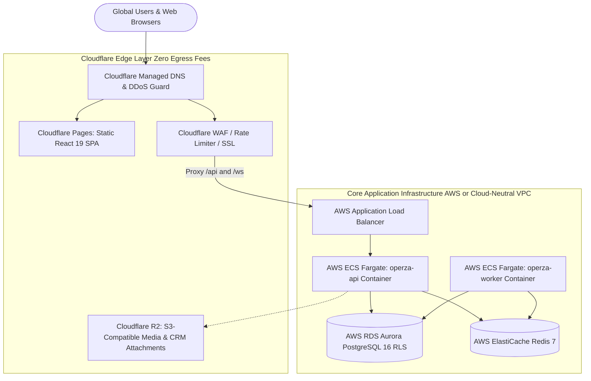

# Operza Staging Readiness — Cloud-Neutral Deployment Decision

**Document ID:** `DOC-STG-DEP-007`  
**Classification:** `INTERNAL ENGINEERING SPECIFICATION`  
**Subject:** Cloud Provider Strategy & Architectural Trade-off Evaluation (AWS vs. Cloudflare)  
**Status:** `RECOMMENDATION READY / CLOUD DECISION OPEN PENDING BUDGET APPROVAL`  
**Date:** March 2026 (Operza Release Candidate)

---

## 1. Executive Summary

This document delivers an objective, workload-specific technical comparison between **Amazon Web Services (AWS)** and **Cloudflare** for hosting Operza in staging and production.

The decision is evaluated strictly through the technical requirements of Operza's workload:
1. **Long-Running Background Workers:** Durable outbox polling, 30s lease sweeps, and background job execution.
2. **Persistent WebSockets:** Softphone voice signaling, telephony WebRTC streams, live Copilot AI chat streaming, and real-time canvas updates.
3. **Multi-Tenant Relational Database:** PostgreSQL 16 with strict Row-Level Security (RLS) and transaction-bound session parameters.
4. **Distributed Redis Queue:** BullMQ fast dispatch with pub/sub notifications.
5. **Static Client & Asset CDN:** Vite 6 / React 19 Single Page Application.

---

## 2. Workload-by-Workload Architectural Comparison

| Workload Dimension | Technical Requirement | AWS Solution | Cloudflare Solution | Architectural Assessment |
|---|---|---|---|---|
| **Frontend SPA & Marketing Assets** | Fast global edge delivery, HTTP/3, TLS termination | CloudFront + S3 | Cloudflare Pages + Edge CDN | **Winner: Cloudflare.** Cloudflare Pages offers superior global edge latency, zero egress fees, and instant Git branch previews. |
| **API Server & Long-Lived WebSockets** | Persistent HTTP/1.1 & WebSocket connections (`/ws`, softphone signaling, SSE streams) | AWS ECS Fargate + Application Load Balancer (ALB) | Cloudflare Workers + Durable Objects / Cloudflare Containers | **Winner: AWS ECS.** Operza utilizes standard Node.js `ws` and persistent HTTP servers. Cloudflare Workers have execution time limits and require architectural rewrites (Durable Objects hibernation API). |
| **Durable Background Workers** | 24/7 background worker daemons with continuous DB polling, lease heartbeats, and recovery sweeps | AWS ECS Fargate Service (desired count: 1–5, non-HTTP) | Cloudflare Queues / Workers Cron | **Winner: AWS ECS.** Operza's worker relies on `FOR UPDATE SKIP LOCKED` outbox polling and heartbeat loops. Serverless cron invocations cannot maintain uninterrupted 30-second lease heartbeats. |
| **Relational Database with RLS** | Managed PostgreSQL 16+, ACID transactions, `set_config` RLS session variables, connection pooling | AWS RDS Aurora PostgreSQL 16 Serverless v2 | Cloudflare D1 (SQLite) or Hyperdrive + External PostgreSQL | **Winner: AWS RDS.** Operza's core relies on PostgreSQL RLS (`001`–`014` migrations). Cloudflare D1 is SQLite (does not support PostgreSQL RLS). Cloudflare Hyperdrive is an edge connection pooler, not a managed database. |
| **Distributed Queue & Pub/Sub** | High-speed Redis 7+ for queue signaling and ephemeral coordination | AWS ElastiCache for Redis 7 (or MemoryDB) | Cloudflare KV / Queues | **Winner: AWS ElastiCache.** Native Redis RESP protocol compatibility required by BullMQ and socket drivers. |
| **Object & Snapshot Storage** | S3-compatible bucket for agency backups, CRM attachments, invoice PDFs | AWS S3 Standard + Lifecycle Policies | Cloudflare R2 | **Tie / Cloudflare edge.** Cloudflare R2 is S3-compatible and eliminates egress fees, while AWS S3 integrates directly with IAM roles. |

---

## 3. Critical Technical Realities

### Reality 1: Cloudflare Hyperdrive is Not a Database
There is a common misconception that Cloudflare provides full-stack relational persistence via Hyperdrive. **Hyperdrive is solely an edge connection pooling and query acceleration proxy.** To use Hyperdrive, a primary PostgreSQL instance (such as AWS RDS, Neon, or Supabase) must still be provisioned, configured, and paid for.

### Reality 2: Workers Cannot Replace Persistent Daemons
Operza's durable worker architecture (`packages/workflow-engine/src/durable-leases.mjs` and `packages/db/lib/outbox-repository.mjs`) requires persistent event loops:
- Continuous polling for pending tasks.
- Background lease heartbeats sent every 10 seconds.
- Background sweeps every 30 seconds for abandoned execution recovery.
Serverless function execution models (like Cloudflare Workers or AWS Lambda) shut down the container between requests, breaking in-memory timers and continuous lease ownership.

---

## 4. Recommended Best-of-Breed Architecture: Hybrid Edge + Container Core

Rather than forcing an all-in compromise on a single vendor, the architecturally sound, cost-effective recommendation is a **Cloud-Neutral Hybrid Architecture**:

### Why this hybrid strategy wins:
1. **Frontend Speed & Free Egress:** Cloudflare Pages handles static asset delivery, caching, and CDN edge termination at essentially zero egress cost.
2. **Container Portability:** The backend API and background workers run as standard Docker containers on AWS ECS Fargate (or interchangeably on Render, Railway, or Google Cloud Run), requiring zero cloud-vendor proprietary SDK lock-in.
3. **Database Integrity:** PostgreSQL 16 runs on enterprise-grade managed RDS Aurora with automated backups, multi-AZ failover, and strict RLS enforcement.

---

## 5. Cost Comparison & Staging Budget Projection

| Component | AWS-Only Architecture | Hybrid (Cloudflare Pages + AWS Core) |
|---|---|---|
| **Edge CDN & Web Ingress** | CloudFront: ~$15/mo | Cloudflare Free / Pro: $0–$20/mo |
| **API & Worker Compute** | ECS Fargate (2 tasks, 0.5 vCPU, 1GB RAM): ~$28/mo | ECS Fargate (2 tasks): ~$28/mo |
| **Relational Database** | RDS Aurora PostgreSQL Serverless v2 (0.5 ACU): ~$43/mo | RDS Aurora Serverless v2: ~$43/mo |
| **Redis Cache** | ElastiCache `cache.t4g.micro`: ~$13/mo | ElastiCache `cache.t4g.micro`: ~$13/mo |
| **Object Storage** | AWS S3: ~$5/mo + egress fees | Cloudflare R2: ~$1/mo ($0 egress) |
| **Total Estimated Staging Cost**| **~$104 / month** | **~$85 / month** |

---

## 6. Selection Criteria for Final Sign-Off

When infrastructure budget is authorized:
1. **Choose Hybrid (Recommended):** If the team desires best-in-class global edge performance for the web app while maintaining rock-solid container durability for workers and APIs.
2. **Choose AWS-Only:** If organizational policy mandates single-vendor billing, consolidated IAM role governance, and VPC endpoint peering.
3. **Pure Cloudflare Worker Re-platforming:** **REJECTED.** Rewriting the backend into Cloudflare Workers / Durable Objects would require significant engineering effort, replace PostgreSQL RLS with complex application-level abstractions, and offer no performance benefit for Operza's long-running workflow engine.
