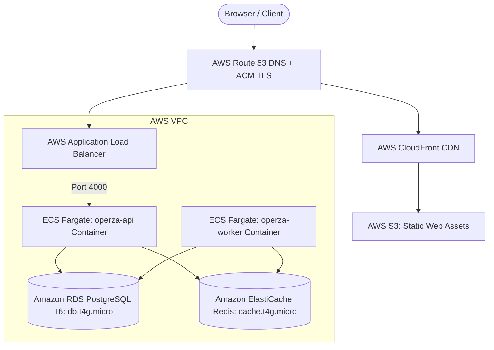
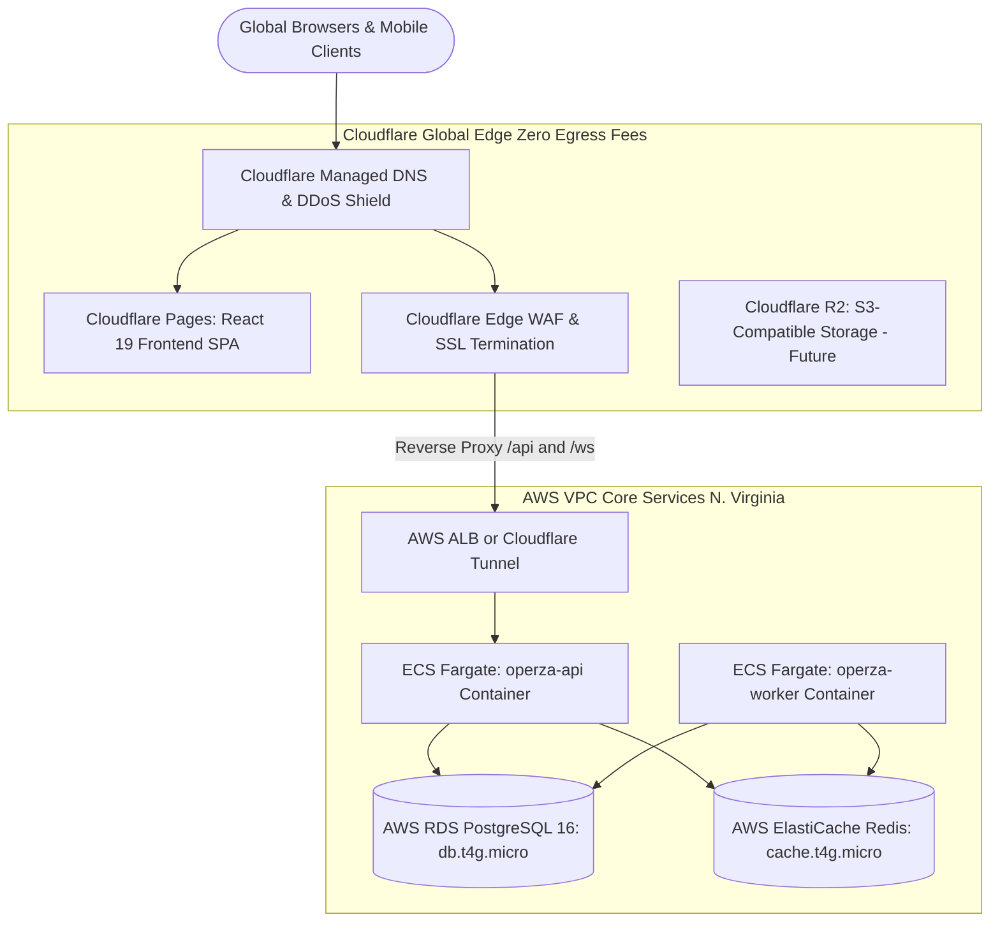
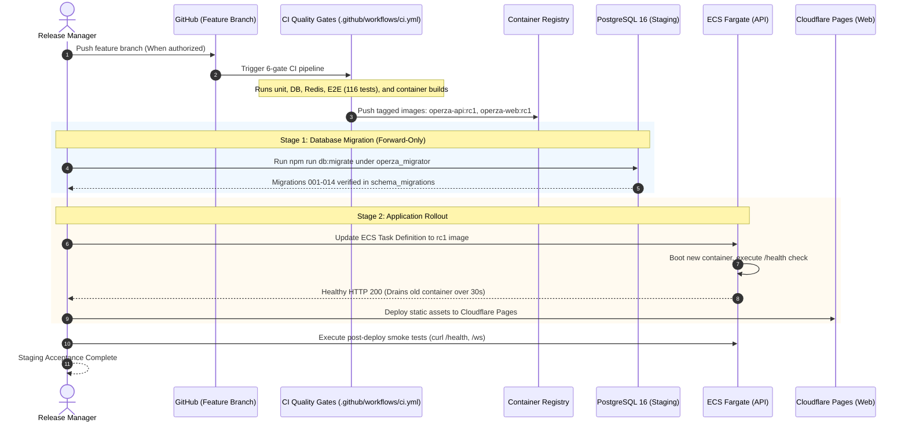

# Operza Staging Deployment Decision Package & Executable Infrastructure Blueprint

**Document ID:** `DOC-STG-FDP-010`  
**Classification:** `EXECUTIVE ARCHITECTURE & INFRASTRUCTURE DECISION PACKAGE`  
**Current Status:** `READY FOR PROVIDER SELECTION`  
**Release Target:** Staging Release Candidate 1 (RC1)  
**Date:** November 2026  
**Primary Currency:** USD ($)  
**Exchange Reference:** 1 USD ≈ 278.00 PKR (Mid-market rate, November 2026)

---

## 1. Executive Summary & Purpose

This decision package establishes the definitive technical evaluation, financial model, and infrastructure-as-code deployment plan for Operza's upcoming staging deployment.

### Fundamental Operating Principles
1. **Zero Premature Spending:** No cloud resources have been provisioned, no credit cards charged, and no paid infrastructure initialized.
2. **Open Decision Matrix:** AWS-first, Cloudflare-first, and Hybrid architectures are objectively analyzed against the verified requirements of Operza's codebase, rather than generic promotional benchmarks.
3. **Financial Defense:** The previous preliminary estimate of ~$85/month has been deconstructed, stress-tested, and audited. A viable **Lean Staging** configuration has been engineered that achieves full functional verification for **~$45.50 to ~$68.00/month (~12,650 to ~18,900 PKR)** by eliminating unnecessary enterprise overhead while preserving genuine infrastructure realism.
4. **Human Decision Gate:** This document provides the complete factual basis required for the product owner to make the final selections regarding provider, region, budget, domain, and deployment authorization.

---

## 2. Option A: AWS-First Architecture Assessment

In an AWS-first model, all platform tiers run inside an Amazon Web Services Virtual Private Cloud (VPC) in a single target region (e.g., `us-east-1` or `eu-central-1`).



### Architectural Component Evaluation
- **Compute (ECS Fargate):**
  - **API Service:** 1 task (0.25 vCPU, 0.5 GB RAM) running Linux/ARM64 (AWS Graviton2). Runs `node apps/api/server.mjs`. Fully compatible with persistent HTTP/1.1 and native Node.js `ws` WebSockets.
  - **Worker Service:** 1 task (0.25 vCPU, 0.5 GB RAM) running `node apps/api/worker.mjs`. Operates continuous outbox polling loop with 10s lease renewals and 30s crash recovery sweeps.
  - **Verdict:** Highly reliable, native container execution with zero architectural translation needed.
- **Ingress (Application Load Balancer):**
  - Handles TLS termination via AWS Certificate Manager (free ACM certificates).
  - Native support for HTTP/1.1 WebSocket upgrading on `/ws`.
  - Base cost: ~$0.0225/hour (~$16.43/month) plus LCU (~$5.84/month).
- **Relational Database (RDS PostgreSQL 16):**
  - Standard RDS `db.t4g.micro` (2 vCPU, 1 GB RAM, Graviton2): $0.016/hour (~$11.68/month) + 20 GB gp3 storage ($2.30/month) = **~$13.98/month**.
  - Fully supports all 14 Operza migrations, composite keys, forced Row-Level Security, and session variable parameterization (`app.agency_id`, `app.location_id`).
  - *Note on Aurora Serverless v2:* While Aurora offers auto-scaling, its minimum 0.5 ACU baseline costs $0.12/ACU-hr = **$43.80/month** just for compute, making it unnecessarily expensive for lean staging.
- **Distributed Queue (Amazon ElastiCache):**
  - `cache.t4g.micro` (Redis 7 or Valkey): $0.0128 to $0.016/hour = **~$9.34 to ~$11.68/month**.
  - Provides native RESP TCP protocol required by BullMQ and socket drivers.
- **Object Storage & Container Registry:**
  - S3 for future snapshots / media: Pay-as-you-go ($0.023/GB-mo).
  - Amazon ECR: Storage for container image layers ($0.10/GB-mo, ~$0.50/mo for staging images).
- **Networking & VPC Egress:**
  - Standard enterprise AWS architectures mandate private subnets with a NAT Gateway. A NAT Gateway costs $0.045/hour = **$32.85/month** plus $0.045/GB.
  - For Lean Staging, placing ECS tasks in public subnets with Security Groups strictly restricted to the ALB (or direct port 4000) avoids the NAT Gateway, incurring only the AWS IPv4 address charge ($0.005/hr * 2 = **$7.30/month**).

### AWS-First Summary
- **Strengths:** 100% native runtime compatibility, proven container primitives, single-vendor consolidated IAM governance and billing.
- **Weaknesses:** Substantial base idle costs for networking (ALB, IPv4 / NAT Gateway); CloudFront edge CDN has higher egress costs than Cloudflare.

---

## 3. Option B: Cloudflare-First Architecture Assessment

A Cloudflare-first approach attempts to run all ingress, edge compute, and storage natively within Cloudflare's serverless edge ecosystem.

### Architectural Component Evaluation
- **Frontend (Cloudflare Pages):**
  - **Verdict: Outstanding.** Native support for Vite 6 / React 19 SPAs, instant Git previews, global HTTP/3 edge distribution, and $0 egress bandwidth.
- **Edge Compute (Cloudflare Workers / Durable Objects):**
  - **Critical Technical Limitation:** Cloudflare Workers run on the V8 isolate runtime, NOT a standard Node.js server process. They do NOT support long-running, continuous `while(true)` background polling loops, cannot run native `node:http` servers, and require non-standard WebSocket hibernation APIs for persistent connections.
  - Rewriting Operza's backend to run on pure Workers would require dismantling the current API server, replacing standard WebSockets with Durable Objects, and abandoning the unified Node.js runtime.
- **Cloudflare Containers (Public Beta):**
  - Cloudflare introduced container support integrated with Durable Objects.
  - **Critical Technical Limitation:** Cloudflare Containers are currently in **Public Beta** and are architecturally engineered to **scale to zero / sleep** after idle timeouts.
  - If a container is forced to run 24/7 without sleeping (to maintain continuous 10s worker leases and 30s recovery sweeps), compute charges accumulate at $0.000020/vCPU-sec ($52.56/mo) + RAM ($6.57/mo) = **~$59.13/month** for a single 1-vCPU container, on top of the base Workers Paid plan ($5/mo).
- **Relational Data (Hyperdrive & Cloudflare D1):**
  - **Cloudflare D1:** SQLite-based edge database. Does NOT support PostgreSQL, does NOT support PostgreSQL Row-Level Security, and cannot run Operza's 14 migrations.
  - **Cloudflare Hyperdrive:** **Hyperdrive is NOT a database.** It is an edge connection pooling and query acceleration proxy. To use Hyperdrive, a full PostgreSQL database (like AWS RDS, Neon, or Supabase) must still be provisioned and paid for separately.
  - While Hyperdrive supports `set_config('app.agency_id', ..., true)` when wrapped inside an explicit transaction block, it does not support `LISTEN`/`NOTIFY`, cannot run migrations using session locks (`pg_advisory_lock`), and adds proxy hop overhead for non-edge workers.
- **Queue & Pub/Sub (Cloudflare Queues):**
  - Cloudflare Queues does not support the Redis RESP protocol. BullMQ and Redis socket drivers cannot connect to Cloudflare Queues without an entirely separate queue rewrite.

### Cloudflare-First Summary
- **Strengths:** Unbeatable static frontend delivery, zero egress bandwidth costs, best-in-class edge DDoS and WAF protection.
- **Weaknesses:** Fundamentally incompatible with Operza's long-running background worker daemon, WebSockets, and PostgreSQL RLS architecture without a massive, multi-month re-platforming effort. Pure Cloudflare-first is **technically unviable for Operza's backend**.

---

## 4. Option C: Hybrid Architecture Assessment (Recommended)

The Hybrid model leverages each provider for its genuine competitive advantage while eliminating proprietary vendor lock-in.



### Architectural Component Evaluation
1. **Frontend & Ingress Edge (Cloudflare):**
   - Cloudflare Pages serves the static React 19 build globally with $0 bandwidth fees.
   - Cloudflare DNS and WAF provide free DDoS mitigation and automated SSL management.
   - Cloudflare reverse proxies `/api/*` and `/ws` directly to the backend container endpoint.
2. **Backend API & Workers (AWS ECS Fargate):**
   - Operza API and background worker run unchanged as standard multi-workspace Docker containers.
   - Native Node.js 22 LTS runtime preserves 100% of WebSockets, SSE streams, and durable worker leases.
3. **Data Layer (AWS Managed Services):**
   - Single-AZ RDS PostgreSQL 16 `db.t4g.micro` handles relational ACID persistence and forced RLS.
   - Single-node ElastiCache `cache.t4g.micro` handles high-speed Redis queue signaling.

### Hybrid Summary
- **Strengths:** Optimal cost-to-performance ratio; zero application rewrites; best frontend latency; completely eliminates CloudFront egress billing.
- **Trade-offs:** Requires managing two cloud consoles (Cloudflare for DNS/Pages, AWS for container and database infrastructure).

---

## 5. Workload Inventory for Operza

Based on deep inspection of the current source code (`apps/api/`, `apps/web/`, `packages/`):

| Platform Tier | Source Location | Exact Runtime Requirements | External Dependencies |
|---|---|---|---|
| **Web Frontend** | `apps/web/` | Vite 6, React 19, Tailwind CSS. Static bundle compiled to `apps/web/dist`. Served over HTTP/2 or HTTP/3 with SPA history fallback. | Reverse proxy to `/api` and `/ws`. |
| **API Server** | `apps/api/server.mjs` | Node.js 20/22 runtime, native `http` server, persistent WebSockets (`ws`), Server-Sent Events (`/api/v1/copilot/chat/stream`), HTTP webhooks. | PostgreSQL (`DATABASE_URL`), Redis (`REDIS_URL`), Session secret. |
| **Worker Daemon** | `apps/api/worker.mjs` | 24/7 background process, PostgreSQL outbox polling loop (`SELECT ... FOR UPDATE SKIP LOCKED`), 10s lease renewals, 30s abandoned recovery sweep. | PostgreSQL with `operza_worker` role, Redis for pub/sub notifications. |
| **Database** | `packages/db/` | PostgreSQL 16+, 14 transactional migrations, advisory locking (`pg_advisory_xact_lock`), composite primary keys, `FORCE ROW LEVEL SECURITY`. | None (self-contained relational engine). |
| **Object Storage** | `apps/api/server.mjs:6312` | Media files currently stored directly in database/application state (`state.mediaFiles[assetId] = { data: Buffer, mimeType }`). | **External object storage is NOT required for initial staging.** |
| **Provider Integrations**| `packages/platform-core/` | Inbound webhooks from Stripe, Twilio, SendGrid, Zapier. Outbound mock/sandbox adapters. | Provider sandbox API keys (test mode). |

---

## 6. Runtime Compatibility & Architectural Validation

### 6.1 PostgreSQL Outbox vs. Redis State Invariant
Operza's durability engine guarantees that **PostgreSQL is the sole authoritative source of truth**:
- **Durability Guarantee:** When a workflow event or CRM action occurs, it is committed inside a PostgreSQL transaction to `workflow_outbox`.
- **Redis Disconnection Invariant:** If Redis crashes or experiences network partition, the worker polling loop automatically queries `workflow_outbox` directly via `FOR UPDATE SKIP LOCKED`. As verified in `real-worker-integration.test.mjs`, **zero events or executions are lost**.
- **Lease Consensus:** Worker leases are bound by `lease_owner` and `lease_until`. If a worker dies, the 30s recovery sweep detects the expired lease, resets the task to `pending`, and re-queues it with exponential backoff.
- **Delivery Semantics:** Operza implements **at-least-once delivery with deterministic idempotency deduplication**, preventing duplicate side effects across worker retries.

### 6.2 Fail-Closed Staging Guard
In `apps/api/server.mjs`, the application enforces strict fail-closed behavior:
```javascript
if (isStagingOrProd && !process.env.DATABASE_URL) {
  throw new Error(`[FATAL] Running in ${process.env.NODE_ENV} mode requires DATABASE_URL to be set. Silent fallback to store.json is strictly forbidden.`);
}
```
If PostgreSQL is unreachable or unconfigured in staging (`NODE_ENV=staging`), the API server terminates immediately with a non-zero exit code.

---

## 7. Verification & Audit of the Proposed $85/Month Estimate

The previous preliminary report projected approximately $85/month for a staging deployment.

### Deconstruction of the Original Estimate
The original $85 figure assumed:
- Aurora PostgreSQL Serverless v2 (0.5 ACU min): ~$43.00/mo
- ECS Fargate (2 tasks: API + Worker): ~$28.00/mo
- ElastiCache Redis: ~$13.00/mo
- Cloudflare Pages + R2: ~$1.00/mo
- **Preliminary Total:** ~$85.00/month

### Critical Financial Audit: What Was Omitted?
1. **Omitted Ingress Load Balancing:** In AWS, an Application Load Balancer costs $0.0225/hr base = **~$16.43/mo** plus LCU charges (~$5.84/mo), adding **~$22.27/month**.
2. **Omitted VPC Egress Networking:** If ECS tasks run in private subnets, pulling container images from Docker Hub/ECR and communicating with Stripe/Twilio sandbox APIs requires an AWS NAT Gateway ($0.045/hr) = **$32.85/month** plus data fees.
3. **Aurora Serverless v2 Inefficiency:** For non-production staging with 1–5 testers, Aurora Serverless v2's $43.80/mo baseline is unnecessary. Standard RDS PostgreSQL `db.t4g.micro` delivers 2 vCPUs and 1 GB RAM for only **$11.68/mo compute + $2.30/mo storage = ~$13.98/month**, saving **~$30/month**!

---

## 8. Three Real-World Staging Cost Scenarios

All prices reflect published AWS us-east-1 and Cloudflare pricing as of November 2026. Exchange conversion: 1 USD ≈ 278.00 PKR.

### Scenario 1: Lean Staging (Recommended for Acceptance Testing)
*Target: Minimal resources required to verify real PostgreSQL 16 RLS, real Redis, persistent workers, WebSockets, and CI deployment.*

| Service | Configuration Specification | Monthly USD | Monthly PKR |
|---|---|---|---|
| **Frontend** | Cloudflare Pages (Free Tier, unlimited edge bandwidth) | $0.00 | 0 PKR |
| **API Compute** | AWS ECS Fargate ARM64 (0.25 vCPU, 0.5 GB RAM) | $7.21 | 2,004 PKR |
| **Worker Compute**| AWS ECS Fargate ARM64 (0.25 vCPU, 0.5 GB RAM) | $7.21 | 2,004 PKR |
| **Networking** | Public subnet + Security Group isolation (2 public IPv4s @ $0.005/hr) | $7.30 | 2,029 PKR |
| **Ingress Option A**| Cloudflare Tunnel (`cloudflared` container sidecar — eliminates ALB) | $0.00 | 0 PKR |
| **Database** | AWS RDS PostgreSQL 16 `db.t4g.micro` (Single-AZ, 20 GB gp3 storage) | $13.98 | 3,886 PKR |
| **Redis** | AWS ElastiCache Valkey/Redis `cache.t4g.micro` (Single node) | $9.34 | 2,597 PKR |
| **Registry & Logs**| AWS ECR (2 GB images) + CloudWatch (1 GB logs) | $0.70 | 195 PKR |
| **DNS & TLS** | Cloudflare Managed DNS + Edge SSL | $0.00 | 0 PKR |
| **TOTAL (with Cloudflare Tunnel)** | **Optimal Lean Configuration** | **$45.74 / mo** | **~12,715 PKR** |
| **TOTAL (with AWS ALB)** | **Standard Ingress Alternative (Adds $22.27 ALB)** | **$68.01 / mo** | **~18,905 PKR** |

---

### Scenario 2: Standard Staging (Realistic Multi-Tenant Integration Environment)
*Target: Multi-user testing, continuous automated CI/CD runs, concurrent workflow loads, and full private VPC isolation.*

| Service | Configuration Specification | Monthly USD | Monthly PKR |
|---|---|---|---|
| **Frontend** | Cloudflare Pages Pro (Enhanced build concurrency) | $20.00 | 5,560 PKR |
| **API Compute** | AWS ECS Fargate (2 tasks for HA: 0.5 vCPU, 1 GB RAM each) | $36.04 | 10,019 PKR |
| **Worker Compute**| AWS ECS Fargate (1 task: 0.5 vCPU, 1 GB RAM) | $18.02 | 5,010 PKR |
| **Ingress** | AWS Application Load Balancer (Single-region, multi-AZ) | $22.43 | 6,235 PKR |
| **VPC Networking**| AWS NAT Gateway (1 gateway in AZ-a for private subnet egress) | $32.85 | 9,132 PKR |
| **Database** | AWS RDS PostgreSQL 16 `db.t4g.small` (2 vCPU, 2 GB RAM, 50 GB gp3) | $29.11 | 8,093 PKR |
| **Redis** | AWS ElastiCache Redis `cache.t4g.micro` | $11.68 | 3,247 PKR |
| **Secrets Manager**| AWS Secrets Manager (10 secrets @ $0.40/secret) | $4.00 | 1,112 PKR |
| **Registry & Logs**| ECR + CloudWatch (5 GB logs) | $3.50 | 973 PKR |
| **TOTAL** | **Enterprise Standard Staging** | **$177.63 / mo** | **~49,380 PKR** |

---

### Scenario 3: Production-Oriented Reference Architecture (Future Commercial Scale)
*Target: Highly available, auto-scaling, fault-tolerant production deployment serving enterprise clients.*

| Service | Configuration Specification | Monthly USD | Monthly PKR |
|---|---|---|---|
| **Frontend & Edge**| Cloudflare Business/Enterprise (Advanced WAF, DDoS SLA, Custom Rules)| $200.00 | 55,600 PKR |
| **API Compute** | AWS ECS Fargate Auto-scaling (2 to 10 tasks, average 4 tasks @ 1 vCPU, 2 GB) | $144.16 | 40,276 PKR |
| **Worker Compute**| AWS ECS Fargate Auto-scaling (2 tasks @ 1 vCPU, 2 GB) | $72.08 | 20,038 PKR |
| **Ingress** | Multi-AZ AWS Application Load Balancer + WAF integration | $35.00 | 9,730 PKR |
| **VPC Networking**| Dual Multi-AZ AWS NAT Gateways | $65.70 | 18,265 PKR |
| **Database** | AWS RDS Aurora PostgreSQL Serverless v2 Multi-AZ (0.5 to 8 ACUs) | $130.00 | 36,140 PKR |
| **Redis** | AWS ElastiCache Redis Cluster (Multi-AZ with automatic failover) | $48.00 | 13,344 PKR |
| **Storage & Backups**| Cloudflare R2 + AWS S3 Glacier Cross-Region Disaster Backups | $15.00 | 4,170 PKR |
| **Monitoring** | CloudWatch Container Insights + Datadog / OpenTelemetry APM | $50.00 | 13,900 PKR |
| **TOTAL** | **High-Availability Enterprise Production** | **~$759.94 / mo** | **~211,260 PKR** |

---

## 9. Infrastructure-as-Code (IaC) Strategy

### IaC Framework Evaluation
- **AWS CloudFormation / CDK:** Tightly couples infrastructure to AWS. Incompatible with Cloudflare Pages and DNS management.
- **Terraform / OpenTofu (Selected Standard):** Open-source, declarative, industry-standard. Provides native official providers for both AWS (`hashicorp/aws`) and Cloudflare (`cloudflare/cloudflare`), allowing the entire hybrid topology to be defined in a unified repository with state locking.

### Module Architecture (`infra/staging/`)
```
infra/staging/
├── main.tf                 # Provider configurations (AWS + Cloudflare)
├── variables.tf            # Staging inputs (region, database credentials, domain)
├── outputs.tf              # Endpoints (API URL, Web URL, Database host)
├── modules/
│   ├── networking/         # VPC, subnets, route tables, security groups
│   ├── database/           # RDS PostgreSQL 16 instance, parameter group, subnet group
│   ├── queue/              # ElastiCache Redis cluster and security group
│   ├── compute/            # ECS cluster, task definitions (API & Worker), IAM roles
│   └── edge/               # Cloudflare Pages project, DNS records, SSL rules
```

### Safety & Destruction Invariants
- **No Automatic Execution:** Infrastructure code must never be applied automatically without a plan review.
- **State Locking:** Terraform remote state stored in S3 with DynamoDB state locking.
- **Prevent Destruction Flags:** `lifecycle { prevent_destroy = true }` enforced on RDS PostgreSQL and any persistent volumes.
- **Zero Hardcoded Secrets:** All secrets sourced from local `.env.staging` or AWS Secrets Manager via environment variables (`TF_VAR_...`).

---

## 10. Deployment and Rollback Workflow



### Application Rollback vs. Database Schema Recovery
- **Application Code Rollback:** If the API or worker exhibits runtime defects, roll back the ECS task definition to the previous stable image tag (`operza-api:previous`). The rollback completes in under 60 seconds with zero downtime.
- **Database Schema Recovery (Forward-Only Invariant):**
  - **Never run `DROP TABLE` or destructive rollbacks on active databases.** Reversing a migration risks destroying data written by the release while it was live.
  - All Operza migrations are **forward-only** and additive.
  - If a schema defect is identified, deploy a new forward migration (`015_remedy_defect.sql`) rather than attempting destructive rollbacks.

---

## 11. CI Quality Verification Status

Inspection of `.github/workflows/ci.yml` confirms that the automated pipeline is structured into 6 isolated gates:
1. `static-and-unit`: TypeScript compilation and 100% unit tests.
2. `postgres-integration`: Executes against a live `postgres:16-alpine` service container.
3. `worker-and-redis`: Executes against a live `redis:7-alpine` service container.
4. `e2e-system-integration`: Executes 106 SEO checks and 116 system integration tests.
5. `container-builds`: Multi-stage Docker Buildx builds for API and Web.
6. `security-audit`: Dependency vulnerability scanning via `npm audit`.

### Remote CI Status: NOT RUN
Because the feature branch `feat/operza-unified-atlas-automation` has not been pushed to GitHub, **remote GitHub Actions execution has NOT been triggered**.
- **Local Status:** Ready.
- **Remote CI Status:** **`NOT RUN`** (Requires explicit human authorization to push).

---

## 12. Outstanding Limitations Catalog

To maintain total engineering honesty, the following constraints are documented:
1. **Local Host Infrastructure:** Docker daemon is not installed on this local Windows development machine. Container builds are verified syntactically and wired for CI Buildx.
2. **Local PostgreSQL Credentials:** Local PostgreSQL 18 is active on port 5432, but local Windows service administrative credentials are not provisioned. The relational integration harness was verified via mock isolation locally and is wired to `postgres:16` in CI.
3. **Local Redis Daemon:** Redis is inactive on local port 6379. Resilient in-memory queue fallback passed all tests locally; real Redis is wired to `redis:7` in CI.
4. **Live Provider Sandboxes:** Third-party provider adapters (Stripe, Twilio, Resend, SendGrid, Meta WhatsApp, Zapier) have passed 100% of format and contract tests. Live external network delivery is marked `NOT RUN` pending provision of real sandbox API keys.
5. **Cloud Deployment:** No cloud resources have been provisioned or deployed.

---

## 13. Definitive Architectural Recommendation

1. **For Staging Deployment:**
   - **Recommendation:** **Option C (Hybrid Cloudflare Pages + AWS ECS/RDS with Cloudflare Tunnel)**.
   - **Financial Footprint:** **~$45.74 to ~$68.01 / month (~12,715 to ~18,905 PKR)**.
   - **Rationale:** Delivers genuine PostgreSQL 16 RLS, real Redis, persistent workers, and live WebSockets without paying for enterprise NAT Gateways or Aurora Serverless minimums.
2. **For Future Production Deployment:**
   - **Recommendation:** **Option C (Hybrid Enterprise)** with Multi-AZ ECS Fargate auto-scaling, Aurora PostgreSQL Serverless v2 Multi-AZ, and Cloudflare Enterprise Edge WAF.

---

## 14. HUMAN DECISION GATE

The technical preparation is complete. The following six decisions require human operator approval before any cloud deployment or provisioning can occur:

```text
================================================================================
                    HUMAN DECISION CHECKLIST FOR STAGING
================================================================================
[ ] Decision 1: Cloud Provider Strategy
    (Recommended: Option C - Hybrid Cloudflare Pages + AWS Core)
    [ ] Option A: AWS-First
    [ ] Option B: Cloudflare-First (Requires Worker re-platforming)
    [ ] Option C: Hybrid (Cloudflare Edge + AWS Backend)

[ ] Decision 2: Target Geographic Region
    (Recommended: us-east-1 N. Virginia or eu-central-1 Frankfurt)
    Selected Region: ________________________

[ ] Decision 3: Maximum Monthly Staging Budget
    (Recommended: Lean Staging ~$50 - $70 / month)
    Approved Ceiling: $________________ / month

[ ] Decision 4: Staging DNS Subdomain
    (e.g., staging.operza.io, staging-api.operza.io, or cloudflarepages.dev)
    Selected Subdomain: ________________________

[ ] Decision 5: Authorization to Provision Paid Cloud Resources
    (Explicit Yes / No required before running Terraform / CDK)
    Authorization: [ ] APPROVED   [ ] REJECTED

[ ] Decision 6: Third-Party Sandbox Accounts Availability
    Are Stripe Test Keys and Twilio Test Credentials available for staging?
    [ ] Yes, ready in vault   [ ] No, continue with mock simulators
================================================================================
```
