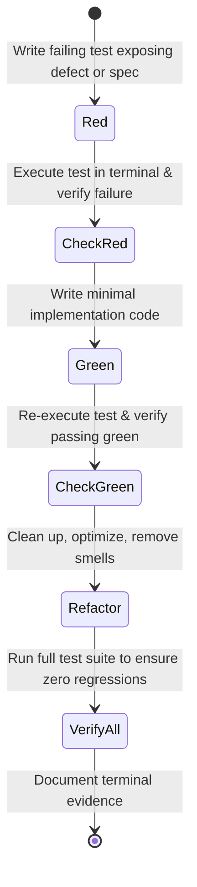

# Operza Testing Strategy & Quality Verification

This document specifies the testing methodology, test hierarchy, execution commands, and verification criteria for Operza.

---

## 1. Core Testing Philosophy: Test-Driven Development (TDD)

All behavioral modifications, new capabilities, and defect resolutions in Operza must strictly follow the **RED -> GREEN -> REFACTOR** lifecycle:



### Test Integrity Rules
1. **Never alter or delete tests merely to make a failing build pass.** If a test fails, either fix the implementation or gain explicit approval for a specification change.
2. **Never report a test as passed without running it.** Inspect the actual terminal output and exit code.
3. **Tests must be hermetic and deterministic.** No flakiness, no dependency on external network calls.

---

## 2. Test Pyramid & Execution Tiers

### Tier 1: Fast Hermetic Unit Tests (Sub-second execution)
- **Scope:** Pure functions, graph validators, Zod schemas, state machine transitions, domain calculation algorithms.
- **Tools:** Node test runner (`node --test`), Vitest.
- **Command:** `npm run test:unit`

### Tier 2: Database & Domain Integration Tests (Hermetic in-memory PostgreSQL)
- **Scope:** PostgreSQL queries, schema migrations, Row-Level Security (RLS) enforcement, transaction rollbacks.
- **Tools:** `@electric-sql/pglite` (runs real PostgreSQL compiled to WASM in-process; zero external database required).
- **Command:** `npm --workspace=@operza/db test`

### Tier 3: API & Workflow Integration Tests
- **Scope:** Fastify HTTP route handlers, request validation, tenant resolution middleware, workflow step execution, durable approval tokens.
- **Command:** `npm run test:platform`

### Tier 4: Browser & Frontend QA (Real Browser Verification)
- **Scope:** React component rendering, interactive visual flows, form submissions, console error inspection.
- **Tools:** Chrome DevTools MCP, Playwright.
- **Command:** `npm --workspace=@operza/web run build && npm run test:e2e`

### Tier 5: Security & Vulnerability Audits
- **Scope:** Sandboxed vulnerability scanning, SSRF protection, credential leakage, tenant boundary verification.
- **Tools:** `security-audit` skill (Cloudflare).
- **Execution:** Read-only analysis with isolated local scratch verification.

---

## 3. Verified Repository Test Commands

The following commands are defined in `package.json` and verified against the current monorepo structure:

| Test Target | Exact Command Line | Primary Scope | Expected Behavior |
|---|---|---|---|
| **Full Monorepo Suite** | `npm test` | All packages + SEO + E2E | Runs workflow-engine, platform-core, db, SEO audit, and E2E |
| **Unit Test Fast Suite** | `npm run test:unit` | Core packages | Fast feedback loop for local development |
| **Platform & DB Suite** | `npm run test:platform` | `packages/platform-core`, `packages/db` | Validates models, auth, and database contracts |
| **Workflow Engine** | `npm --workspace=@operza/workflow-engine test` | `packages/workflow-engine` | Graph compiler, node validation, execution runner |
| **Frontend Typecheck** | `npm run typecheck` | `apps/web` | TypeScript compiler type safety check |
| **Frontend Production Build** | `npm run build` | `apps/web` | Vite production bundle compilation |
| **SEO Audit** | `npm run test:seo` | `scripts/seo-audit` | Audits meta tags, robots, sitemaps, structured data |
| **E2E Integration** | `npm run test:e2e` | `scripts/test-e2e.mjs` | Verifies end-to-end API and server health |

---

## 4. Evidence-Based Verification Standard

Every pull request or task completion report must include an **Evidence Block** structured as follows:

```markdown
### Verification Evidence
- **Command Executed:** `npm run test:unit`
- **Working Directory:** `C:\Users\Muhammad Asim\.gemini\antigravity\scratch\operza`
- **Exit Code:** `0`
- **Terminal Output Summary:**
  ```text
  ✔ workflow-engine > graph compiler validates linear DAG (12ms)
  ✔ workflow-engine > detects circular loops (4ms)
  ✔ platform-core > enforces tenant boundary on contact query (45ms)
  ✔ db > rejects query lacking location context (32ms)
  All 18 tests passed.
  ```
- **What Was Not Tested:** Browser visual rendering on mobile breakpoints (scheduled for Tier 4).
- **Security Implications:** Verified tenant isolation; no RLS bypass detected.
- **Merge Safety:** Safe to merge into feature branch.
```
