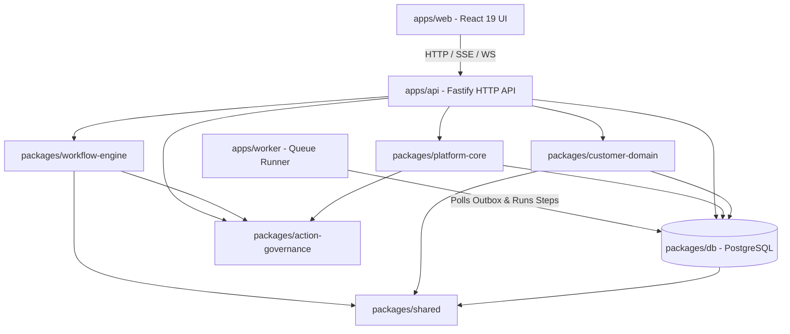

# Deliverable 7: API Architecture & Package Dependency Map

**Auditor:** Principal Software Architect & Technical Director  
**Scope:** Monorepo package dependency graph, external libraries, and Fastify decomposition blueprint for `apps/api`.  
**Applied Methodology:** Matt Pocock (`codebase-design`), Addy Osmani (`api-and-interface-design`), Superpowers (`writing-plans`)

---

## 1. Monorepo Package Dependency Topology



### Monorepo Dependency Rules
1. **Unidirectional Flow:** Applications (`apps/*`) depend on packages (`packages/*`). Packages **never** depend on applications.
2. **Zero Circular Dependencies:** Packages must not import from each other cyclically. Common types and interfaces reside in `packages/shared`.
3. **Deep Module Encapsulation:** External callers import exclusively from the package entrypoint (`index.mjs` / `index.ts`). Private helpers in `src/internal/` must not be referenced across package boundaries.

---

## 2. Blueprint for Decomposing `apps/api/server.mjs`

The current 8,670-line monolithic `apps/api/server.mjs` will be decomposed into modular **Fastify Route Plugins**. Fastify provides high-throughput async routing, native JSON schema validation, automatic OpenAPI/Swagger generation, and clean encapsulated plugin scopes.

```text
apps/api/
├── package.json
├── server.mjs                           # Bootstrapper (~120 lines): registers plugins, sets error handlers
├── plugins/
│   ├── authenticate.mjs                 # Session token & API key authentication decorator
│   ├── tenant-context.mjs               # Sets agency_id & location_id; configures PostgreSQL RLS
│   ├── csrf-protection.mjs              # Double-submit cookie CSRF validation
│   ├── rate-limiter.mjs                 # IP & tenant-based leaky bucket rate limiting
│   └── error-handler.mjs                # Scrubbed JSON error response formatter
│
└── routes/
    ├── auth/                            # /api/auth (login, signup, session, logout)
    │   ├── index.mjs
    │   └── schemas.mjs
    ├── crm/                             # /api/crm (contacts, custom-fields, pipelines, opportunities)
    │   ├── contacts.mjs
    │   ├── pipelines.mjs
    │   └── views.mjs
    ├── workflows/                       # /api/workflows (definitions, runner, runs, approval resume)
    │   ├── definitions.mjs
    │   └── executions.mjs
    ├── copilot/                         # /api/copilot (chat/stream, proposals, agent delegation)
    │   ├── chat-stream.mjs
    │   └── proposals.mjs
    ├── calendars/                       # /api/calendars & /api/appointments
    │   └── booking.mjs
    ├── payments/                        # /api/payments (links, checkout, invoices)
    │   └── checkout.mjs
    ├── webhooks/                        # /api/webhooks (Twilio, Stripe, Zapier, Meta)
    │   ├── twilio.mjs
    │   ├── stripe.mjs
    │   └── zapier.mjs
    ├── agency/                          # /api/agency (locations, sub-accounts, snapshots)
    │   ├── locations.mjs
    │   └── snapshots.mjs
    └── system/                          # /health, /ready, /metrics, /robots.txt, /sitemap.xml
        └── telemetry.mjs
```

### Route Plugin Contract Example
```javascript
// apps/api/routes/crm/contacts.mjs
import { contactInputSchema, contactQuerySchema } from './schemas.mjs';

export default async function contactsRoutes(fastify, options) {
  fastify.get('/api/crm/contacts', {
    schema: { querystring: contactQuerySchema },
    preHandler: [fastify.authenticate, fastify.requireLocationContext],
    handler: async (request, reply) => {
      const { agencyId, locationId } = request.tenant;
      const contacts = await fastify.customerDomain.listContacts({
        agencyId,
        locationId,
        query: request.query
      });
      return reply.code(200).send({ data: contacts });
    }
  });
}
```

---

## 3. Package Interface Contracts

### A. `apps/api` <-> `packages/customer-domain`
- **Method:** In-process TypeScript / ESM module calls.
- **Contract:** Domain methods (`createContact`, `updateContact`, `mergeRecords`) accept validated input objects and explicit tenant contexts. They throw structured domain errors (`DuplicateContactError`, `InvalidCustomFieldError`).
- **Isolation:** The HTTP layer is responsible solely for translating HTTP request parameters into domain inputs and mapping domain errors to HTTP status codes (`400`, `404`, `409`).

### B. `apps/api` <-> `packages/workflow-engine`
- **Contract:** 
  - `validateWorkflowGraph(graphDefinition): ValidationResult`
  - `startExecution({ workflowId, tenantContext, triggerPayload, idempotencyKey }): ExecutionHandle`
  - `resolveApproval({ approvalToken, decision, actorUserId }): ResumeResult`
- **Isolation:** The workflow engine does not handle HTTP requests directly; it executes execution state transitions and returns deterministic receipts.

### C. `apps/worker` <-> `packages/db`
- **Contract:** Transactional outbox pattern using `packages/db/lib/outbox-repository.mjs`:
  - `claimJobs({ workerId, batchSize, leaseDurationMs }): JobBatch`
  - `acknowledgeJob({ jobId, workerId, resultPayload }): void`
  - `failJob({ jobId, workerId, error, retryDelayMs }): void`
- **Isolation:** Workers operate in an autonomous loop; tasks are distributed via row locking (`FOR UPDATE SKIP LOCKED`) in PostgreSQL, eliminating worker collision.

---

## 4. Third-Party Dependencies Audit

### `apps/web`
- **React 19 & React DOM 19:** Stable, modern React. Full support for Server Actions, Suspense streaming, and modern hooks.
- **Vite 5.4:** Extremely fast HMR and optimized production rollup builds.
- **Lucide React:** Lightweight, tree-shakeable SVG icons.
- **Tailwind CSS 3.4:** Zero runtime CSS overhead.
- **Audit Result:** Clean, modern, zero high-risk vulnerabilities.

### `apps/api` & `packages/*`
- **`pg` (8.13.1):** Standard, mature PostgreSQL client with connection pooling.
- **`@electric-sql/pglite` (0.2.14):** In-memory PostgreSQL compiled to WASM. Enables hermetic testing with 100% real PostgreSQL behavior.
- **`ws` (8.18.0):** High-performance WebSocket server attached to HTTP ingress.
- **No Heavy Framework Bloat:** Monorepo avoids heavy runtime dependencies like Express, Prisma, or TypeORM, keeping bundle sizes minimal and boot times sub-second.
