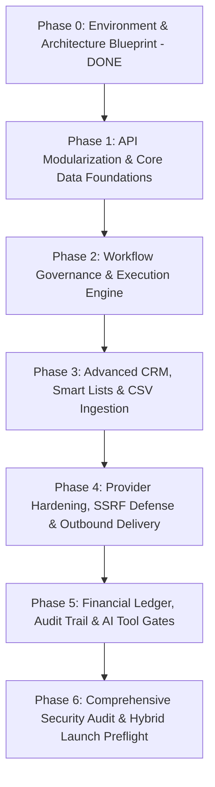

# Deliverable 14: Atlas to Operza Capability Convergence Roadmap (Phases 1–6)

**Auditor:** Principal Software Architect & Technical Director  
**Strategy:** Phased, test-driven, incremental capability migration without monolithic pull requests or breaking changes.  
**Applied Methodology:** Superpowers (`writing-plans`, `subagent-driven-development`), Addy Osmani (`deprecation-and-migration`, `api-and-interface-design`), Matt Pocock (`codebase-design`)

---

## Master Roadmap Overview

---

## Detailed Phase Execution Specifications

### Phase 1: API Modularization & Core Data Foundations
- **Objective:** Decompose the 8,670-line monolithic `apps/api/server.mjs` into modular Fastify route plugins, formalize CRM tables, and enforce PostgreSQL RLS across all core tables.
- **Current Problem:** `server.mjs` is an unstable monolith; initial tables in `001_agency_tenant_core.sql` lack forced RLS directives.
- **Target State:** Modular Fastify server with route plugins in `apps/api/routes/`; migration `011_platform_reconciliation.sql` applied with 100% forced RLS.
- **Atlas Sources:** Modular route structure in `Atlas/apps/api/*-routes.mjs`.
- **Operza Destinations:** `apps/api/routes/`, `packages/db/migrations/011_platform_reconciliation.sql`.
- **Tasks:**
  1. Add Fastify to `apps/api/package.json`.
  2. Implement Fastify plugins for session auth, tenant context setting, and CSRF protection.
  3. Extract routes into modular plugins (`routes/auth/`, `routes/crm/`, `routes/agency/`).
  4. Write migration `011_platform_reconciliation.sql` to enforce RLS on `agencies`, `users`, and `agency_memberships`.
  5. Formalize `pipelines`, `pipeline_stages`, `opportunities`, and `appointments` tables.
- **Tests & Acceptance Criteria:**
  - `npm run test:platform` passes with zero regressions.
  - `npm run test:e2e` (all 116 tests) passes against the decomposed Fastify API.
  - Multi-tenant isolation test asserts 0 rows returned for cross-tenant queries.
- **Rollback Strategy:** Preserve legacy `server.mjs` as a fallback during staged route cutover.

---

### Phase 2: Workflow Governance & Automation Engine Consolidation
- **Objective:** Port Atlas typed action schemas, sandboxed AST expression engine, and advanced node runtime into Operza's workflow engine.
- **Current Problem:** Operza workflow engine uses ad-hoc regex variable substitution, lacks complex data nodes (`loop`, `split`, `merge`), and does not pin workflow graph versions with hashes.
- **Target State:** Hardened workflow engine with ReDoS-safe JSON schemas, safe AST variable resolution, and n8n-grade data manipulation nodes.
- **Atlas Sources:**
  - `packages/atlas-action-fabric` (`schema.mjs`, `index.mjs`)
  - `packages/atlas-core/expression-engine.mjs`
  - `packages/atlas-automation-fabric/node-runtime.mjs`
- **Operza Destinations:**
  - `packages/action-governance/`
  - `packages/workflow-engine/src/expression-engine.mjs`
  - `packages/workflow-engine/src/nodes/`
  - `packages/db/migrations/012_durable_workflow_leases.sql`
- **Tasks:**
  1. Port `atlas-action-fabric` into `packages/action-governance` with full unit test suite.
  2. Integrate `expression-engine.mjs` into `workflow-engine` variable resolver.
  3. Register advanced node types (`loop_over_items`, `split_out`, `merge`, `filter`).
  4. Apply migration `012` to add `definition_hash` and worker lease columns.
- **Tests & Acceptance Criteria:**
  - Unit tests verify looping over 500 items in batches, 3-way array merges, and ReDoS pattern rejection.
  - Workflow execution graph hash pins execution version.
- **Rollback Strategy:** Feature-flag new node kinds; fall back to legacy variable resolver if needed.

---

### Phase 3: Advanced CRM, Smart Lists & CSV Ingestion
- **Objective:** Port Atlas in-memory SQL saved views store, duplicate detection, and streaming CSV import.
- **Current Problem:** Operza smart lists run in-memory; contact deduplication is rudimentary.
- **Target State:** Durable SQL-backed saved views in PostgreSQL; bulk CSV import capable of processing 10,000+ rows; human-approved contact merges.
- **Atlas Sources:**
  - `packages/atlas-customer-lifecycle` (`postgres-views-store.mjs`, `csv-transfer.mjs`, `import-executor.mjs`)
  - `apps/api/crm-duplicates-routes.mjs`
- **Operza Destinations:**
  - `packages/customer-domain/`
  - `apps/api/routes/crm/views.mjs` & `duplicates.mjs`
- **Tasks:**
  1. Adapt `postgres-views-store.mjs` to Operza `(agency_id, location_id)` schema.
  2. Port streaming CSV parser and import pipeline with deduplication checks.
  3. Connect `apps/web/src/pages/SmartLists.tsx` to the durable SQL views API.
- **Tests & Acceptance Criteria:**
  - PGlite integration tests verify complex multi-condition SQL filters (`tags contains VIP AND balance > 100`).
  - 10,000-row CSV import completes in <5s with zero memory leaks.

---

### Phase 4: Provider Hardening, SSRF Defense & Outbound Delivery
- **Objective:** Implement DNS pre-pinning SSRF protection and deterministic idempotency headers for outbound requests.
- **Current Problem:** Webhook nodes could be vulnerable to DNS rebinding attacks targeting cloud metadata.
- **Target State:** Hardened outbound HTTP client verifying DNS resolution against private CIDR blocks prior to socket connection.
- **Atlas Sources:** `packages/atlas-trust/`, `atlas-action-fabric` request signing.
- **Operza Destinations:** `packages/platform-core/src/provider-adapters.mjs`, `packages/workflow-engine/src/action-governance.mjs`.
- **Tasks:**
  1. Implement DNS pre-pinning socket wrapper.
  2. Blacklist all private IP ranges (`10.0.0.0/8`, `172.16.0.0/12`, `192.168.0.0/16`, `127.0.0.0/8`, `169.254.169.254`).
  3. Inject deterministic `Idempotency-Key` headers on all outbound provider dispatches.
- **Tests & Acceptance Criteria:**
  - Outbound requests to `http://169.254.169.254/` or rebinding domains are terminated before connection.
  - External retry dispatches send identical idempotency keys.

---

### Phase 5: Financial Ledger, Audit Trail & AI Tool Gates
- **Objective:** Port Atlas double-entry accounting ledger and create immutable operational audit logs.
- **Current Problem:** In-memory plan usage arrays; audit logs lack immutable database constraints.
- **Target State:** Tamper-proof `billing_ledger` and `audit_events` tables with SHA-256 checksums and forced RLS.
- **Atlas Sources:** `packages/atlas-transactional-os` (`index.mjs`), `atlas-trust`.
- **Operza Destinations:** `packages/platform-core/src/billing-ledger.mjs`, `packages/db/migrations/013` & `014`.
- **Tasks:**
  1. Apply migration `013_transactional_billing_ledger.sql` and `014_immutable_audit_events.sql`.
  2. Implement double-entry credit grant and usage debit routines.
  3. Bind AI Copilot tool invocations to location credit balances.
- **Tests & Acceptance Criteria:**
  - Credit debits and grants balance to zero in ledger; checksum verification detects tampered rows.
  - Audit log table rejects `UPDATE` and `DELETE` SQL queries.

---

### Phase 6: Comprehensive Security Audit & Hybrid Launch Preflight
- **Objective:** Execute full Cloudflare `security-audit` methodology and prepare container preflight for hybrid deployment.
- **Target State:** Zero high/critical security findings; verified Docker container build; ready for staging deployment.
- **Tasks:**
  1. Run full Cloudflare security audit across all packages and endpoints.
  2. Build and verify production Docker images for `apps/web`, `apps/api`, and `apps/worker`.
  3. Validate Cloudflare Pages + R2 object storage integration.
  4. Final executive launch sign-off.
