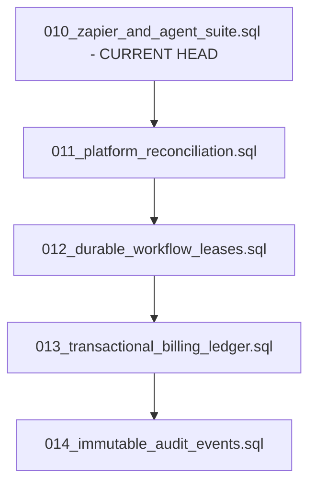

# Deliverable 6: Forward-Only Database Migration Strategy

**Auditor:** Principal Software Architect & Technical Director  
**Scope:** Canonical migration lifecycle, RLS enforcement, privilege separation, and hermetic PGlite verification.  
**Applied Methodology:** Addy Osmani (`deprecation-and-migration`, `api-and-interface-design`), Cloudflare (`security-audit`)

---

## 1. Governance Rules for Database Migrations

1. **One Migration History:** All migrations reside exclusively in Operza at [`packages/db/migrations/`](file:///C:/Users/Muhammad%20Asim/.gemini/antigravity/scratch/operza/packages/db/migrations/).
2. **Frozen Historical Migrations:** Migrations `001` through `010` are permanently frozen. Never edit, reorder, or delete an already-applied migration.
3. **No Wholesale Migration Copying:** Never copy Atlas SQL files wholesale. Extract DDL patterns and translate them into Operza's canonical `(agency_id, location_id)` schema.
4. **Forward-Only Idempotence:** All future migrations must be forward-only, idempotent (`CREATE TABLE IF NOT EXISTS`, `ADD COLUMN IF NOT EXISTS`), and accompany a safe downgrade script.
5. **No Schema Changes During Phase 0:** No SQL migrations will be applied during Phase 0.

---

## 2. Planned Migration Sequence (Phase 1 Execution Blueprint)



### Migration `011_platform_reconciliation.sql`
- **Objective:** Formalize core CRM tables and enforce RLS across all historical tables.
- **DDL Actions:**
  1. `ALTER TABLE agencies ENABLE ROW LEVEL SECURITY; ALTER TABLE agencies FORCE ROW LEVEL SECURITY;`
  2. `ALTER TABLE users ENABLE ROW LEVEL SECURITY; ALTER TABLE users FORCE ROW LEVEL SECURITY;`
  3. `ALTER TABLE agency_memberships ENABLE ROW LEVEL SECURITY; ALTER TABLE agency_memberships FORCE ROW LEVEL SECURITY;`
  4. Create `pipelines` and `pipeline_stages` tables bound to `(agency_id, location_id)`.
  5. Create `opportunities` table with stage foreign key and RLS.
  6. Create `calendars` and `appointments` tables with Google OAuth token refs and RLS.
  7. Add compound indexes on `contacts(agency_id, location_id, email)` and `contacts(agency_id, location_id, phone)`.

### Migration `012_durable_workflow_leases.sql`
- **Objective:** Elevate workflow executions to enterprise durability.
- **DDL Actions:**
  1. Add `definition_hash CHAR(64)` to `workflow_definitions` to guarantee version pinning.
  2. Add `worker_lease_id UUID`, `lease_expires_at TIMESTAMPTZ`, and `attempt_count INTEGER DEFAULT 0` to `workflow_executions`.
  3. Create index `idx_workflow_executions_lease ON workflow_executions(status, lease_expires_at) WHERE status IN ('running', 'resuming');`.

### Migration `013_transactional_billing_ledger.sql`
- **Objective:** Port Atlas double-entry accounting engine for tamper-proof credit metering.
- **DDL Actions:**
  1. Create `billing_ledger` table:
     ```sql
     CREATE TABLE IF NOT EXISTS billing_ledger (
       id uuid PRIMARY KEY DEFAULT gen_random_uuid(),
       agency_id uuid NOT NULL REFERENCES agencies(id) ON DELETE CASCADE,
       location_id uuid NOT NULL,
       entry_type text NOT NULL CHECK (entry_type IN ('credit_grant', 'usage_debit', 'refund', 'adjustment')),
       amount numeric(16, 4) NOT NULL,
       balance_after numeric(16, 4) NOT NULL,
       metric text NOT NULL,
       source_ref text NOT NULL,
       idempotency_key text NOT NULL UNIQUE,
       checksum char(64) NOT NULL,
       created_at timestamptz NOT NULL DEFAULT now()
     );
     ALTER TABLE billing_ledger ENABLE ROW LEVEL SECURITY;
     ALTER TABLE billing_ledger FORCE ROW LEVEL SECURITY;
     ```

### Migration `014_immutable_audit_events.sql`
- **Objective:** Create tamper-proof operational audit trail.
- **DDL Actions:**
  1. Create `audit_events` table with immutable insert-only rule (rejects `UPDATE` and `DELETE`).

---

## 3. PostgreSQL Row-Level Security (RLS) Architecture

### Session Context Setting
Before executing any tenant query, backend connection poolers must invoke:
```sql
SELECT set_config('operza.current_agency_id', $1, true);
SELECT set_config('operza.current_location_id', $2, true);
SELECT set_config('operza.current_user_id', $3, true);
```
*Note: Setting `is_local = true` ensures parameters are scoped strictly to the current transaction and are automatically cleared when the connection is returned to the pool.*

### Standard Tenant Isolation Policy Pattern
```sql
CREATE POLICY tenant_isolation_policy ON target_table
  FOR ALL
  USING (
    agency_id = NULLIF(current_setting('operza.current_agency_id', true), '')::uuid
    AND (
      location_id IS NULL OR 
      location_id = NULLIF(current_setting('operza.current_location_id', true), '')::uuid
    )
  );
```

### Fail-Closed Defense
If `operza.current_agency_id` is null or empty string, `NULLIF()` evaluates to `NULL`. The comparison `agency_id = NULL` evaluates to `UNKNOWN` in SQL 3-valued logic, which PostgreSQL RLS treats as `FALSE`. Thus, zero records are returned, preventing data leakage.

---

## 4. Database Privilege Separation

| Database Role | Permitted Privileges | Restricted Actions |
|---|---|---|
| **`operza_migrator`** | `CREATE`, `ALTER`, `DROP`, `INDEX`, `TRIGGER` | Used exclusively by migration runner during deploy |
| **`operza_api`** | `SELECT`, `INSERT`, `UPDATE`, `DELETE` (Subject to RLS) | Cannot drop tables, alter schemas, or bypass RLS |
| **`operza_worker`** | `SELECT`, `UPDATE` on outbox & executions; `INSERT` on ledger | Cannot alter schemas or access unassigned tenant rows |

*Security Rule:* Neither `operza_api` nor `operza_worker` shall ever possess `BYPASSRLS` or superuser attributes.

---

## 5. Hermetic Verification via PGlite

To ensure migrations are 100% reliable across local developer machines and CI/CD pipelines without requiring a local Docker daemon:
- Operza uses `@electric-sql/pglite` (real PostgreSQL compiled to WebAssembly).
- In `packages/db/test/platform-repository.test.mjs`, a fresh PGlite instance boots in ~50ms.
- All migrations (`001` through `010`) are applied sequentially in-memory.
- Test suites execute real SQL queries, verify foreign key cascades, and validate that cross-tenant queries fail closed under RLS.
- This hermetic verification guarantees that migration syntax errors are caught in unit tests before reaching staging environments.
