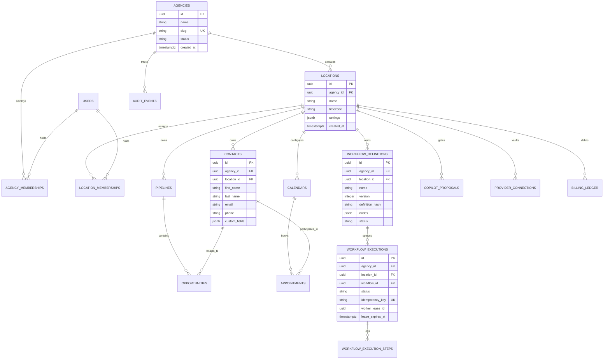

# Deliverable 5: Domain Model Reconciliation & Entity Mapping

**Auditor:** Principal Software Architect & Technical Director  
**Scope:** Definitive reconciliation of domain entities, schemas, foreign keys, and Row-Level Security between Operza and Atlas.  
**Applied Methodology:** Matt Pocock (`domain-modeling`), Addy Osmani (`api-and-interface-design`), Cloudflare (`security-audit`)

---

## 1. Canonical Tenancy & Identity Principles

The canonical business identity for Operza is the **Agency / Location hierarchy**:
- **Agency (`agencies`):** The top-level administrative tenant representing a digital agency, marketing firm, or enterprise organization. Owns billing, subscription tiers, team members, snapshots, and global settings.
- **Location (`locations`):** A client workspace, sub-account, branch, or brand operated under an Agency. Owns contacts, CRM pipelines, visual workflows, phone numbers, calendars, forms, and conversations.
- **User (`users`):** A human operator with email credentials. Can belong to multiple agencies via `agency_memberships` and multiple locations via `location_memberships`.

**Abolition of Atlas Organization Model:** Atlas introduced `atlas_organizations` and flat `tenant_id TEXT` columns in its V112 migrations. This model is **completely rejected**. All migrated entities from Atlas will be refactored to bind strictly to Operza's composite foreign key `(agency_id, location_id)`.

---

## 2. Definitive Entity Reconciliation Matrix

| Business Concept | Operza Implementation | Atlas Implementation | Reconciliation Decision | Required Schema Adjustments |
|---|---|---|---|---|
| **Top-Level Tenant** | `agencies` (UUID primary key) | `atlas_organizations` (Text PK) | **Operza Canonical** | Retain `agencies`. Discard `atlas_organizations`. All migrated capabilities reference `agency_id UUID`. |
| **Workspace / Sub-Account** | `locations` (Composite PK: `agency_id, id`) | `atlas_freelancer_workspaces` (Text PK) | **Operza Canonical** | Retain `locations`. Discard Atlas workspaces. |
| **User Identity** | `users` (`001_agency_tenant_core.sql`) | `atlas_auth_users` (`V112`) | **Operza Canonical** | Retain Operza `users`. Adopt Atlas password hashing bounds and session timeout rules. |
| **Memberships & Roles** | `agency_memberships` (owner, admin, member, viewer) | `atlas_organization_memberships` | **Operza Canonical** | Retain Operza roles. Add fine-grained permission flags from Atlas as an optional JSONB column `permissions`. |
| **Contacts (CRM)** | `contacts` (in-memory & `packages/db`) | `atlas_crm_records` (`V102`) | **Operza Canonical** | Retain Operza contact fields (first/last name, email, phone, tags, custom_fields); adopt Atlas deduplication indexing. |
| **Pipelines & Deals** | `opportunities` (in-memory & `apps/api`) | `atlas_crm_pipelines`, `atlas_crm_associations` | **MERGE** | Formalize SQL schema for `pipelines` and `opportunities` with forced RLS in Operza migration `011`. |
| **Appointments & Calendars** | `calendars`, `appointments` (`apps/api:4200`) | `atlas_booking_calendars`, `atlas_appointments` | **Operza Canonical** | Operza implementation is mature and handles Google Calendar 2-way OAuth sync. Formalize PostgreSQL table in `011`. |
| **Visual Workflow Graph** | `workflow_definitions` (`003_workflow_executions.sql`) | `atlas_workflow_graph_releases` (`V102`) | **Operza Canonical** | Retain Operza graph schema; adopt Atlas definition checksum hashing (`SHA-256`) to pin graph versions. |
| **Workflow Executions** | `workflow_executions` (`003_workflow_executions.sql`) | `atlas_workflow_executions` (`V102`) | **MERGE** | Keep Operza execution table; adopt Atlas lease columns (`worker_lease_id`, `lease_expires_at`, `idempotency_key`). |
| **Workflow Step History** | `workflow_execution_steps` (`003` & `007`) | `atlas_workflow_execution_steps` (`V102`) | **Operza Canonical** | Operza already supports `simulated` status alongside `running`, `completed`, `failed`, `waiting_approval`. |
| **Action Registry & Governance** | `packages/workflow-engine/src/action-governance.mjs` | `packages/atlas-action-fabric` | **ADOPT (Atlas)** | Adopt Atlas typed schema registry and risk tiers (`read`, `write`, `external_side_effect`, `financial`, `privileged`). |
| **Human Approval Gates** | `copilot_proposals` (`009`) & `approval-lifecycle.mjs` | `atlas_spend_decisions`, `atlas_release_gates` | **Operza Canonical** | Operza `copilot_proposals` with forced RLS is the single source of truth for human approvals. |
| **Provider Connections** | `provider_connections` (`008_platform_foundation.sql`) | `atlas_provider_connections`, `atlas_connector_grants` | **Operza Canonical** | Operza provider lifecycle (`pending_verification`, `verified`, `degraded`, `revoked`) and secret vaulting are canonical. |
| **Transactional Ledger** | `usage_events`, `plan_entitlements` (`008`) | `atlas_billing_ledger` (`V103`) | **ADOPT (Atlas)** | Introduce `billing_ledger` in Operza migration `011` for double-entry credit balance accounting. |
| **Audit Logs** | In-memory audit array in `apps/api/data/store.json` | `atlas_security_events`, `atlas_auth_audit_events` | **ADOPT (Atlas)** | Create durable `audit_events` table in Operza with immutable append-only constraints and RLS. |

---

## 3. Entity Relationship Diagram (Canonical Target)

---

## 4. Database Schema Deficiencies & Remediation Plan

### A. Missing Forced RLS in Initial Core Tables
- **Finding:** In `001_agency_tenant_core.sql`, `agencies`, `users`, and `agency_memberships` were created without explicit `ALTER TABLE ... ENABLE ROW LEVEL SECURITY`.
- **Remediation:** Migration `011_platform_reconciliation.sql` will explicitly enforce RLS on all pre-existing tables.

### B. Incomplete Pipeline and Opportunity Tables
- **Finding:** `apps/web` has rich UI for Pipelines, Opportunities, and Calendars, but `packages/db` currently relies on JSON file mode or in-memory arrays for these entities.
- **Remediation:** Create formal PostgreSQL tables `pipelines`, `pipeline_stages`, `opportunities`, `calendars`, and `appointments` with composite tenant foreign keys `(agency_id, location_id)`.

### C. Missing Indexes for High-Velocity Queries
- **Finding:** Workflow execution lookups by `(agency_id, location_id, status, created_at DESC)` and contact lookups by `email` and `phone` require compound indexes.
- **Remediation:** Add compound B-tree indexes in migration `011`.
