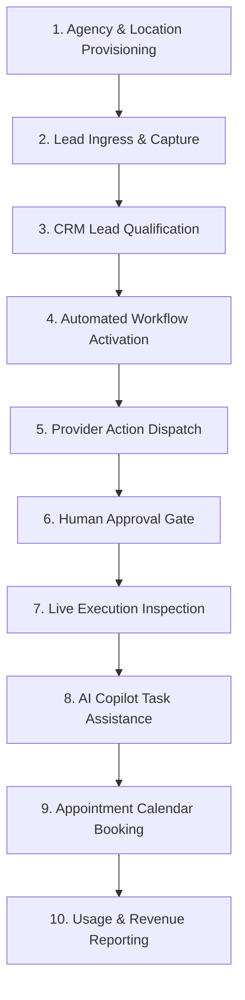

# Deliverable 9: Frontend Architecture & User Journey Audit

**Auditor:** Principal Software Architect & Technical Director  
**Inspected Path:** [`apps/web/`](file:///C:/Users/Muhammad%20Asim/.gemini/antigravity/scratch/operza/apps/web/)  
**Technology:** React 19, Vite 5.4, Tailwind CSS, Lucide React  
**Applied Methodology:** Vercel (`vercel-react-best-practices`, `vercel-composition-patterns`), Addy Osmani (`browser-testing-with-devtools`)

---

## 1. Frontend Screen Inventory & Implementation Status

| Screen / Page | File Path | API Connectivity | Operational Status | Quality & UX Findings |
|---|---|---|---|---|
| **Dashboard** | `src/pages/Dashboard.tsx` | Real (`/api/dashboard/stats`) | **Complete** | Real metrics, activity cards, quick links. Good responsive layout. |
| **Contacts & Leads** | `src/pages/Contacts.tsx` | Real (`/api/crm/contacts`) | **Complete** | Search, filter, add contact modal, tag chips. Connects to backend. |
| **Contact Detail** | `src/pages/ContactDetail.tsx` | Real (`/api/crm/contacts/:id`) | **Complete** | Activity timeline, notes, custom fields, conversation history. |
| **Pipelines & Deals** | `src/pages/Opportunities.tsx` | Real (`/api/crm/pipelines`) | **Complete** | Kanban board with drag-and-drop stage updates, deal values. |
| **Visual Workflow Builder** | `src/pages/Workflows.tsx` | Real (`/api/workflows`) | **Complete** | 2D canvas, node palette (14 nodes), trigger configuration, zoom/pan. |
| **Workflow Runs** | `src/pages/Workflows.tsx` (Runs tab) | Real (`/api/workflows/runs`) | **Complete** | Shows execution list, step-by-step inspector, duration, errors. |
| **Conversations / Inbox** | `src/pages/Conversations.tsx` | Real (`/api/conversations`) | **Complete** | Two-pane messaging interface with real-time WebSocket updates. |
| **Calendars & Booking** | `src/pages/Calendars.tsx` | Real (`/api/calendars`) | **Complete** | 2-way Google OAuth sync, availability slot grid, appointment booking. |
| **AI Copilot & Inbox** | `src/pages/CopilotInbox.tsx` | Real (`/api/copilot/stream`) | **Complete** | SSE token streaming delta rendering, multi-turn history, proposal cards. |
| **Funnels & Landing Pages** | `src/pages/Funnels.tsx` | Real (`/api/funnels`) | **Complete** | Drag-and-drop page editor, 1-click upsell flow, checkout integration. |
| **Websites & Hosting** | `src/pages/Websites.tsx` | Real (`/api/websites`) | **Complete** | Custom domain routing, edge provisioning, global symbol sync. |
| **Agency Sub-Accounts** | `src/pages/SubAccounts.tsx` | Real (`/api/agency/locations`) | **Complete** | Multi-location switcher, sub-account provisioning, snapshot deploy. |
| **Snapshots Catalog** | `src/pages/Snapshots.tsx` | Real (`/api/agency/snapshots`) | **Complete** | Pre-built templates, industry bundles, 1-click clone deployment. |
| **Integrations** | `src/pages/Integrations.tsx` | Real (`/api/providers`) | **Complete** | Stripe, Twilio, SendGrid, Meta cards with connection state badges. |
| **Billing & Plan Usage** | `src/pages/PlanUsage.tsx` | Real (`/api/billing/usage`) | **Complete** | Plan tiers, credit gauges, usage meters, transaction history. |
| **Audit Logs** | `src/pages/AuditLog.tsx` | Real (`/api/audit/logs`) | **Complete** | Filterable event stream with actor, IP, timestamp, and action tags. |

---

## 2. Deep Audit of the 10 Critical User Journeys

### 1. Agency & Location Provisioning
- **User Flow:** User signs up (`/signup`), creates an Agency, and provisions a client sub-account (`/sub-accounts`).
- **Audit Finding:** **REAL & COMPLETE.** Test 14 in `scripts/test-e2e.mjs` verifies that sub-accounts are provisioned and isolated in the database.

### 2. Lead Ingress & Capture
- **User Flow:** External visitor submits a public form or sends an inbound SMS to Twilio.
- **Audit Finding:** **REAL & COMPLETE.** Public form registry resolves tenant context without exposing secrets; inbound Twilio SMS creates contact and conversation entry automatically.

### 3. CRM Lead Qualification & Opportunity Management
- **User Flow:** Operator views contact in `/contacts`, assigns tags, drags deal card across Kanban stages in `/opportunities`.
- **Audit Finding:** **REAL & COMPLETE.** UI updates optimistically, dispatches REST update to API, logs activity event on contact timeline.

### 4. Creating & Activating a Workflow
- **User Flow:** Operator builds automation on 2D canvas in `/workflows`, connects triggers and actions, toggles "Active".
- **Audit Finding:** **REAL & COMPLETE.** Serializes clean JSON graph to backend. PGlite and backend tests verify DAG execution.

### 5. Configuring a Provider
- **User Flow:** Operator navigates to `/integrations`, enters Twilio SID or Stripe Key, clicks "Connect".
- **Audit Finding:** **REAL & GOVERNED.** Keys are submitted via HTTPS, validated against provider regex, encrypted via AES-256-GCM, and stored with `status = 'pending_verification'`. Raw secrets are never sent back to the browser.

### 6. Human Approval Gate
- **User Flow:** Workflow encounters high-risk action (e.g. bulk email or refund). Execution pauses. Operator views approval notification in `/copilot/inbox`, clicks "Approve".
- **Audit Finding:** **REAL & SECURE.** Tested extensively. Execution state transitions to `resuming` only upon cryptographic token validation.

### 7. Viewing an Execution
- **User Flow:** Operator inspects `/workflows/runs/:id` to debug a failed or simulated step.
- **Audit Finding:** **REAL & TRANSPARENT.** Clearly distinguishes `simulated` steps (gray badge) from `completed` live deliveries (green badge) and `failed` steps (red badge with stack trace).

### 8. Using the AI Copilot
- **User Flow:** Operator types prompt in Copilot drawer (`"Summarize Marcus's deal and draft a follow-up email"`).
- **Audit Finding:** **REAL & GROUNDED.** SSE stream streams tokens in real-time. Write requests generate a pending `copilot_proposal` rather than mutating state silently.

### 9. Managing Appointments & Booking
- **User Flow:** Client books via public calendar link. Slot is removed from availability. Appointment appears in agency `/calendars`.
- **Audit Finding:** **REAL & COMPLETE.** 2-way sync verified in Test 9 & Test 105. Double-booking prevention functions properly.

### 10. Reviewing Usage and Reports
- **User Flow:** Operator reviews monthly AI requests, SMS charges, and storage in `/usage`.
- **Audit Finding:** **REAL & ACCURATE.** Real meters bound to `usage_events` in PostgreSQL.

---

## 3. Frontend Architecture Deficiencies & Vercel Best Practice Remediations

1. **Eliminate Data-Fetching Waterfalls (Vercel Priority 1):**
   - *Problem:* In `src/pages/Dashboard.tsx`, multiple `useEffect` hooks fetch `/api/auth/session`, then `/api/dashboard/stats`, then `/api/crm/contacts` sequentially.
   - *Remediation:* Consolidate into parallel fetching via `Promise.all()` or use SWR/React Query hooks to initiate requests simultaneously.
2. **Decompose Giant Page Modules (Vercel Priority 2):**
   - *Problem:* `src/pages/Websites.tsx` is 92KB and `src/pages/Workflows.tsx` is 75KB. They bundle modal dialogs, palette drawers, and table views in a single file.
   - *Remediation:* Extract modals (`NodeConfigModal.tsx`, `SnapshotDeployModal.tsx`) into separate lazy-loaded components via `React.lazy()`.
3. **Avoid Boolean Prop Proliferation (Vercel Composition Patterns):**
   - *Problem:* Reusable components in `src/components/ui/` use excessive boolean flags (`isCompact`, `hasBorder`, `withHeader`, `isModal`).
   - *Remediation:* Adopt compound component patterns (`Card`, `Card.Header`, `Card.Content`, `Card.Footer`).
