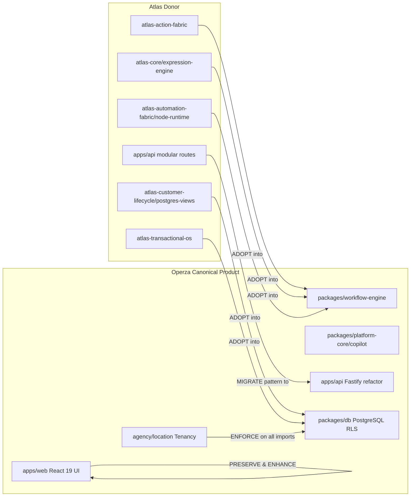

# Deliverable 4: Operza-Atlas Convergence Matrix & Cutover Strategy

**Auditor:** Principal Software Architect & Technical Director  
**Scope:** Actionable convergence decisions for every subsystem across Operza and Atlas.  
**Applied Methodology:** Superpowers (`using-superpowers`, `brainstorming`), Matt Pocock (`codebase-design`), Addy Osmani (`deprecation-and-migration`, `api-and-interface-design`)

---

## 1. Executive Convergence Principles

1. **One Product:** Operza is the sole application; Atlas is an engineering donor.
2. **One Architecture:** One database, one identity system, one workflow engine, one AI platform.
3. **Canonical Tenancy:** Operza's Agency/Location model (`agency_id` / `location_id`) is strictly enforced; Atlas `organization_id` is abolished.
4. **No Premature Deletion:** Operza functionality is replaced only after Atlas donor capabilities are adapted, integrated, and verified through regression tests.

---

## 2. Comprehensive Subsystem Convergence Matrix

---

### Detailed Subsystem Actions

| Subsystem | Donor Source (Atlas) | Canonical Target (Operza) | Action | Technical Justification | Risk & Rollback Strategy |
|---|---|---|---|---|---|
| **Action Registry & Schemas** | `packages/atlas-action-fabric` | `packages/action-governance` | **ADOPT** | Atlas schema validator provides ReDoS-safe regex validation, prototype pollution defense, and automated credential leakage detection. | Low risk. Implemented as a standalone package; workflow engine calls it as a validator. Rollback: revert validator wrapper. |
| **Workflow Expressions** | `packages/atlas-core/expression-engine.mjs` | `packages/workflow-engine/src/expression-engine.mjs` | **ADOPT** | Replaces brittle regex variable substitution with a sandboxed AST parser that prevents code injection and bounds computation. | Low risk. Pure function with zero dependencies. Rollback: fall back to existing template resolver. |
| **Complex Workflow Nodes** | `packages/atlas-automation-fabric/node-runtime.mjs` | `packages/workflow-engine/src/nodes/` | **ADOPT** | Adds n8n-grade data manipulation (`loop_over_items`, `split_out`, 3-way `merge`, `sort`, `filter`) without rewriting core engine. | Low risk. Nodes are registered as self-contained handlers in the node registry. |
| **API Server Architecture** | `Atlas/apps/api/*-routes.mjs` (modular pattern) | `Operza/apps/api/` (Fastify decomposition) | **REPLACE / MODULARIZE** | Operza's 8,670-line monolithic `server.mjs` is the single biggest architectural liability. Decomposing routes into Fastify modules dramatically improves maintainability. | Medium risk. Requires keeping exact REST contracts and headers. Rollback: preserve `server.mjs` as fallback during staged route migration. |
| **Saved Views & Smart Lists** | `packages/atlas-customer-lifecycle/postgres-views-store.mjs` | `packages/customer-domain/views-store.mjs` | **ADOPT** | Atlas provides a tested SQL filter compiler with PGlite integration, replacing Operza's in-memory smart list filtering. | Low risk. New API endpoint `/api/crm/views` introduced in parallel with legacy lists. |
| **Durable Worker Recovery** | `Atlas/apps/worker/workflow-executor.mjs` | `Operza/packages/platform-core/src/outbox-worker.mjs` | **MERGE** | Combine Operza's transactional outbox producer with Atlas's abandoned job lease recovery and exponential backoff retry mechanics. | Medium risk. Worker state machine must preserve exact execution statuses. Test with crash-recovery scenarios. |
| **Financial Ledger & Metering** | `packages/atlas-transactional-os` | `packages/platform-core/src/billing-ledger.mjs` | **ADOPT** | Provides double-entry ledger accounting with SHA-256 integrity checksums for agency credit consumption and billing tracking. | Low risk. Additive persistence model (`billing_ledger` table); does not alter existing subscriptions. |
| **Multi-Tenant Identity** | *None (Reject Atlas org model)* | `packages/db/migrations/001` (`agencies`, `locations`) | **KEEP (CANONICAL)** | Operza's agency/location hierarchy is the product's fundamental commercial architecture. Atlas's `organization_id` is eliminated. | Zero risk. Preserves Operza as the single source of truth. |
| **Visual Workflow Builder** | *None (Atlas has no UI)* | `apps/web/src/pages/Workflows.tsx` | **KEEP** | Operza's React 19 visual canvas is a primary competitive asset. Preserved completely. | Zero risk. |
| **AI Copilot & Agents** | `packages/atlas-copilot/` | `packages/platform-core/src/copilot/` & `multi-agent/` | **KEEP / IMPROVE** | Operza's Copilot has real SSE token streaming and a 10-agent domain team. Enhance with Atlas action permission schemas. | Low risk. Extends tool parameter definitions. |
| **Zapier Integration** | `Atlas/apps/api/event-ingress.mjs` | `apps/api/zapier-router.mjs` & `packages/db/migrations/010` | **KEEP** | Operza already has a production-ready Zapier Platform CLI integration with 14 triggers and 12 actions. | Zero risk. |
| **Twilio & Stripe Webhooks** | `Atlas/apps/api/inbox-webhooks.mjs` | `Operza/apps/api/server.mjs:3759` | **IMPROVE** | Move raw webhook handlers out of `server.mjs` into dedicated Fastify route plugins with HMAC signature validation. | Low risk. Validate webhook secrets against test payloads before deployment. |

---

## 3. Detailed Cutover & Deprecation Rules

Following the Addy Osmani `deprecation-and-migration` methodology:
1. **Expand-and-Contract:** When replacing an Operza backend mechanism (such as the in-memory smart list or the monolithic router), deploy the modular replacement alongside the existing handler.
2. **Dual-Run Verification:** Run regression suites against both old and new handlers to prove exact contract parity.
3. **Traffic Shift:** Switch caller endpoints (UI pages, external webhooks) to the new modular endpoints.
4. **Contract Retract:** Delete the deprecated legacy code path only after telemetry confirms zero traffic and test suites confirm zero callers.
