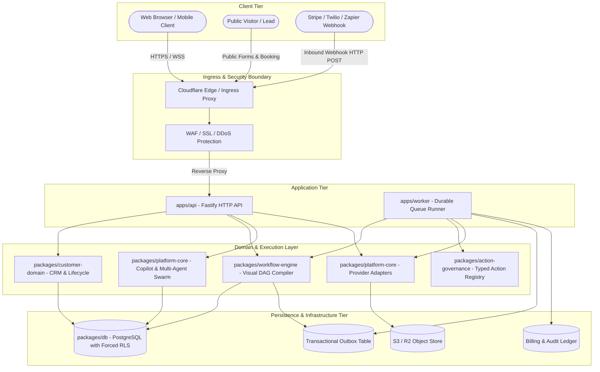
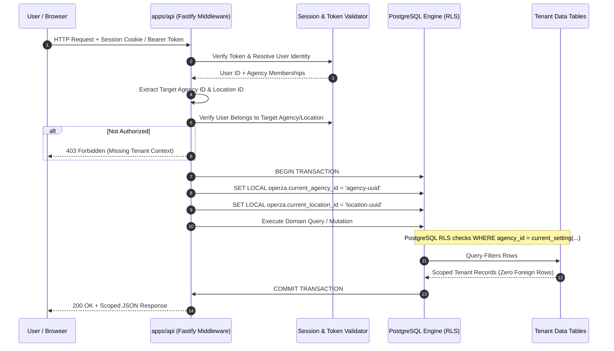

# Deliverable 13: Target Logical Architecture & Technical Blueprint

**Auditor:** Principal Software Architect & Technical Director  
**Scope:** Canonical system architecture, component communication, and security boundary enforcement.  
**Applied Methodology:** Matt Pocock (`codebase-design`), Superpowers (`writing-plans`), Cloudflare (`security-audit`)

---

## 1. Target Logical Architecture Blueprint

The consolidated architecture for **Operza Growth** unites Operza's rich React 19 visual portal and agency CRM with Atlas's typed action fabric, sandboxed expression engine, and durable worker mechanics into one coherent monorepo.

---

## 2. Subsystem Boundaries & Component Contracts

### A. Client Presentation Layer (`apps/web`)
- **Technology:** React 19, Vite, Tailwind CSS, Lucide React.
- **Responsibilities:**
  - Agency and location administrative portal (dashboard, CRM lists, visual pipeline Kanban, calendars).
  - 2D visual automation canvas for constructing DAG workflows.
  - Copilot conversational drawer with real-time SSE streaming and proposal approval cards.
  - Public booking, public forms, and client review portals.
- **Security Boundary:** Zero direct database access, zero provider secrets. Communicates exclusively via HTTPS REST API and WebSocket events.

### B. API Gateway & Ingress Layer (`apps/api`)
- **Technology:** Node.js (ESM), Fastify framework with route plugins.
- **Responsibilities:**
  - Session authentication (scrypt-hashed passwords, secure HTTP-only cookies).
  - Multi-tenant context resolution (`agency_id`, `location_id`).
  - Request payload validation using Zod schemas.
  - Double-submit CSRF protection on mutation routes.
  - Delegating domain operations to underlying domain packages.
- **Tenant Enforcement:** On every authenticated request, sets PostgreSQL transaction parameters (`SET LOCAL operza.current_agency_id = ...; SET LOCAL operza.current_location_id = ...;`).

### C. Core Customer Domain (`packages/customer-domain`)
- **Technology:** Pure TypeScript domain models, Zod validation.
- **Responsibilities:**
  - Contact management, custom field validation, contact tags, and notes.
  - Opportunities, sales pipelines, stage progression, and deal values.
  - Contact deduplication and record merging (adapted from Atlas).
  - Saved views and smart list query generation (adapted from Atlas `postgres-views-store`).

### D. Automation Platform (`packages/workflow-engine` & `packages/action-governance`)
- **Technology:** DAG compiler, typed action registry, sandboxed AST expression engine.
- **Responsibilities:**
  - Validating workflow graphs, detecting circular loops, computing SHA-256 graph hashes.
  - Action governance: scanning inputs for sensitive credentials, enforcing risk tiers (`read`, `write`, `external_side_effect`, `financial`, `privileged`).
  - Safe AST expression evaluation without `eval()` (adapted from Atlas `expression-engine.mjs`).
  - Node runtime: executing data transformations (`loop_over_items`, `split_out`, `merge`, `filter`).
  - Cryptographic human approval gate token lifecycle.

### E. Background Processing & Worker Daemon (`apps/worker`)
- **Technology:** Node.js continuous worker process.
- **Responsibilities:**
  - Polling PostgreSQL transactional outbox using `FOR UPDATE SKIP LOCKED`.
  - Managing worker job leases, heartbeat renewal, and orphaned task reclamation.
  - Dispatching external provider communications with retry backoff and idempotency keys.
  - Logging step-by-step execution history and terminal execution statuses.

### F. AI Platform & Copilot Runtime (`packages/platform-core`)
- **Technology:** Multi-model gateway, RAG vector retrieval, autonomous multi-agent swarm.
- **Responsibilities:**
  - Copilot chat completion and real-time SSE token delta streaming.
  - 10-agent domain team (CRM, Sales, Marketing, Dev, Analytics, etc.) with prompt grounding.
  - Proposal-only mode for destructive or external state mutations.
  - Tool permission checks enforcing location plan entitlements.

### G. Integrations & Provider Adapter Fabric (`packages/platform-core`)
- **Technology:** Vaulted provider adapters (Stripe, Twilio, SendGrid, Meta, Zapier).
- **Responsibilities:**
  - Managing provider lifecycle states (`UNCONFIGURED`, `PENDING_VERIFICATION`, `VERIFIED`, `DEGRADED`, `REVOKED`).
  - AES-256-GCM encryption of integration credentials at rest.
  - Outbound DNS pre-pinning and SSRF IP validation on webhooks.
  - Distinguishing simulated dry-run dispatches from verified live deliveries.

### H. Persistence Tier (`packages/db`)
- **Technology:** PostgreSQL 16+ with Row-Level Security, PGlite for local testing.
- **Responsibilities:**
  - Relational integrity, foreign key cascades, and compound indexes.
  - Multi-tenant isolation enforced at the database engine level via forced RLS.
  - Double-entry credit and billing ledger with SHA-256 checksums.
  - Immutable audit logs.

---

## 3. Tenant Boundary & Authorization Flow

