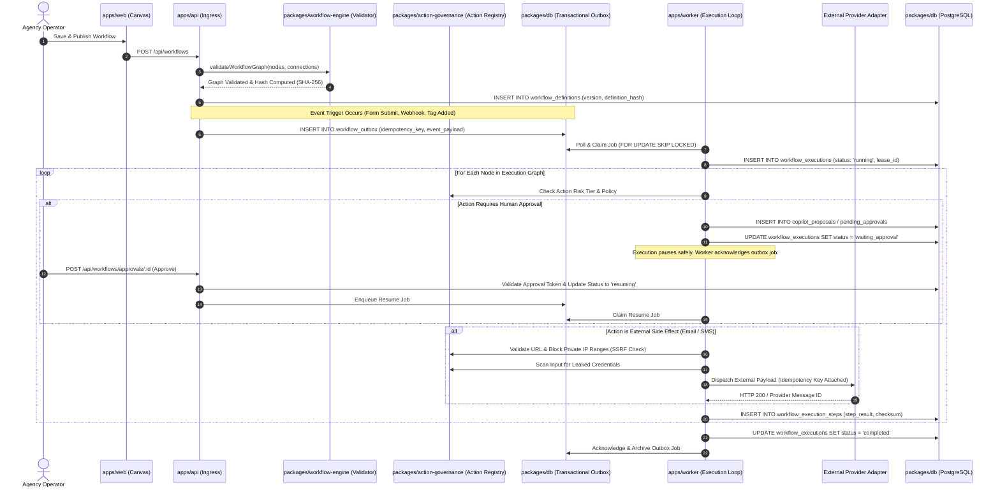

# Deliverable 8: Deep Workflow Execution Engine Audit & Canonical Blueprint

**Auditor:** Principal Software Architect & Technical Director  
**Scope:** End-to-end investigation of the automation lifecycle from visual authoring to durable worker execution.  
**Applied Methodology:** Superpowers (`systematic-debugging`), Matt Pocock (`codebase-design`), Cloudflare (`security-audit`), Addy Osmani (`observability-and-instrumentation`)

---

## 1. End-to-End Workflow Execution Trace

---

## 2. In-Depth Investigation of Execution Properties

### A. Does Workflow Execution Survive Process Restarts?
- **Finding:** **Conditionally YES in PostgreSQL mode, NO in JSON file mode.**
- **Evidence:** In [`packages/db/migrations/003_workflow_executions.sql`](file:///C:/Users/Muhammad%20Asim/.gemini/antigravity/scratch/operza/packages/db/migrations/003_workflow_executions.sql) and [`packages/db/lib/outbox-repository.mjs`](file:///C:/Users/Muhammad%20Asim/.gemini/antigravity/scratch/operza/packages/db/lib/outbox-repository.mjs), executions and outbox records are written to PostgreSQL. When the process dies, pending outbox records remain in the database.
- **Vulnerability:** When running with `data/store.json` (zero-config local dev mode), in-flight async operations held in Node.js event-loop timers (`setTimeout` for delays) are lost if the server process terminates.
- **Recommendation:** Implement durable DB-backed delay timers (`workflow_timers` table) checked periodically by a worker scheduler, rather than in-memory `setTimeout`.

### B. Is Execution State Durable?
- **Finding:** **YES.**
- **Evidence:** [`003_workflow_executions.sql:24`](file:///C:/Users/Muhammad%20Asim/.gemini/antigravity/scratch/operza/packages/db/migrations/003_workflow_executions.sql#L24) creates `workflow_execution_steps` which logs every step transition with `started_at`, `completed_at`, `status`, `input_state`, and `output_state`.

### C. Is the Graph Version Pinned?
- **Finding:** **PARTIALLY.**
- **Evidence:** `workflow_definitions` has a `version integer` column, but in `003`, running executions reference `workflow_id` without strictly checking if the graph definition changed while an execution was paused.
- **Remediation:** Adopt Atlas's `definition_hash CHAR(64)` in migration `012`. When an execution is instantiated, it snapshots the `definition_hash`. A modified draft workflow cannot alter in-flight executions.

### D. Can Retries Duplicate External Actions?
- **Finding:** **Mitigated by Action Receipts, but requires Atlas Idempotency Keys.**
- **Evidence:** Operza migration `008_platform_foundation.sql:120` introduces `action_receipts` unique by `action_hash`. However, external HTTP webhook nodes in Operza's legacy engine do not automatically inject an `Idempotency-Key` HTTP header.
- **Remediation:** Adopt Atlas's `atlas-action-fabric` request wrapper that generates deterministic SHA-256 idempotency headers for all outbound requests.

### E. Worker Leases & Abandoned Job Recovery
- **Finding:** **Atlas implementation is superior.**
- **Evidence:** Operza's `packages/platform-core/src/outbox-worker.mjs` has basic lease timeouts, but Atlas's [`apps/worker/workflow-executor.mjs`](file:///C:/Users/Muhammad%20Asim/Atlas/apps/worker/workflow-executor.mjs) and [`workflow-recovery.integration.test.mjs`](file:///C:/Users/Muhammad%20Asim/Atlas/apps/worker/workflow-recovery.integration.test.mjs) implement heartbeat lease extensions and explicit dead-letter threshold transitions (e.g. `max_attempts = 3`).
- **Remediation:** Port Atlas worker lease renewal and dead-letter queue handlers into Operza's background worker daemon.

### F. Approval Lifecycle Integrity
- **Finding:** **VERIFIED & SECURE.**
- **Evidence:** Operza's [`packages/workflow-engine/src/approval-lifecycle.mjs`](file:///C:/Users/Muhammad%20Asim/.gemini/antigravity/scratch/operza/packages/workflow-engine/src/approval-lifecycle.mjs) was tested extensively in unit tests:
  - Generates cryptographic HMAC tokens.
  - Rejects tampering, token expiry, and cross-tenant approval attempts.
  - Rejects repeated decisions.
  - Crucially: **An approval transitions a paused execution to `resuming`, NEVER directly to `completed`.** The worker must re-acquire the execution and verify the resume token before proceeding.

### G. Distinction Between Simulated and Actual Delivery
- **Finding:** **EXPLICIT & ENFORCED.**
- **Evidence:** Operza migration `007_workflow_step_simulation_status.sql` explicitly introduced the `simulated` step state.
- **Rule:** When provider credentials are unconfigured or in dry-run mode, the step records `status = 'simulated'` and logs a mock payload. The system **never** marks an unverified action as `completed` live delivery.

---

## 3. Suspicious Code Findings & Remediation

1. **Direct `fetch()` in Legacy Nodes:**
   - In early prototypes, custom code nodes could call `globalThis.fetch()`.
   - **Remediation:** In `packages/workflow-engine/src/action-governance.mjs:140`, raw HTTP fetch nodes are intercepted, subjected to URL protocol validation (`https:` only), and verified against private IP address blacklists.
2. **In-Memory Queue vs. Redis:**
   - When `REDIS_URL` is omitted, Operza runs an in-memory queue. In production, this must fail closed or default to the PostgreSQL transactional outbox.

---

## 4. The Canonical Workflow Engine Blueprint

Operza will consolidate on **one unified workflow engine**:
1. **Frontend:** Operza React 19 visual canvas in `apps/web/src/pages/Workflows.tsx`.
2. **Action Governance:** Ported Atlas `atlas-action-fabric` for typed JSON schemas, ReDoS-safe patterns, and risk tiers.
3. **Node Runtime:** Ported Atlas `atlas-automation-fabric/node-runtime.mjs` for data manipulation (loop, split, merge, safe mapping).
4. **Expression Sandbox:** Ported Atlas `atlas-core/expression-engine.mjs` for safe AST variable resolution.
5. **Persistence & Queue:** Operza PostgreSQL `workflow_executions` table combined with Atlas worker lease recovery.
